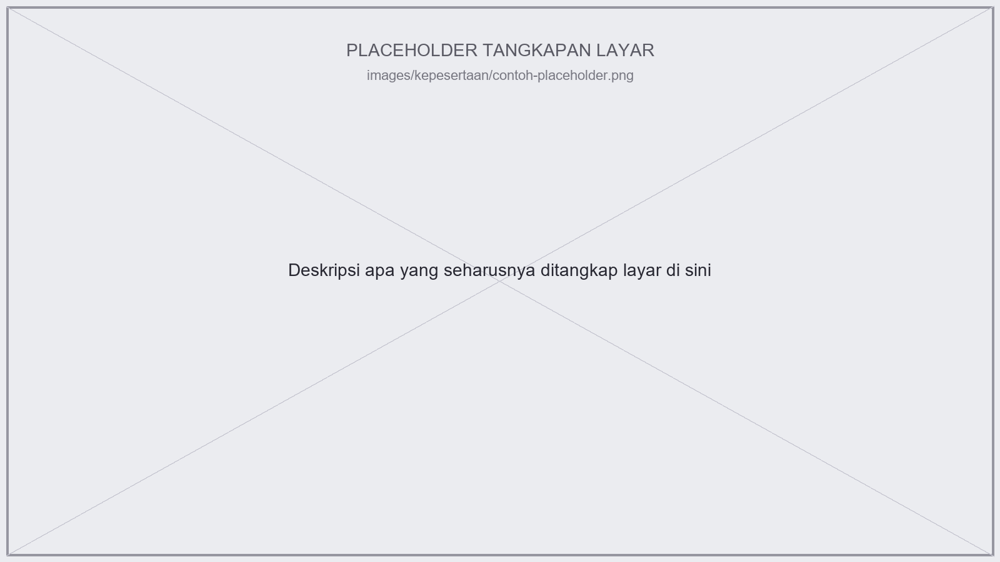

# Pendahuluan {.unnumbered}

Panduan ini ditulis untuk dosen di Institut Teknologi Sumatera (ITERA) yang mengelola kelas di **kuliah2.itera.ac.id**, situs *e-learning* kampus yang ditenagai Moodle. Tujuannya sederhana: supaya Anda tidak perlu meraba-raba sendiri menu mana yang harus diklik untuk membuat mata kuliah, mengelola peserta, membuat asesmen, sampai menelusuri jejak aktivitas mahasiswa.

## Cara Membaca Panduan Ini

Panduan disusun menjadi lima bab, mengikuti kebutuhan nyata siklus mengelola kelas:

1. **Kepesertaan** — membuat mata kuliah, mendaftarkan mahasiswa per kelas, menetapkan dosen dan asisten, serta mengelola pergantian mahasiswa tiap semester.
2. **Knowledge & Community Management** — memanfaatkan *block*, menyampaikan materi lintas media, mengatur tampilan kelas, dan integrasi kalender.
3. **Asesmen** — membuat aktivitas penilaian, mengatur Safe Exam Browser, memeriksa dan memberi nilai, serta menarik rekapitulasi nilai akhir.
4. **Jejak Digital** — melihat aktivitas peserta dan menjaga log aktivitas mahasiswa yang sudah lulus atau keluar.
5. **OBE / CPMK** — mengukur capaian pembelajaran mata kuliah (CPMK) lewat Moodle.

Tiap bab bisa dibaca berdiri sendiri sesuai kebutuhan Anda saat itu — tidak harus berurutan dari awal.

## Dasar Penyusunan

Panduan ini digrounding dari dua sumber:

1. **Dokumentasi resmi Moodle** (`docs.moodle.org`, versi 5.02), untuk perilaku umum yang berlaku di semua instance Moodle.
2. **Eksplorasi langsung ke `kuliah2.itera.ac.id`**, memakai akun dosen dan kursus contoh **PL25-12001 Statistika Untuk Perencanaan**, untuk memverifikasi menu, label, dan alur mana yang benar-benar aktif di instance ITERA — karena label peran dan sebagian pengaturan di ITERA sudah disesuaikan dari default Moodle (misalnya "Teacher" menjadi "Dosen (Teacher)").

Ke mana pun langkah di panduan ini bersumber, saya tandai dengan cara berikut:

::: {.callout-note}
## Catatan sumber
Bagian yang ditandai **catatan** seperti ini menjelaskan dari mana suatu klaim berasal — apakah sudah diverifikasi langsung di kursus contoh ITERA, atau masih berdasarkan dokumentasi generik Moodle yang perlu dicek ulang saat benar-benar dipakai.
:::

Beberapa bagian asesmen (jenis *Activity*, Safe Exam Browser, alur *grading*) belum bisa diverifikasi langsung karena kursus contoh yang dijelajahi masih kosong dari aktivitas semacam itu. Bagian-bagian ini ditandai jelas sebagai dugaan berbasis dokumentasi generik, bukan hasil pengamatan langsung.

## Tentang Tangkapan Layar

Saya belum punya akses langsung untuk mengambil tangkapan layar dari kuliah2.itera.ac.id. Setiap tempat yang seharusnya diisi tangkapan layar ditandai dengan gambar *placeholder* seperti berikut:

Path gambar mengikuti pola `images/<nama-bab>/<nama-file>.png`. Silakan ganti file placeholder itu dengan tangkapan layar asli Anda — nama filenya sudah saya siapkan supaya tidak perlu mengubah teks panduan lagi setelah gambar ditambahkan.
