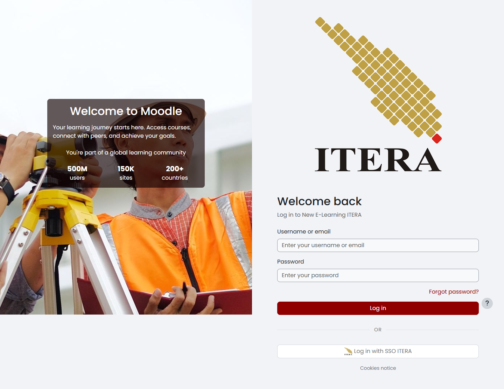
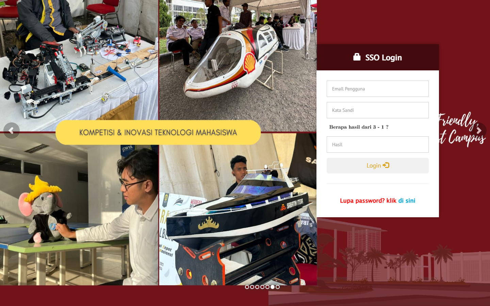
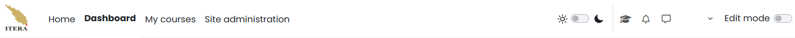
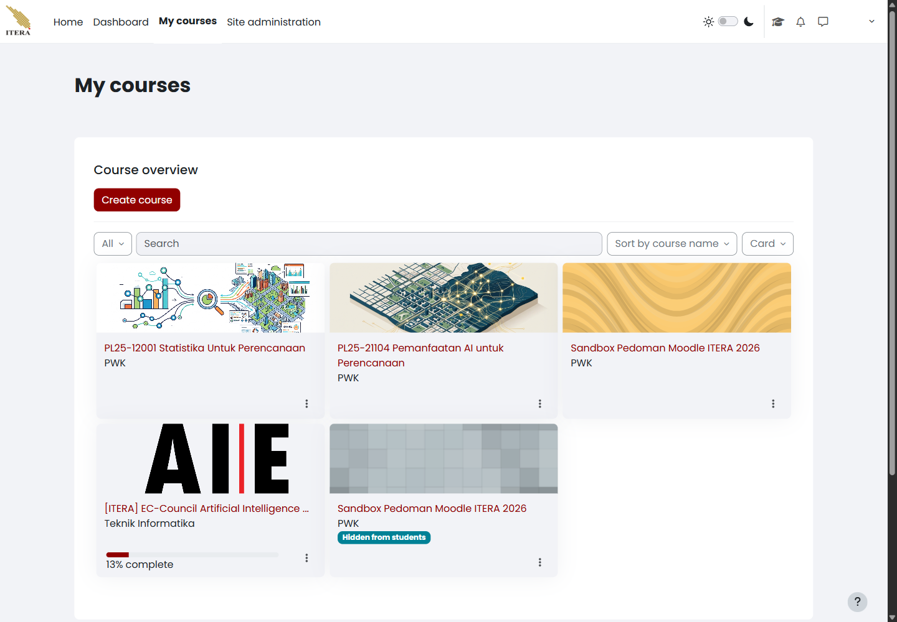
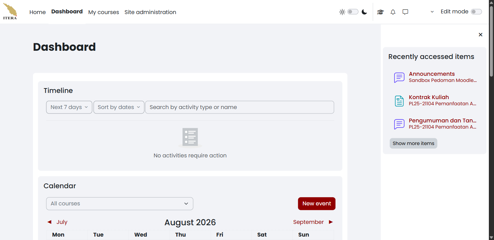
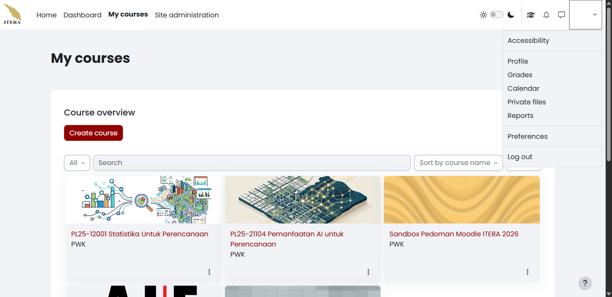

# Masuk dan Mengenali Antarmuka {#sec-login-orientasi}

Bab ini menuntun Anda masuk ke New E-Learning ITERA, mengenali setiap laman yang tersedia di menu navigasi teratas, dan keluar dengan aman setelah selesai. Pembuatan dan pengelolaan mata kuliah dibahas tersendiri pada @sec-dosen-mata-kuliah.

## Masuk ke New E-Learning ITERA {#sec-dosen-masuk}

<!-- Sumber internal: Guide/KULIAH2.md; pengamatan sesi dosen pada kuliah2.itera.ac.id — alamat pangkal situs mengalihkan ke my/courses.php setelah sesi masuk aktif. -->

Anda memerlukan akun SSO ITERA yang aktif dan peramban (*browser*) yang mutakhir. Akun lokal Moodle hanya dipakai kalau pengelola layanan secara khusus memberikannya kepada Anda. Buka peramban, lalu ikuti langkah berikut:

1. Ketik alamat `https://kuliah2.itera.ac.id` pada bilah alamat, lalu tekan **Enter**.
2. Pilih **Log in** di sudut kanan atas beranda seperti terlihat pada @fig-dosen-login-beranda.

{#fig-dosen-login-beranda fig-pos="H" width="80%"}

3. Pada halaman **Welcome back**, pilih **Log in with SSO ITERA** seperti terlihat pada @fig-dosen-login-moodle. Gunakan formulir *username* dan kata sandi Moodle hanya jika pengelola layanan memberi Anda akun lokal.

{#fig-dosen-login-moodle fig-pos="H" width="60%"}

4. Pada halaman **SSO Login**, isi **Email Pengguna**, **Kata Sandi**, dan **Hasil** pemeriksaan aritmetika, lalu pilih **Login**. @fig-dosen-login-sso memperlihatkan formulir sebelum data akun diisi.

{#fig-dosen-login-sso fig-pos="H" width="60%"}

Setelah proses masuk selesai, New E-Learning ITERA membuka halaman **My courses**, bukan **Dashboard**. Alamat pangkal `https://kuliah2.itera.ac.id` juga mengarah ke halaman yang sama selama sesi Anda masih aktif, sehingga mengetik alamat itu kembali tidak akan membawa Anda ke beranda publik.

Jika halaman SSO menolak data akun Anda, periksa kembali alamat surel dan hasil pemeriksaan aritmetika sebelum mencoba lagi; kata sandi SSO tidak dikelola oleh Moodle sehingga pemulihannya dilakukan melalui layanan SSO ITERA, bukan melalui halaman ini. Jika Anda masuk tetapi tidak melihat satu pun mata kuliah, lanjutkan ke @sec-dosen-mata-kuliah — mata kuliah Anda mungkin memang belum dibuat.

## Mengenali tampilan antarmuka {#sec-dosen-antarmuka}

<!-- Sumber internal: pengamatan sesi dosen pada kuliah2.itera.ac.id — menubar Home/Dashboard/My courses/Site administration, kendali kanan (togel tema, My learning, notifikasi, pesan, menu akun), dan togel Edit mode. -->

Menu navigasi teratas tetap sama di halaman mana pun Anda berada, seperti terlihat pada @fig-dosen-orientasi-nav. Sisi kiri memuat empat tautan laman — **Home**, **Dashboard**, **My courses**, dan **Site administration** — sedangkan sisi kanan memuat kendali yang menyertai akun Anda: togel tema terang/gelap, tombol **My learning**, ikon notifikasi, ikon pesan, dan menu akun. Togel **Edit mode** muncul di ujung kanan pada halaman yang memang dapat disunting, yaitu **Dashboard** dan halaman mata kuliah.

{#fig-dosen-orientasi-nav fig-pos="H" width="100%"}

Empat laman berikut dibahas satu per satu supaya Anda tahu apa yang dapat dan tidak dapat dikerjakan dari masing-masing laman.

### My courses {#sec-dosen-laman-mycourses}

**My courses** adalah halaman pertama yang Anda lihat setelah masuk, dan menjadi titik mulai hampir semua pekerjaan Anda di New E-Learning ITERA. Halaman ini memuat satu blok **Course overview** yang mendaftar seluruh mata kuliah tempat akun Anda terdaftar — sebagai pengajar maupun peserta (@fig-dosen-mycourses-01).

{#fig-dosen-mycourses-01 fig-pos="H" width="100%"}

Di dalam blok tersebut tersedia:

| Kendali | Kegunaan |
|---|---|
| **Create course** | Membuat mata kuliah baru. Tombol ini hanya muncul bagi akun yang berperan **Course creator** (lihat @sec-dosen-mata-kuliah). |
| Penyaring **All** | Menyaring daftar menurut keadaan mata kuliah: **All**, **In progress**, **Future**, **Past**, **Starred**, dan **Removed from view**. |
| **Search** | Mencari mata kuliah berdasarkan namanya, berguna ketika daftar sudah panjang. |
| **Sort by course name** | Mengurutkan daftar menurut nama, waktu akses terakhir, atau tanggal mulai. |
| **Card** | Mengganti bentuk tampilan antara **Card**, **List**, dan **Summary**. |

Setiap kartu mata kuliah menampilkan nama mata kuliah, kategori tempat mata kuliah itu berada, dan menu titik tiga (**⋮**) untuk menandainya sebagai favorit (*Star this course*) atau menyembunyikannya dari daftar (*Remove from view*). Mata kuliah yang belum diterbitkan bagi mahasiswa ditandai lencana **Hidden from students**.

::: {.callout-note title="Catatan"}
#### Daftar Mata Kuliah Dimuat Belakangan {.unnumbered .unlisted}

Blok **Course overview** mengambil isinya melalui permintaan terpisah setelah halaman tampil. Kalau daftar terlihat kosong sesaat setelah halaman terbuka, tunggu beberapa detik atau muat ulang halaman sebelum menyimpulkan bahwa Anda tidak terdaftar di mata kuliah mana pun.
:::

Jika sebuah mata kuliah tidak muncul di daftar, periksa lebih dahulu penyaring **All** dan pilihan **Removed from view** — kartu yang pernah disembunyikan tidak ikut tampil pada penyaring lain. Kalau mata kuliah tetap tidak ditemukan padahal Anda yakin sudah terdaftar, minta pengelola prodi memeriksa status *enrolment* akun Anda; jangan mencoba mendaftarkan diri lewat **Site administration**.

### Dashboard {#sec-dosen-laman-dashboard}

**Dashboard** merangkum kegiatan lintas mata kuliah dalam satu layar (@fig-dosen-dashboard-01). Halaman ini bersifat pribadi: susunannya hanya berlaku untuk akun Anda dan tidak memengaruhi tampilan mahasiswa.

{#fig-dosen-dashboard-01 fig-pos="H" width="100%"}

Blok **Timeline** mendaftar kegiatan bertenggat yang memerlukan tindakan, dengan penyaring rentang waktu (**Next 7 days**), pengurutan (**Sort by dates**), dan kotak pencarian menurut jenis atau nama aktivitas. Blok **Calendar** menampilkan kalender bulanan, penyaring **All courses** untuk membatasi tampilan pada satu mata kuliah, serta tombol **New event** untuk menambahkan agenda. Panel **Recently accessed items** di sisi kanan mempercepat Anda kembali ke bahan yang terakhir dibuka.

Togel **Edit mode** pada halaman ini mengatur susunan blok **Dashboard** Anda sendiri — memindahkan, menambah, atau menghapus blok — bukan mengubah isi mata kuliah. Kalau **Timeline** menampilkan `No activities require action` padahal Anda tahu ada tugas berjalan, periksa rentang waktu pada penyaringnya; kegiatan yang tenggatnya lebih jauh dari rentang terpilih memang tidak ditampilkan.

### Home {#sec-dosen-laman-home}

**Home** membuka beranda situs New E-Learning ITERA, yaitu halaman yang juga dilihat pengunjung yang belum masuk. Isinya ditetapkan pengelola layanan dan biasanya memuat pengumuman tingkat situs serta daftar kategori mata kuliah. Anda tidak mengelola apa pun dari sini; laman ini berguna ketika Anda perlu menelusuri kategori prodi atau memeriksa pengumuman resmi layanan.

### Site administration {#sec-dosen-laman-siteadmin}

**Site administration** membuka pengaturan tingkat situs. Bagi dosen, isinya jauh lebih terbatas daripada bagi admin layanan — hanya sebagian tab yang terbuka, dan sebagian besar bagian di dalamnya menolak akses dengan pesan `Section error!`. Yang relevan bagi Anda umumnya adalah pengelolaan mata kuliah, yang jalurnya juga tersedia lebih langsung lewat **My courses**.

::: {.callout-warning title="Peringatan"}
#### Batasan Akses Site Administration {.unnumbered .unlisted}

Kalau Anda memerlukan kewenangan yang tidak Anda miliki — menambah metode *enrolment* yang tidak tersedia, mengubah pengaturan tingkat situs, atau membuka laporan yang terkunci — hubungi pengelola layanan atau pengelola prodi. Mencoba menembusnya lewat **Site administration** hanya akan menghasilkan pesan galat, dan sebagian pengaturan tingkat situs berdampak ke seluruh mata kuliah di ITERA, bukan hanya milik Anda.
:::

### Menu akun dan preferensi {#sec-dosen-laman-akun}

Menu akun dibuka lewat foto profil di ujung kanan menu navigasi. Isinya memuat jalur pintas ke data pribadi Anda dan kendali untuk keluar (@fig-dosen-akun-01).

{#fig-dosen-akun-01 fig-pos="H" width="100%"}

| Butir | Kegunaan |
|---|---|
| **Accessibility** | Menyetel bantuan aksesibilitas tampilan. |
| **Profile** | Membuka profil Anda, termasuk daftar mata kuliah dan ringkasan aktivitas. |
| **Grades** | Menampilkan nilai Anda sendiri sebagai peserta, bukan nilai mahasiswa yang Anda ampu. |
| **Calendar** | Membuka kalender penuh, lebih lengkap daripada blok kalender di **Dashboard**. |
| **Private files** | Ruang penyimpanan pribadi yang tidak terikat pada satu mata kuliah. |
| **Reports** | Laporan aktivitas akun Anda sendiri. |
| **Preferences** | Pengaturan akun: bahasa, notifikasi, penyuntingan profil, dan kata sandi (untuk akun lokal). |
| **Log out** | Mengakhiri sesi, dibahas pada @sec-dosen-keluar. |

Perhatikan bahwa **Grades** dan **Reports** pada menu ini selalu mengacu pada akun Anda sendiri. Nilai dan laporan mahasiswa yang Anda ampu dibuka dari menu di dalam mata kuliah, bukan dari sini — lihat @sec-dosen-menu-mata-kuliah.

## Keluar dari New E-Learning ITERA {#sec-dosen-keluar}

<!-- Sumber internal: pengamatan sesi dosen — konsol memuat modul peringatan batas waktu sesi Moodle; nilai batas waktunya sendiri berada di Site administration yang tidak dapat diakses peran dosen. -->

Sesi yang ditinggalkan terbuka memberi orang lain akses penuh ke mata kuliah, nilai, dan data mahasiswa Anda. Selesaikan pekerjaan Anda, lalu ikuti langkah berikut:

1. Buka menu akun di ujung kanan menu navigasi teratas.
2. Pilih **Log out**.
3. Pastikan halaman kembali ke beranda publik dan menu navigasi tidak lagi menampilkan **My courses** atau **Site administration**.
4. Tutup jendela peramban kalau Anda memakai komputer bersama, misalnya komputer di ruang kelas atau laboratorium.

::: {.callout-warning title="Peringatan"}
#### Sesi Berakhir Sendiri, Tetapi Jangan Mengandalkannya {.unnumbered .unlisted}

New E-Learning ITERA memutus sesi yang lama tidak dipakai dan menampilkan peringatan sebelum sesi berakhir. Batas waktunya ditetapkan pengelola layanan dan tidak dapat Anda ubah, jadi jangan memperkirakan sendiri berapa lama sesi Anda akan bertahan. Dua akibatnya: jangan meninggalkan komputer bersama dalam keadaan masuk dengan harapan sesi akan tertutup sendiri, dan simpan pekerjaan panjang secara berkala — formulir pengaturan atau naskah pengumuman yang ditinggal terlalu lama dapat gagal tersimpan ketika sesi sudah berakhir.
:::

Jika halaman mata kuliah masih dapat dibuka setelah Anda memilih **Log out**, muat ulang halaman satu kali. Jika isi mata kuliah tetap terlihat, tutup seluruh jendela peramban dan laporkan keadaan tersebut kepada pengelola layanan; jangan menyertakan kata sandi dalam laporan itu.
