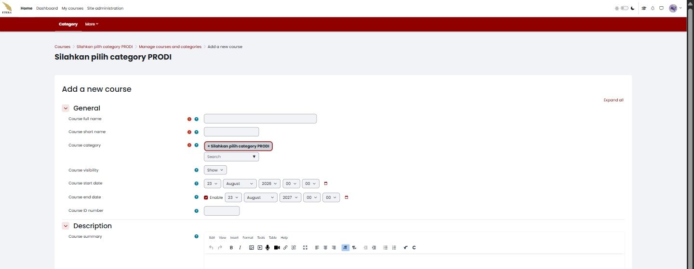
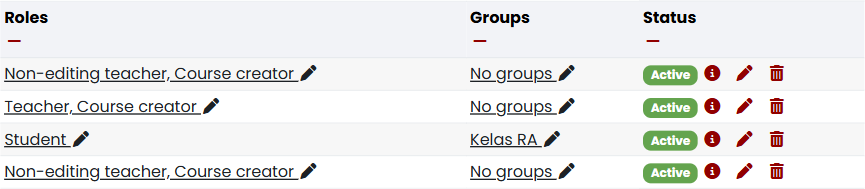
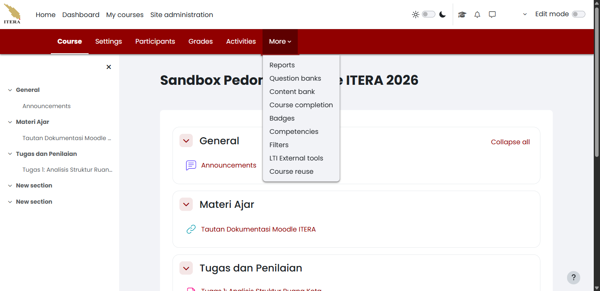

# Membuat dan Membuka Mata Kuliah {#sec-dosen-mata-kuliah}

Di New E-Learning ITERA, satu mata kuliah sama dengan satu *course* Moodle. Bab ini menjelaskan cara membuat mata kuliah sendiri, membukanya, dan mengenali setiap menu yang tersedia di dalamnya sebelum Anda mulai mengisi bahan ajar.

## Membuat mata kuliah baru {#sec-dosen-buat-mata-kuliah}

<!-- Sumber internal: Guide/KULIAH2.md; pengamatan sesi dosen — tombol Create course pada blok Course overview, formulir Add a new course, dan tag kategori bawaan "Silahkan pilih category PRODI". -->

Sebelum Anda mengelola sebuah mata kuliah, pastikan mata kuliahnya sudah ada. Setiap dosen dapat membuatnya sendiri tanpa perlu menunggu dibuatkan admin LMS atau pengelola prodi, selama akun Anda berperan **Course creator**. Buka **My courses**, lalu ikuti langkah berikut:

1. Kalau mata kuliah Anda belum terdaftar di sana, pilih **Create course** pada blok **Course overview**.
2. Isi formulir **Add a new course** (@fig-dosen-orientasi-buatkursus): **Course full name** (nama lengkap mata kuliah), **Course short name** (format `PRODI##-#####`, misalnya `PL25-12001`), **Course category**, **Course visibility**, serta **Course start date** dan **Course end date** sesuai semester berjalan.
3. Pilih **Save and display** di bagian bawah formulir untuk menyimpan dan langsung membuka mata kuliahnya.

{#fig-dosen-orientasi-buatkursus fig-pos="H" width="100%"}

::: {.callout-warning title="Peringatan"}
#### Kategori Bawaan Bukan Program Studi Anda {.unnumbered .unlisted}

Bidang **Course category** terisi otomatis dengan tag **"Silahkan pilih category PRODI"**. Tag itu adalah pengingat, bukan kategori sungguhan. Ganti dengan mengetik nama program studi Anda pada kotak pencarian di bawah tag tersebut sebelum menyimpan. Mata kuliah yang tersimpan tanpa penggantian ini akan tersesat di kategori yang salah dan sulit ditemukan mahasiswa maupun pengelola prodi.
:::

Jika tombol **Create course** tidak muncul, akun Anda tidak berperan **Course creator** pada kategori mana pun — mintalah pengelola prodi membuatkan mata kuliahnya atau menambahkan peran tersebut. Jika mata kuliah tersimpan tetapi tidak muncul di **My courses**, periksa penyaring daftar seperti dijelaskan pada @sec-dosen-laman-mycourses sebelum membuat mata kuliah kedua yang isinya sama.

### Pengaturan lanjutan pada formulir {#sec-dosen-pengaturan-lanjutan}

Formulir **Add a new course** juga memuat beberapa kelompok pengaturan lanjutan yang terlipat secara bawaan. Anda tidak wajib mengubahnya saat membuat mata kuliah — nilai bawaannya sudah layak pakai — tetapi kenali maksudnya karena pengaturan yang sama muncul kembali di **Settings** setelah mata kuliah dibuka.

**Course format**

| Pengaturan | Maksud |
|---|---|
| **Format** | Tata letak mata kuliah: **Custom sections** (bagian dapat diberi judul sendiri, cocok untuk topik berdurasi berbeda-beda), **Weekly sections** (bagian mengikuti minggu perkuliahan sesuai **Course start date**), atau **Single activity** (mata kuliah hanya berisi satu aktivitas). |
| **Course layout** | Menampilkan seluruh bagian dalam satu halaman yang bisa digulir, atau satu bagian per halaman. |
| **Hidden sections** | Bagian yang disembunyikan tampil sepenuhnya tersembunyi, atau hanya menampilkan judulnya saja. |

**Appearance**

| Pengaturan | Maksud |
|---|---|
| **Force language** | Memaksa antarmuka mata kuliah memakai satu bahasa tertentu, mengabaikan preferensi bahasa pribadi mahasiswa. |
| **Number of announcements** | Jumlah pengumuman terbaru dari forum *Announcements* yang tampil di blok **Latest announcements**. Isi `0` jika mata kuliah tidak memakai forum pengumuman. |
| **Show gradebook to students** | Menentukan apakah mahasiswa melihat tautan **Grades**. Nonaktifkan jika mata kuliah tidak memakai aktivitas yang dinilai. |
| **Show activity reports** | Menentukan apakah mahasiswa dapat melihat laporan aktivitas mereka sendiri. |

**Files and uploads**

| Pengaturan | Maksud |
|---|---|
| **Maximum upload size** | Ukuran berkas terbesar yang boleh diunggah mahasiswa ke mata kuliah ini, dibatasi juga oleh batas yang ditetapkan admin situs. |

**Completion tracking**

| Pengaturan | Maksud |
|---|---|
| **Enable completion tracking** | Mengaktifkan pelacakan penyelesaian aktivitas (*Activity completion*) di tingkat mata kuliah. Wajib aktif lebih dulu sebelum syarat penyelesaian mata kuliah (*Course completion*) dapat diatur. |

**Groups**

| Pengaturan | Maksud |
|---|---|
| **Group mode** | Mode kelompok bawaan untuk seluruh aktivitas di mata kuliah ini — **No groups**, **Separate groups**, atau **Visible groups** (lihat @sec-dosen-kepesertaan). |
| **Force** | Kalau diaktifkan, mode kelompok tingkat mata kuliah berlaku untuk semua aktivitas dan mengesampingkan pengaturan mode kelompok pada aktivitas tertentu. |
| **Default grouping** | *Grouping* bawaan yang dipakai aktivitas dan bahan ajar baru, kalau fitur *grouping* dipakai. |

**Tags**

| Pengaturan | Maksud |
|---|---|
| **Course tags** | Label pencarian yang membantu mata kuliah ini ditemukan lewat fitur pencarian mata kuliah. |

## Membuka mata kuliah {#sec-dosen-buka-mata-kuliah}

<!-- Sumber internal: pengamatan sesi dosen — kolom Roles pada Participants menampilkan peran majemuk; togel Edit mode hanya muncul bagi akun berperan Teacher. -->

Anda memerlukan mata kuliah yang sudah terdaftar pada **My courses**. Buka **My courses**, lalu ikuti langkah berikut:

1. Pilih mata kuliah yang menjadi tanggung jawab Anda.
2. Periksa nama mata kuliah pada judul halaman sebelum melakukan tindakan apa pun — dua mata kuliah dengan nama mirip mudah tertukar, terutama pada kelas paralel.
3. Amati menu mata kuliah yang tersedia di bawah menu navigasi situs, lalu kenali isinya lewat @sec-dosen-menu-mata-kuliah sebelum mengubah apa pun.
4. Baru setelah itu, nyalakan togel **Edit mode** di kanan atas kalau Anda memang perlu mengubah isi mata kuliah. Menyalakannya menambahkan tombol sunting di setiap *section* dan aktivitas; mematikannya mengembalikan tampilan seperti yang dilihat mahasiswa.
5. Baca peran Anda sendiri di mata kuliah ini alih-alih menebaknya. Buka **Participants**, cari nama Anda, lalu baca kolom **Roles** (@fig-dosen-orientasi-peran). Kolom ini bisa menampilkan lebih dari satu peran sekaligus, misalnya **Teacher, Course creator** atau **Non-editing teacher, Course creator**.

{#fig-dosen-orientasi-peran fig-pos="H" width="100%"}

Menu New E-Learning ITERA mengikuti peran yang tercatat di kolom itu. **Reports**, misalnya, tersedia bagi **Teacher** maupun **Non-editing teacher**, tetapi togel **Edit mode** hanya muncul bagi akun yang berperan **Teacher**. Kalau Anda tidak melihat togel itu sama sekali, itu tandanya akun Anda berperan **Non-editing teacher** pada mata kuliah tersebut, bukan tanda bahwa mata kuliah atau akun Anda rusak.

::: {.callout-warning title="Peringatan"}
#### Penanganan Perbedaan Tampilan Hak Akses {.unnumbered .unlisted}

- Jika mata kuliah tidak muncul di **My courses** meski Anda yakin sudah membuatnya, minta pengelola prodi memeriksa kategori dan status *enrolment* akun Anda.
- Jika kolom **Roles** hanya menampilkan **Non-editing teacher** tanpa kewenangan menyunting yang Anda perlukan, hubungi dosen pengampu utama atau pengelola prodi alih-alih mencoba mengakalinya lewat **Site administration**.
:::

## Penjelasan menu-menu mata kuliah {#sec-dosen-menu-mata-kuliah}

<!-- Sumber internal: pengamatan sesi dosen pada course 917 — menubar Course/Settings/Participants/Grades/Activities/More dan sembilan butir di dalam More; pembandingan dengan menubar peran Student. -->

Setelah mata kuliah terbuka, muncul baris menu mata kuliah di bawah menu navigasi situs: **Course**, **Settings**, **Participants**, **Grades**, **Activities**, dan **More** (@fig-dosen-menu-more-01). Baris inilah yang Anda pakai sehari-hari, dan isinya menyesuaikan peran Anda.

{#fig-dosen-menu-more-01 fig-pos="H" width="100%"}

### Course {#sec-dosen-menu-course}

**Course** mengembalikan Anda ke halaman utama mata kuliah — daftar *section* beserta bahan ajar dan aktivitas di dalamnya. Panel indeks kursus di sisi kiri memuat peta seluruh *section*, dapat dilipat, dan membawa Anda langsung ke bagian yang dipilih. Ini halaman yang paling mirip dengan apa yang dilihat mahasiswa, terutama ketika **Edit mode** dimatikan. Cara menyusun *section*, *subsection*, dan *block* dibahas pada @sec-dosen-organisasi-materi.

### Settings {#sec-dosen-menu-settings}

**Settings** membuka kembali formulir pengaturan mata kuliah — persis formulir yang Anda isi saat membuat mata kuliah, termasuk seluruh kelompok pengaturan lanjutan pada @sec-dosen-pengaturan-lanjutan. Dari sini Anda mengubah nama, kategori, tanggal, format, dan visibilitas mata kuliah. Menu ini **tidak tersedia** bagi **Non-editing teacher** maupun mahasiswa.

### Participants {#sec-dosen-menu-participants}

**Participants** adalah pusat pengelolaan orang di dalam mata kuliah: daftar peserta beserta peran, kelompok, dan status pendaftarannya. Dari menu turunannya Anda mengelola **Enrolment methods**, **Groups**, dan **Groupings**. Seluruh pekerjaan kepesertaan — kelas paralel, pendaftaran mandiri, penetapan asisten — dibahas pada @sec-dosen-kepesertaan.

### Grades {#sec-dosen-menu-grades}

**Grades** membuka buku nilai mata kuliah: nilai seluruh peserta untuk setiap aktivitas yang dinilai, beserta penyiapan kategori dan bobot penilaian. Berbeda dengan **Grades** pada menu akun yang menampilkan nilai Anda sendiri sebagai peserta (@sec-dosen-laman-akun), **Grades** di sini menampilkan nilai mahasiswa yang Anda ampu. **Non-editing teacher** dapat membuka halaman ini.

### Activities {#sec-dosen-menu-activities}

**Activities** mendaftar seluruh aktivitas dan bahan ajar di mata kuliah, dikelompokkan menurut jenisnya — misalnya seluruh **Assignment** dalam satu daftar, seluruh **Quiz** dalam daftar lain. Menu ini mempercepat Anda menemukan satu tugas tertentu tanpa menggulir halaman mata kuliah, terutama pada mata kuliah yang *section*-nya sudah banyak.

### More {#sec-dosen-menu-more}

**More** menampung sembilan menu yang lebih jarang dipakai:

| Butir | Kegunaan |
|---|---|
| **Reports** | Laporan aktivitas mata kuliah, termasuk **Logs** yang merekam siapa membuka apa dan kapan (lihat @sec-dosen-lacak-log). |
| **Question banks** | Bank soal mata kuliah, dipakai bersama aktivitas **Quiz**. |
| **Content bank** | Penyimpanan konten interaktif, terutama berkas H5P, yang dapat dipakai ulang di beberapa aktivitas. |
| **Course completion** | Syarat penyelesaian mata kuliah. Memerlukan **Enable completion tracking** yang aktif lebih dulu. |
| **Badges** | Lencana penghargaan yang diberikan otomatis ketika mahasiswa memenuhi syarat tertentu. |
| **Competencies** | Kerangka kompetensi yang ditautkan ke aktivitas — satu-satunya menu di **More** yang juga terlihat oleh mahasiswa. |
| **Filters** | Penyaring teks tingkat mata kuliah, misalnya penulisan rumus matematika atau penanaman media. |
| **LTI External tools** | Penyambungan alat pembelajaran dari luar Moodle. |
| **Course reuse** | Menyalin, mencadangkan, mengembalikan, atau mengosongkan isi mata kuliah — berguna saat menyiapkan mata kuliah semester berikutnya dari mata kuliah semester lalu. |

::: {.callout-note title="Catatan"}
#### Menu Mahasiswa Memang Berbeda {.unnumbered .unlisted}

Mahasiswa melihat baris menu yang lebih pendek: **Course**, **Participants**, **Grades**, **Activities**, **Competencies**, dan **More**. Tidak ada **Settings** dan tidak ada togel **Edit mode**. Jadi ketika mahasiswa melaporkan bahwa suatu menu "tidak ada", cocokkan dulu dengan daftar ini sebelum menduga ada yang rusak.
:::

Jika sebuah menu yang disebut di atas tidak muncul pada layar Anda, periksa kembali kolom **Roles** seperti pada @sec-dosen-buka-mata-kuliah — **Non-editing teacher** tidak mempunyai **Settings** dan **Course reuse**. Jika menu ada tetapi halamannya kosong, biasanya fiturnya memang belum dipakai di mata kuliah itu, misalnya **Question banks** yang kosong sebelum soal pertama dibuat.
