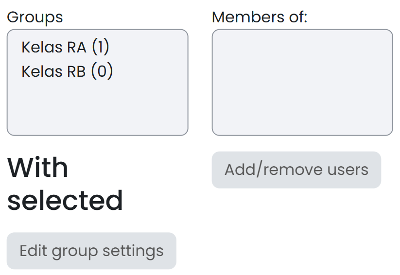
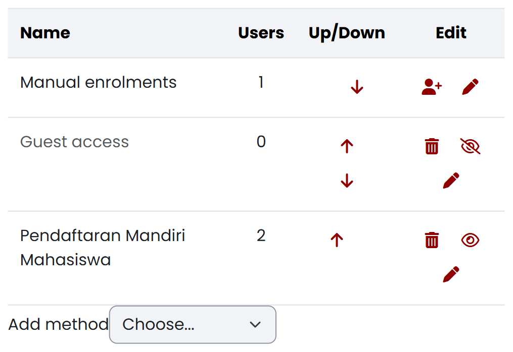

# Mengelola Kepesertaan, Kelas Paralel, dan Peran {#sec-dosen-kepesertaan}

<!-- Sumber internal: Guide/spec.md D-02, D-03, D-04; Guide/KULIAH2.md §Kepesertaan; Code/moodle_docs/Enrolment_methods.md; Manual_enrolment.md; Self_enrolment.md; Groups.md; Groupings.md; Teacher_role.md. -->

Setelah membuat mata kuliah, dosen perlu mengelola siapa saja yang menjadi peserta di dalamnya: dosen pengampu lain, asisten, dan mahasiswa. Bagian ini mengulas pengelolaan peserta tersebut lewat dua fitur Moodle, **Group** dan **Grouping**. Yang dibahas berturut-turut adalah menetapkan dosen lain dan asisten sebagai pengajar, mengelola mahasiswa lewat *group* — kelas paralel, pendaftaran mandiri, kelompok otomatis, dan pendaftaran manual — lalu menggabungkan beberapa *group* dalam satu *grouping* ketika sebuah aktivitas atau pembatasan akses perlu menyasar gabungan kelompok sekaligus.

**Group** berisi peserta, misalnya `Kelas RA` dan `Kelas RB`. **Grouping** adalah kumpulan beberapa *group* yang diarahkan ke aktivitas yang sama. Gunakan *grouping* hanya ketika satu aktivitas perlu melayani gabungan kelompok tertentu.

**Groups** pada aktivitas menentukan interaksi antarkelompok:

| Mode | Dampak pada aktivitas yang mendukung kelompok |
|---|---|
| **No groups** | Semua peserta menggunakan aktivitas yang sama tanpa pemisahan kelompok |
| **Separate groups** | Mahasiswa berinteraksi melalui kelompoknya sendiri dan tidak melihat kelompok lain |
| **Visible groups** | Mahasiswa berinteraksi melalui kelompoknya sendiri, tetapi dapat melihat kelompok lain |

::: {.callout-important title="Perhatian"}
#### Perbedaan Hak Akses Enrolment dan Pengelompokan Group {.unnumbered .unlisted}

*Enrolment* memberi seseorang akses ke mata kuliah dan menetapkan perannya. *Group* mengatur pembagian peserta yang sudah terdaftar. Mahasiswa yang sudah masuk ke `Kelas RA` tetap harus terdaftar sebagai peserta mata kuliah.
:::

::: {.callout-warning title="Peringatan"}
#### Mode Kelompok Bukan Pembatasan Akses {.unnumbered .unlisted}

**Separate groups** mengatur interaksi pada aktivitas yang mendukung kelompok. Jika suatu bahan, aktivitas, atau bagian mata kuliah hanya boleh terlihat oleh kelompok tertentu, atur **Restrict access** secara terpisah.
:::

## Menetapkan dosen lain dan asisten {#sec-dosen-peran-pengajar}

<!-- Sumber internal: Guide/KULIAH2.md; Code/moodle_docs/Teacher_role.md; menu dan kewenangan Teacher serta Non-editing teacher pada kursus acuan. -->

Sebelum menambahkan mahasiswa, tetapkan dulu dosen pengampu lain dan asisten yang akan membantu mengelola mata kuliah ini. Anda memerlukan kewenangan mendaftarkan pengguna dan menetapkan peran, calon dosen/asisten sudah mempunyai akun New E-Learning ITERA, dan penanggung jawab mata kuliah sudah menentukan apakah mereka perlu menyunting konten atau hanya menjalankan tugas terbatas. Buka **Participants**, lalu pilih **Enrol users**, dan ikuti langkah berikut:

1. Cari akun dosen atau asisten melalui **Select users**.
2. Pilih **Teacher** untuk pengajar yang perlu mengubah isi dan pengaturan mata kuliah.
3. Pilih **Non-editing teacher** untuk asisten atau dosen tamu yang hanya memerlukan **Participants**, **Grades**, dan **Reports**, tanpa kewenangan mengubah mata kuliah atau mengelola peserta dan kelompok.
4. Periksa pemilih *group*. Kosongkan pilihan untuk pengguna pengajar — jika formulir tidak menyediakan pilihan kosong, keluarkan pengguna dari *group* melalui **Participants → Groups → Add/remove users** setelah *enrolment* selesai.
5. Pilih **Enrol users**.
6. Periksa peran yang tampil di samping nama pengguna pada **Participants**.

Nama pengguna tampil pada **Participants** dengan peran **Teacher** atau **Non-editing teacher** seperti terlihat pada @fig-dosen-peran-02. **Teacher** dipakai hanya bagi pengajar yang memang perlu menyunting mata kuliah — peran ini bisa mengaktifkan mode sunting, membuka pengaturan mata kuliah, mendaftarkan peserta, dan mengelola *group*. **Non-editing teacher** dipakai untuk tugas yang cukup dilakukan melalui **Participants**, **Grades**, dan **Reports**; peran ini dapat membuka ketiga menu tersebut, tetapi tidak memperoleh **Edit mode**, **Settings**, **Enrol users**, **Groups**, atau **Groupings**.

{#fig-dosen-peran-02 fig-pos="H" width="100%"}



Ketersediaan menu **Grades** hanya menunjukkan bahwa pengguna dapat membuka halaman nilai; menu tersebut tidak dengan sendirinya memberi kewenangan untuk menilai aktivitas, karena kewenangan itu bergantung pada jenis aktivitas dan pengaturan peran. @fig-dosen-peran-01 memperlihatkan menu navigasi mata kuliah yang dilihat akun **Non-editing teacher** sendiri: hanya **Course**, **Participants**, **Grades**, dan **More**, tanpa **Settings** atau **Edit mode**.

{#fig-dosen-peran-01 fig-pos="H" width="100%"}

Jika peran **Teacher** tidak dapat dipilih, akun Anda tidak berwenang menetapkan dosen lain — minta pengelola mata kuliah atau administrator melakukannya. Jika **Non-editing teacher** tidak tampil, jangan menggantinya dengan peran yang lebih tinggi; minta pengelola Moodle menentukan peran yang tepat. Jika akun tidak muncul dalam hasil pencarian, hentikan proses dan minta pengelola Moodle atau layanan dukungan memeriksa akun — jangan memilih akun lain yang namanya mirip. Jika pengguna sudah terdaftar sebagai mahasiswa, ubah perannya hanya setelah memastikan bahwa pengguna memang ditugaskan sebagai pengajar. Jika asisten tidak dapat menjalankan tugas yang diberikan, minta pengelola memeriksa kemampuan perannya alih-alih menaikkan peran tanpa penilaian kebutuhan.

Setelah pendaftaran selesai, minta dosen atau asisten masuk dengan akunnya sendiri dan memastikan mata kuliah tampil, lalu periksa menu yang dapat dibuka sebelum pekerjaan dibagikan.

## Group

Kelola mahasiswa lewat *group* dengan empat cara berikut, diurutkan dari yang paling sering dipakai ke yang paling jarang: membuat kelas paralel, mengizinkan mahasiswa mendaftar sendiri, membagi kelompok tugas secara otomatis, dan — kalau ketiganya tidak cukup — mendaftarkan mahasiswa satu per satu secara manual.

### Membuat kelas paralel dengan Groups {#sec-dosen-groups-kelas-paralel}

<!-- Sumber internal: Guide/KULIAH2.md; Code/moodle_docs/Groups.md; menu Groups, label Visible, dan kewenangan peran pada kursus acuan. -->

Gunakan *group* untuk mengelompokkan mahasiswa ke dalam kelas paralel seperti `Kelas RA` dan `Kelas RB`. Anda memerlukan peran **Dosen (Teacher)** atau kewenangan mengelola *group*, mata kuliah yang benar sudah terbuka, dan nama kelas paralel yang sudah ditetapkan. Buka **Participants → Groups**, lalu ikuti langkah berikut:

1. Pilih **Create group**.
2. Isi **Group name** dengan nama kelas paralel yang mudah dibedakan.
3. Pada **Group membership visibility**, pilih **Visible** agar anggota kelompok dapat melihat keanggotaannya — tetapkan pilihan ini sebelum menambahkan anggota karena pengaturan tidak dapat diubah setelah anggota masuk.
4. Pilih **Save changes**, lalu ulangi langkah 1–3 untuk setiap kelas paralel.
5. Pilih satu *group*, lalu pilih **Add/remove users**.
6. Pilih mahasiswa pada daftar **Potential members**, lalu pilih **Add**. Ulangi sampai setiap mahasiswa berada pada kelas yang benar.

Daftar **Groups** menampilkan setiap kelas paralel seperti terlihat pada @fig-dosen-grup-01; ketika satu kelas dipilih, anggota kelas tersebut tampil pada daftar anggota, dan pengaturan **Group membership visibility** menampilkan **Visible**.

{#fig-dosen-grup-01 fig-pos="H" width="80%"}

Jika **Groups** tidak tampil, akun Anda tidak mempunyai kewenangan mengelola kelompok — peran **Student** dan **Non-editing teacher** tidak dapat mengelola *group*, minta dosen pengelola mata kuliah melakukannya. Jika seorang mahasiswa tidak ada pada **Potential members**, daftarkan mahasiswa tersebut ke mata kuliah terlebih dahulu. Jika seorang mahasiswa masuk ke kelas yang salah, gunakan **Add/remove users** untuk memindahkan keanggotaannya; kalau *group*-nya dibuat oleh mekanisme *enrolment* otomatis, perubahan anggota mungkin harus dilakukan lewat mekanisme yang sama. Sebelum aktivitas per kelas diterbitkan, buka **Groups → Overview** dan periksa mahasiswa yang belum mempunyai *group*.

### Mengizinkan mahasiswa mendaftar sendiri {#sec-dosen-self-enrolment}

<!-- Sumber internal: Guide/KULIAH2.md; Code/moodle_docs/Self_enrolment.md; Default assigned role Student, enrolment key, Use group enrolment keys, dan penempatan mahasiswa melalui kunci group tersedia pada kursus acuan. -->

Metode **Self enrolment (Mahasiswa)** memungkinkan mahasiswa mendaftarkan dirinya sendiri tanpa menunggu didaftarkan satu per satu. Metode ini harus tersedia pada mata kuliah, Anda memerlukan kewenangan mengatur metode *enrolment*, dan periode pendaftaran serta siapa yang boleh menerima akses harus sudah ditentukan — ketersediaan dan pengaturan *self enrolment* sendiri dapat dibatasi oleh pengelola Moodle, dan fitur ini tidak boleh dipakai untuk memberi peran dosen atau asisten. Buka **Participants → Enrolment methods → Self enrolment (Mahasiswa)**, lalu ikuti langkah berikut:

1. Temukan **Self enrolment (Mahasiswa)** dan pastikan ikon mata menunjukkan metode dalam keadaan aktif.
2. Buka pengaturan metode melalui ikon sunting.
3. Pastikan **Default assigned role** adalah **Student**.
4. Atur tanggal mulai, tanggal berakhir, durasi *enrolment*, dan jumlah maksimum peserta sesuai kebutuhan kelas.
5. Jika formulir menampilkan **Enrolment key**, buat kunci mata kuliah yang tidak mudah ditebak.
6. Jika mahasiswa harus langsung masuk kelas paralel, buka setiap *group* dan tetapkan kunci kelompok yang berbeda untuk `Kelas RA`, `Kelas RB`, dan kelas lainnya.
7. Kembali ke pengaturan **Self enrolment (Mahasiswa)**. Jika **Use group enrolment keys** tersedia, pilih **Yes**.
8. Pilih **Save changes**.
9. Bagikan kunci kelompok hanya kepada mahasiswa pada kelas yang sesuai — mahasiswa memasukkan kunci kelompok sebagai pengganti kunci mata kuliah.
10. Minta satu mahasiswa melakukan pendaftaran awal, lalu pastikan namanya tampil sebagai **Student** dan masuk ke *group* yang benar.

Metode **Self enrolment (Mahasiswa)** tampil aktif di antara metode *enrolment* lain seperti terlihat pada @fig-dosen-enrol-01. Mahasiswa yang memenuhi ketentuan dapat mendaftarkan dirinya dan kemudian muncul pada **Participants** dengan peran **Student**; ketika **Use group enrolment keys** diaktifkan, kunci kelompok mendaftarkan mahasiswa sekaligus menempatkannya ke kelas paralel yang sesuai.

{#fig-dosen-enrol-01 fig-pos="H" width="100%"}

::: {.callout-note title="Catatan"}
#### Kunci Enrolment per Group {.unnumbered .unlisted}

Pengaturan **Use group enrolment keys** mengizinkan satu kunci kelompok mendaftarkan mahasiswa sekaligus memasukkannya ke *group*. Gunakan kunci yang berbeda untuk setiap kelas paralel. Jika opsi tersebut tidak tersedia pada mata kuliah lain, gunakan satu kunci mata kuliah dan tempatkan mahasiswa ke kelas paralel melalui **Groups**.
:::

Jika **Self enrolment (Mahasiswa)** tidak ada, jangan menambah metode lain tanpa persetujuan pengelola Moodle — gunakan *enrolment* manual. Jika ikon mata tertutup, aktifkan metode hanya jika Anda mempunyai kewenangan dan mata kuliah memang menerima pendaftaran mandiri. Jika mahasiswa menerima pesan bahwa pendaftaran ditutup, periksa tanggal, durasi, jumlah maksimum peserta, dan kunci *enrolment*. Jika mahasiswa masuk tanpa kelas paralel, tambahkan mahasiswa ke *group* secara manual; jika kunci kelompok hanya mendaftarkan mahasiswa ke mata kuliah tanpa memasukkannya ke *group*, periksa **Use group enrolment keys**, peran bawaan, dan kunci pada pengaturan *group*. Periksa **Participants** setelah masa pendaftaran berakhir, dan nonaktifkan *self enrolment* kalau mata kuliah tidak lagi menerima peserta baru.

### Membuat kelompok tugas secara otomatis {#sec-dosen-auto-create-groups}

<!-- Sumber internal: Code/moodle_docs/Groups.md; formulir Auto-create groups pada kursus acuan menyediakan All, Manager, Course creator, Teacher, Non-editing teacher, dan Student; Preview dengan Student tersedia. -->

Gunakan **Auto-create groups** ketika peserta yang sudah terdaftar perlu dibagi menjadi banyak kelompok berukuran seragam. Penyaring **Select members from role** menyediakan **All**, **Manager**, **Course creator**, **Teacher**, **Non-editing teacher**, dan **Student** — pilihan **No roles** tidak tersedia. Untuk kelompok tugas mahasiswa, pilih **Student** agar dosen dan asisten tidak ikut terbagi.

Sebelum mulai, pastikan mahasiswa sudah terdaftar sebagai **Mahasiswa (Student)**, aturan jumlah kelompok atau jumlah anggota per kelompok sudah ditetapkan, dan mahasiswa yang harus tetap berada dalam kelas paralel tertentu sudah dapat disaring melalui *group* atau *grouping* asal. Buka **Participants → Groups → Auto-create groups**, lalu ikuti langkah berikut:

1. Isi **Naming scheme**. Gunakan `Kelompok @` untuk menghasilkan nama berhuruf atau `Kelompok #` untuk menghasilkan nama bernomor.
2. Pada **Auto create based on**, pilih apakah jumlah ditentukan berdasarkan banyak kelompok atau banyak anggota per kelompok.
3. Isi **Group/member count** sesuai rancangan tugas.
4. Aktifkan **Prevent last small group** jika Anda ingin menghindari kelompok terakhir yang terlalu kecil.
5. Pada **Select members from role**, pilih **Student**. Jangan memilih **All** karena pilihan tersebut dapat memasukkan pengguna dengan peran lain.
6. Aktifkan **Ignore users in groups** jika mahasiswa yang sudah mempunyai kelompok tugas tidak boleh dibagi kembali.
7. Pilih kelompok atau *grouping* asal apabila pembagian harus dibatasi pada kelas paralel tertentu — pilih **None** pada kedua sumber jika seluruh mahasiswa berperan **Student** boleh dibagi.
8. Pilih **Preview** dan periksa nama kelompok, jumlah anggota, serta peserta yang masuk pada setiap kelompok.
9. Kembali ke pengaturan jika hasil pratinjau belum benar. Jika hasil sudah sesuai, pilih **Submit** untuk membuat kelompok.

Pratinjau menampilkan jumlah kelompok, daftar anggota, dan jumlah pengguna tanpa membuat kelompok — pratinjau ini tidak menggantikan pemeriksaan daftar peserta. Setelah **Submit** dipilih, daftar **Groups** menampilkan kelompok baru dengan pola nama dan jumlah anggota yang sama.

Jika mahasiswa tidak muncul pada pratinjau, periksa apakah mahasiswa terdaftar dengan peran **Student** dan termasuk dalam *group* atau *grouping* asal yang dipilih. Jika pengguna selain mahasiswa ikut terbagi, kembali ke pengaturan dan pilih **Mahasiswa (Student)** pada penyaring peran. Jika kelompok terakhir terlalu kecil, aktifkan **Prevent last small group** atau ubah jumlah anggota per kelompok. Jika mahasiswa dari kelas paralel berbeda tercampur, buat kelompok secara terpisah untuk setiap *group* atau *grouping* asal. Sebelum kelompok dipakai pada aktivitas, buka **Groups → Overview** dan cocokkan mahasiswa tanpa kelompok serta keanggotaan ganda.

### Mendaftarkan mahasiswa secara manual {#sec-dosen-manual-enrolment}

<!-- Sumber internal: Guide/KULIAH2.md; Code/moodle_docs/Manual_enrolment.md; modal Enrol users pada kursus acuan menyediakan Teacher, Non-editing teacher, Student, serta pemilih group. -->

Pendaftaran manual cocok untuk kasus yang tidak tercakup oleh *self enrolment* atau *auto-create groups* — misalnya mendaftarkan satu-dua mahasiswa susulan. Mahasiswa yang didaftarkan harus sudah mempunyai akun pada `kuliah2.itera.ac.id`, Anda memerlukan kewenangan mendaftarkan peserta, dan **Manual enrolments** harus dalam keadaan aktif pada **Participants → Enrolment methods**; kewenangan ini hanya berlaku pada mata kuliah yang Anda kelola, dan tidak dimiliki **Student** maupun **Non-editing teacher**. Buka **Participants**, lalu pilih **Enrol users**.

::: {.callout-warning title="Peringatan"}
#### Pemeriksaan Group Sebelum Pendaftaran Pengguna {.unnumbered .unlisted}

Formulir dapat memilih *group* pertama secara otomatis, misalnya `Kelas RA`. Jangan menganggap pilihan awal sudah benar. Konfirmasikan kelas setiap pengguna, atau kosongkan pilihan *group* jika pengguna tidak boleh masuk ke kelompok mana pun. Jika pilihan kosong tidak tersedia, selesaikan *enrolment* lalu keluarkan pengguna dari *group* melalui **Participants → Groups → Add/remove users**.
:::

@fig-dosen-enrol-02 memperlihatkan formulir **Enrol users** dengan **Assign role** dan **Add to group** terbuka; perhatikan `Kelas RA` yang sudah terpilih pada contoh ini.

{#fig-dosen-enrol-02 fig-pos="H" width="80%"}

Ikuti langkah berikut untuk mendaftarkan mahasiswa:

1. Pada **Assign roles**, pilih **Student**. Pilihan lain yang tersedia adalah **Teacher** dan **Non-editing teacher**.
2. Cari mahasiswa melalui **Select users**, lalu pilih akun yang identitasnya tepat.
3. Pilih **Show more** jika Anda perlu mengatur tanggal mulai atau durasi *enrolment*.
4. Periksa pilihan *group*. Pilih kelas paralel yang benar dan pastikan `Kelas RA` tidak dipakai hanya karena terpilih otomatis.
5. Pilih **Enrol users**.
6. Ulangi langkah untuk mahasiswa lain yang belum terdaftar.

Nama mahasiswa tampil pada **Participants** dengan peran **Mahasiswa (Student)**, dan kolom *group* menampilkan kelas paralel jika kelas ditetapkan saat *enrolment*.

Jika akun tidak ditemukan, cari dengan nama lengkap dan cocokkan identitas yang ditampilkan — jangan memilih akun hanya karena namanya serupa. Jika pencarian tetap tidak menghasilkan akun yang tepat, hentikan pendaftaran dan minta pengelola Moodle atau layanan dukungan memeriksa status akun tersebut. Jika **Enrol users** tidak tampil, periksa peran Anda dan status **Manual enrolments**. Jika mahasiswa sudah terdaftar tetapi belum masuk kelas, tambahkan melalui **Participants → Groups → Add/remove users**; jika pilihan *group* tidak muncul pada formulir *enrolment*, selesaikan *enrolment* terlebih dahulu, lalu atur *group* melalui menu **Groups**. Setelah pendaftaran selesai, saring halaman **Participants** berdasarkan peran dan *group*, lalu cocokkan jumlah mahasiswa dengan daftar kelas resmi.

::: {.callout-note title="Catatan"}
#### Pembentukan Kelompok Mandiri Mahasiswa {.unnumbered .unlisted}

Mahasiswa tidak mempunyai kewenangan **Participants → Groups** untuk membuat atau mengubah kelompok — pengelolaan *group* tetap ada di tangan dosen pengelola mata kuliah, bukan bagian dari peran **Student**. Kalau mahasiswa perlu membentuk kelompok tugas secara mandiri (misalnya kelompok tugas besar pilihan sendiri), tentukan jumlah anggota, tenggat, dan aturan keanggotaan terlebih dahulu; minta mahasiswa menyampaikan susunan kelompok lewat saluran resmi mata kuliah, lalu dosen yang membuat *group*-nya lewat **Participants → Groups**. Kalau mahasiswa ternyata bisa mengubah *group* tanpa mekanisme yang disepakati, hentikan penggunaan jalur tersebut dan minta pengelola meninjau kewenangan akun.
:::

## Menggabungkan beberapa group dalam Grouping {#sec-dosen-groupings}

<!-- Sumber internal: Code/moodle_docs/Groupings.md; menu Groupings dan keanggotaan group dalam grouping tersedia pada kursus acuan. -->

Gunakan *grouping* ketika beberapa *group* perlu menerima aktivitas atau pembatasan akses yang sama sekaligus — misalnya menggabungkan `Kelas RA` dan `Kelas RB` ke dalam satu *grouping* `Kelas Paralel` supaya satu tugas atau satu aturan **Restrict access** bisa menyasar kedua kelas tanpa memilihnya satu per satu. Kalau setiap *group* justru perlu diperlakukan berbeda — misalnya tugas atau bahan ajar khusus tiap kelas — cukup pakai *group* tanpa *grouping*. Jangan membuat *grouping* jika satu *group* sudah cukup.

Anda memerlukan sedikitnya dua *group* yang sudah tersedia dan kewenangan mengelola kelompok. Buka **Participants → Groupings**, lalu ikuti langkah berikut:

1. Buka **Participants**, lalu pilih **Groupings**.
2. Pilih **Create grouping**.
3. Isi **Grouping name**, lalu pilih **Save changes**.
4. Pada baris *grouping*, pilih ikon **Show groups in grouping**.
5. Pilih *group* pada **Potential members**.
6. Gunakan tombol panah untuk memindahkannya ke **Existing members**.
7. Pilih **Back to groupings**.

Nama *grouping* tampil pada tabel **Groupings**, beserta *group* yang menjadi anggotanya, seperti terlihat pada @fig-dosen-grouping-01.

{#fig-dosen-grouping-01 fig-pos="H" width="100%"}

Jika menu **Groupings** tidak tampil, periksa peran akun — **Student** dan **Non-editing teacher** tidak dapat mengelola *grouping*, minta dosen pengelola mata kuliah melakukannya. Jika *group* tidak muncul pada **Potential members**, pastikan *group* dibuat pada mata kuliah yang sama. Jika pilihan *grouping* tidak muncul pada pengaturan aktivitas, aktivitas tersebut mungkin tidak mendukung mode grup, atau pembatasan akses yang diperlukan belum diaktifkan. Ketika mengatur aktivitas yang mendukung kelompok, periksa **Common module settings**, pilih mode grup, lalu pilih *grouping* yang sesuai.
