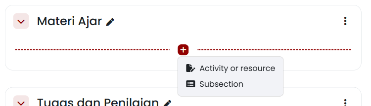
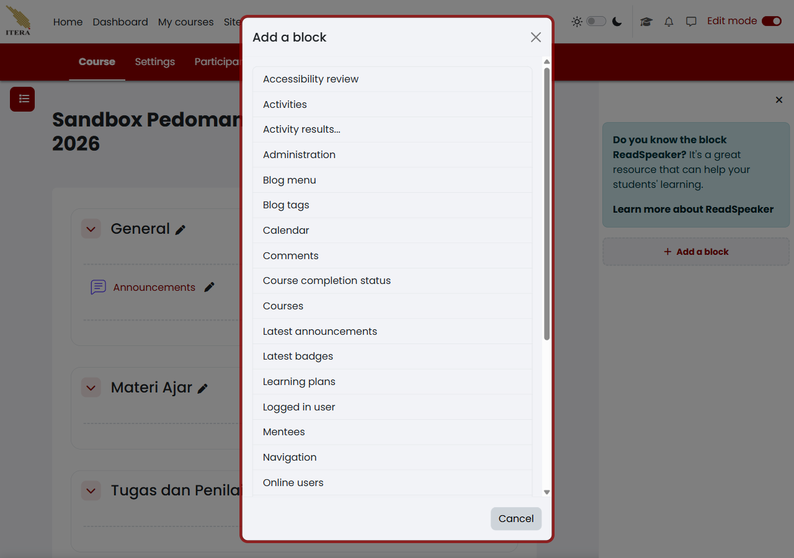
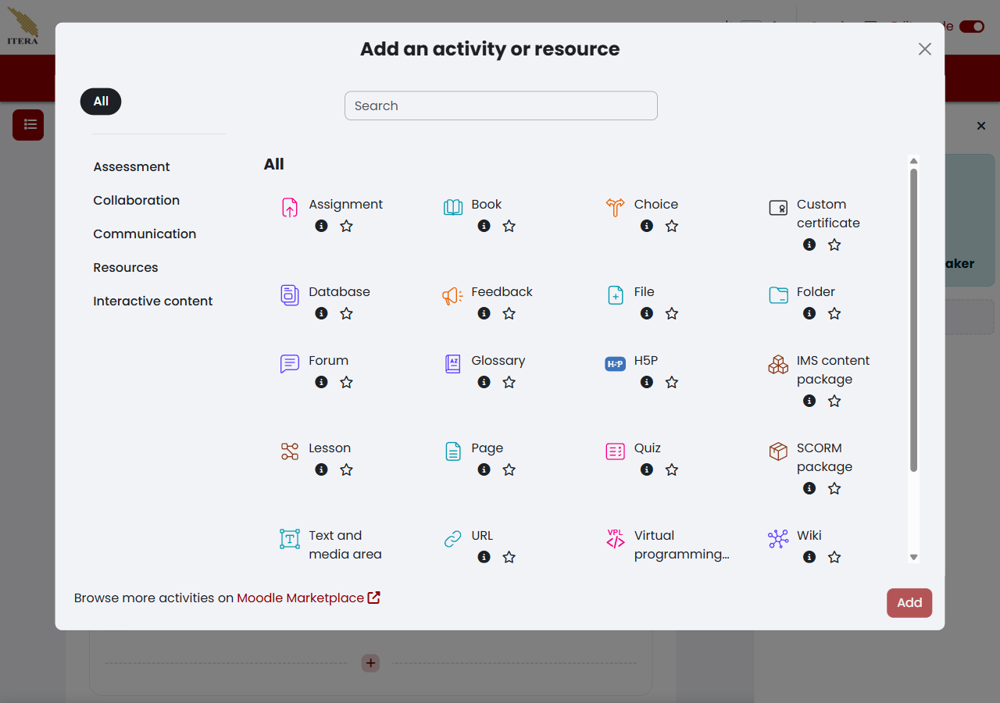
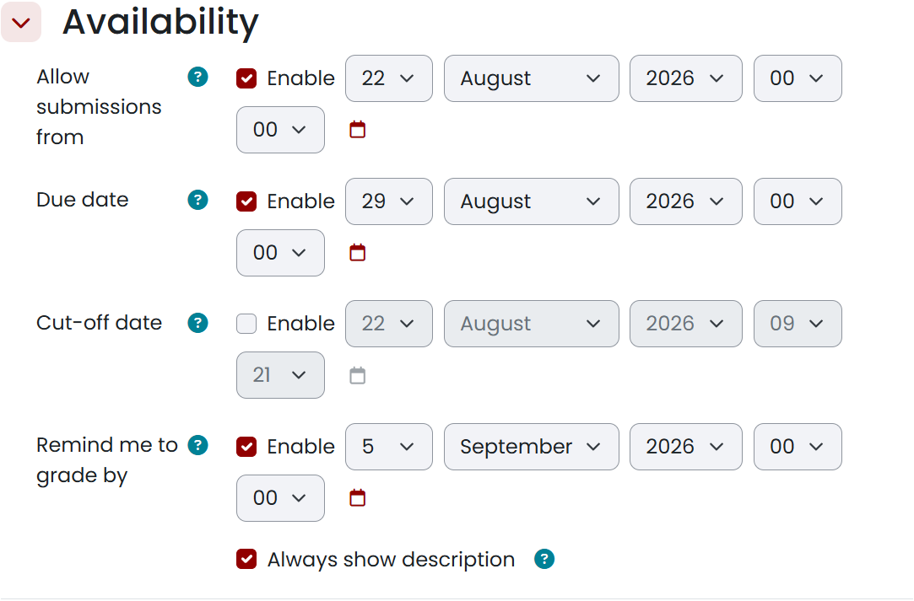
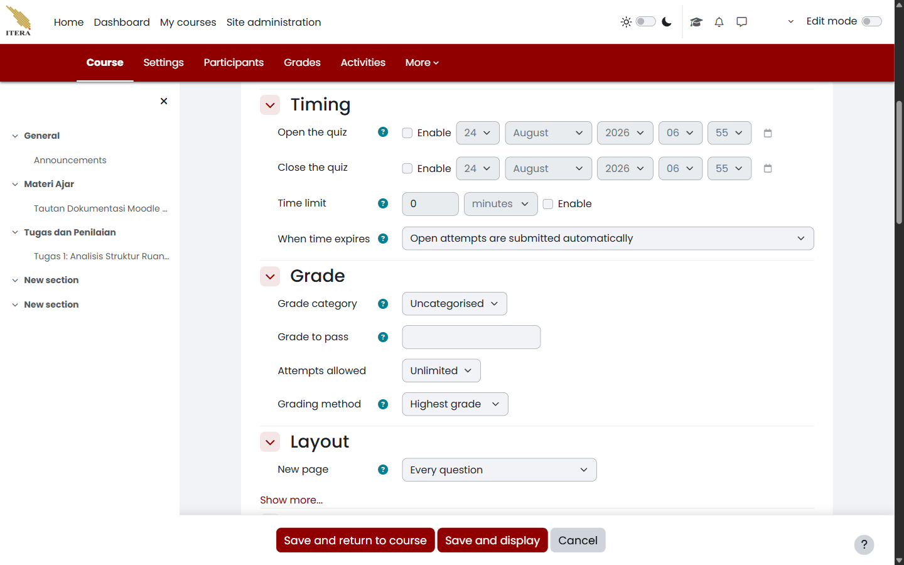
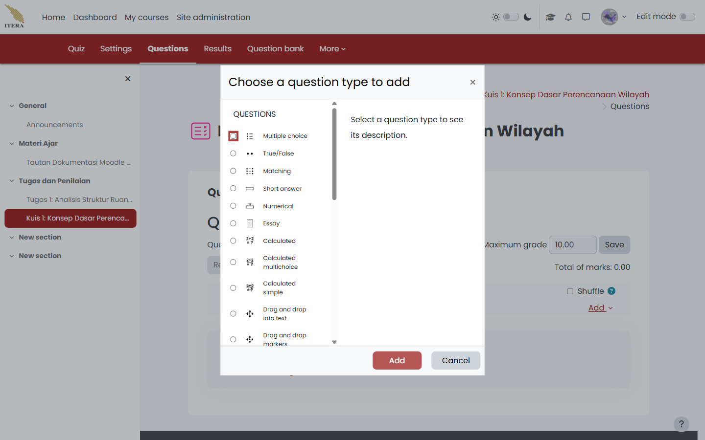
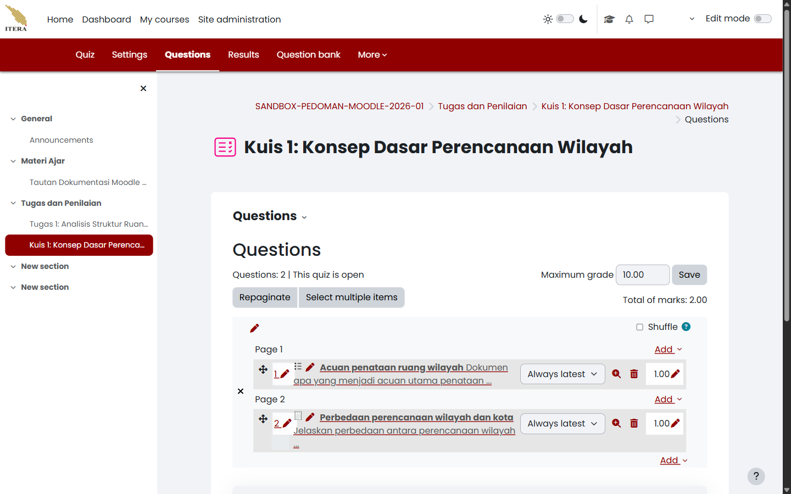
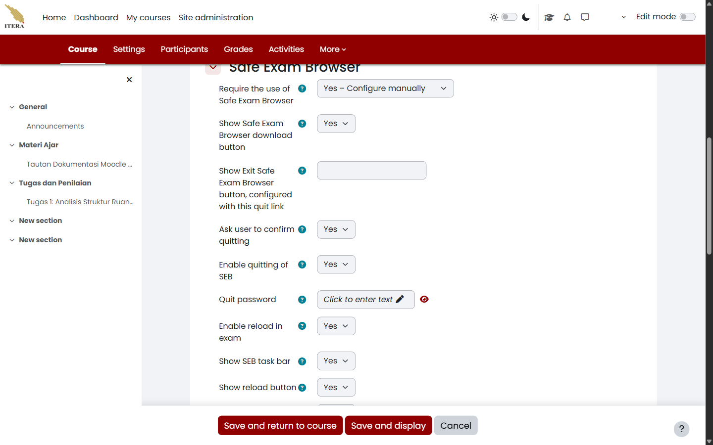

# Mengorganisasi Mata Kuliah, Bahan Ajar, dan Asesmen Tugas {#sec-dosen-organisasi-materi}

<!-- Sumber internal: Guide/spec.md D-05, D-06, D-07; Guide/KULIAH2.md §Knowledge & Community Management, §Asesmen; Code/moodle_docs/Course_homepage.md; Course_settings.md; Course_formats.md; Block_settings.md; Resources.md; Book_resource.md; File_resource.md; Folder_resource.md; Page_resource.md; Text_and_media_area.md; URL_resource.md; Restrict_access.md; Restrict_access_settings.md; Assignment_settings.md; Activities.md; Assignment_activity.md; Quiz_activity.md; Workshop_activity.md; Wiki_activity.md; Glossary_activity.md; Database_activity.md; Forum_activity.md; BigBlueButton.md; H5P_activity.md; Lesson_activity.md; SCORM_activity.md; Choice_activity.md; Feedback_activity.md; LTI_External_tool_activity.md. -->

Pengelolaan tampilan mata kuliah di New E-Learning ITERA mencakup tiga hal: menyusun tata letak agar mudah dinavigasi, memilih bentuk *activities* yang tepat untuk menyampaikan bahan ajar maupun menjalankan asesmen, dan mengatur kapan tiap bagian boleh diakses mahasiswa. Bagian ini membahas ketiganya secara berurutan: mengatur tampilan mata kuliah lewat *section*, *subsection*, dan *block*; mengenal seluruh kelompok *activities* yang tersedia lalu memilih bentuk yang paling cocok untuk bahan ajar maupun asesmen; dan terakhir, mengatur visibilitas serta pembatasan akses supaya bahan dan tugas tampil pada waktu yang tepat bagi peserta yang tepat.

## Mengatur tampilan mata kuliah {#sec-dosen-tampilan-kursus}

### Section dan Subsection {#sec-dosen-section-subsection}

<!-- Sumber internal: Code/moodle_docs/Course_homepage.md; Course_formats.md; temuan sandbox course 917: format Custom sections, inline rename section, tombol "+" membuka menu pilihan Activity or resource dan Subsection. -->

Gunakan *section* untuk membagi materi perkuliahan berdasarkan topik, modul, atau pertemuan. Jika suatu *section* memuat sub-pokok bahasan yang panjang, gunakan *subsection* untuk merapikan hierarki tanpa membebani halaman utama mata kuliah. Anda memerlukan peran **Dosen (Teacher)** pada mata kuliah yang dikelola dengan **Edit mode** aktif; jalurnya lewat **Halaman Utama Mata Kuliah → Edit mode (Aktif) → Bagian Section**.

1. Aktifkan **Edit mode** pada sudut kanan atas bilah navigasi mata kuliah.
2. Untuk mengubah nama *section*, klik langsung pada ikon pensil di samping judul *section* (misalnya `New section`), ketikkan nama baru seperti `Materi Ajar` atau `Tugas dan Penilaian`, lalu tekan tombol **Enter**. Untuk membatalkan, tekan **Escape**.
3. Untuk menambahkan konten atau subbagian baru, arahkan kursor ke garis pemisah di dalam *section* dan pilih tombol tanda tambah (**+**).
4. Pilih **Subsection** pada menu *dropdown* yang muncul jika Anda ingin menambahkan subbagian bersarang.
5. Untuk menambah *section* baru di bagian paling bawah mata kuliah, gulir ke akhir halaman dan pilih **Add section**.
6. Gunakan ikon titik tiga (**⋮**) pada baris *section* untuk memindahkan posisi (*Move*), menyembunyikan sementara dari mahasiswa (*Hide*), atau menghapus *section* (*Delete*).

Garis pemisah *section* menampilkan tombol tanda tambah (**+**) beserta menu pilihan **Activity or resource** dan **Subsection** seperti diperlihatkan pada @fig-dosen-organisasi-01. Judul *section* langsung diperbarui sesuai teks yang dimasukkan.

{#fig-dosen-organisasi-01 fig-pos="H" width="85%"}

Jika tombol **Edit mode** tidak dapat digeser atau ikon pensil tidak muncul, periksa peran akun Anda pada menu **Participants** — akun **Non-editing teacher** atau **Student** tidak memiliki izin mengubah struktur mata kuliah. Jika menu **Add section** tidak tampil di bawah mata kuliah, periksa format mata kuliah pada **Settings → Course format** dan pastikan formatnya **Custom sections** atau **Topics format**. Jika perubahan nama tidak tersimpan, pastikan Anda menekan tombol **Enter** setelah mengetik teks, bukan mengklik area di luar kotak teks. Perubahan susunan *section* dan penambahan *subsection* hanya dapat dilakukan oleh peran **Teacher** atau pengelola mata kuliah, dan berlaku seketika untuk seluruh peserta yang terdaftar.

### Blocks {#sec-dosen-panel-block}

<!-- Sumber internal: Code/moodle_docs/Block_settings.md; Blocks.md; temuan sandbox course 917: panel drawer kanan theme_boost-drawers-blocks memuat tombol Add a block dan daftar blok inti Moodle. -->

Panel blok (*Block*) menyediakan widget ringkas seperti kalender kegiatan, pengumuman terbaru (*Latest announcements*), daftar aktivitas (*Activities*), serta status penyelesaian mata kuliah (*Course completion status*). Anda memerlukan **Edit mode** aktif dan bilah laci blok (*Block drawer*) di sisi kanan layar; jalurnya lewat **Halaman Utama Mata Kuliah → Buka Block drawer (kanan) → Add a block**.

1. Buka laci blok di sisi kanan layar dengan memilih ikon **Open block drawer** jika laci belum terlihat.
2. Pilih tombol **Add a block**.
3. Pada dialog modal yang muncul, telusuri dan pilih jenis blok yang diperlukan, misalnya:
   - **Calendar**: Menampilkan kalender perkuliahan beserta penanda tanggal asesmen.
   - **Latest announcements**: Menampilkan ringkasan pengumuman resmi mata kuliah.
   - **Activities**: Menyediakan navigasi cepat per jenis aktivitas (Assignments, Forums, Resources).
   - **Course completion status**: Menampilkan progres ketuntasan belajar bagi mahasiswa.
4. Blok yang dipilih akan otomatis disematkan pada laci bilah sisi kanan.
5. Untuk memindahkan atau menghapus blok, pilih ikon roda gigi/titik tiga pada header blok yang bersangkutan, lalu pilih aksi yang diinginkan.

Dialog modal **Add a block** menampilkan daftar lengkap widget blok yang didukung oleh sistem New E-Learning ITERA seperti terlihat pada @fig-dosen-block-01.

{#fig-dosen-block-01 fig-pos="H" width="80%"}

Jika tombol **Add a block** tidak terlihat pada bilah sisi, pastikan **Edit mode** sudah dalam posisi aktif. Jika suatu blok tidak muncul dalam daftar modal, periksa apakah blok tersebut sudah pernah ditambahkan sebelumnya ke dalam mata kuliah — Moodle menyembunyikan blok yang hanya diizinkan satu kali pemasangan per halaman. Blok yang ditambahkan pada tingkat mata kuliah hanya tampil di dalam ruang mata kuliah yang bersangkutan dan tidak memengaruhi tampilan *Dashboard* pribadi pengguna di luar mata kuliah.

## Memanfaatkan *activities* sebagai bahan ajar dan asesmen {#sec-dosen-activities}

Kelompok **Activities** di New E-Learning ITERA mencakup jauh lebih banyak pilihan daripada sekadar Assignment dan Quiz. Bagian ini mengenalkan seluruh kelompoknya lebih dulu, lalu memandu memilih bentuk yang paling cocok untuk bahan ajar dan untuk asesmen.

### Penjelasan lengkap *activities* dalam New E-Learning ITERA {#sec-dosen-taksonomi-activities}

<!-- Sumber internal: Code/moodle_docs/Activities.md; Assignment_activity.md; Quiz_activity.md; Workshop_activity.md; Wiki_activity.md; Glossary_activity.md; Database_activity.md; Forum_activity.md; BigBlueButton.md; H5P_activity.md; Lesson_activity.md; SCORM_activity.md; Choice_activity.md; Feedback_activity.md; LTI_External_tool_activity.md; Resources.md. -->

Setiap *activity* di New E-Learning ITERA dapat dikelompokkan menurut fungsinya. Pengelompokan berikut membantu memilih bentuk yang tepat sebelum masuk ke langkah pembuatannya.

#### Kelompok Assessment

Aktivitas dalam kelompok ini menghasilkan nilai atau menilai capaian belajar mahasiswa secara langsung.

| Aktivitas | Fungsi |
|---|---|
| **Assignment** | Pengumpulan dokumen berkas atau teks daring bertenggat, dinilai dosen |
| **Quiz** | Ujian interaktif berbasis bank soal, dapat dinilai otomatis |
| **Workshop** | Penilaian tugas antarteman (*peer assessment*) |

#### Kelompok Collaboration

Aktivitas dalam kelompok ini dibangun bersama oleh peserta, bukan disiapkan sepenuhnya oleh dosen.

| Aktivitas | Fungsi |
|---|---|
| **Wiki** | Dokumen kolaboratif yang disusun bersama peserta, mirip Wikipedia |
| **Glossary** | Kamus istilah yang dibangun dan diperkaya bertahap oleh peserta |
| **Database** | Bank data/entri terstruktur yang diisi dan dicari bersama peserta |

#### Kelompok Communication

Aktivitas dalam kelompok ini memfasilitasi diskusi atau pertemuan antarpeserta.

| Aktivitas | Fungsi |
|---|---|
| **Forum** | Diskusi terstruktur asinkron antardosen dan mahasiswa |
| **BigBlueButton** | Kelas daring langsung (*video conference*) dengan opsi rekaman |

#### Kelompok Resources

Aktivitas dalam kelompok ini menyajikan bahan ajar statis yang dibaca, diunduh, atau dipelajari mahasiswa secara mandiri tanpa memerlukan pengiriman tugas balik — lihat @tbl-dosen-jenis-resource untuk rincian tiap jenisnya.

#### Kelompok Interactive content

Aktivitas dalam kelompok ini menyajikan konten yang merespons masukan mahasiswa secara langsung.

| Aktivitas | Fungsi |
|---|---|
| **H5P** | Konten interaktif (video interaktif, kuis ringan, dsb.) yang tertanam sebagai satu aktivitas |
| **Lesson** | Materi bercabang — halaman berikutnya ditentukan oleh jawaban mahasiswa |
| **SCORM** | Paket *e-learning* standar industri yang diunggah utuh ke mata kuliah |
| **Choice** | Jajak pendapat atau pemilihan opsi tunggal cepat |
| **Feedback** | Survei kuesioner untuk mengumpulkan umpan balik |
| **LTI External tool** | Menyambungkan mata kuliah ke alat pembelajaran pihak ketiga yang sesuai standar LTI |

### Memilih bentuk *activities* untuk bahan ajar {#sec-dosen-pilih-activities-bahan-ajar}

<!-- Sumber internal: Code/moodle_docs/Resources.md; Book_resource.md; File_resource.md; Folder_resource.md; Page_resource.md; Text_and_media_area.md; URL_resource.md; temuan modal Add an activity or resource pada course 917. -->

| Jenis *activities* untuk bahan ajar | Paling cocok untuk |
|---|---|
| **Resources** (File, Folder, Page, URL, Book, Text and media area) | Bahan ajar statis yang dibaca/diunduh mandiri — lihat @tbl-dosen-jenis-resource |
| **Lesson** | Materi bercabang yang perlu disesuaikan dengan jawaban mahasiswa, mis. modul swa-belajar dengan uji pemahaman bertahap |
| **H5P** | Konten interaktif siap pakai (video interaktif, kuis ringan di tengah materi) yang ditambahkan sebagai satu aktivitas |
| **Wiki** | Materi yang disusun/diperkaya bersama mahasiswa, mis. rangkuman kelas kolaboratif |
| **Glossary** | Kamus istilah mata kuliah yang dibangun bertahap sepanjang semester |
| **Database** | Bank data/contoh kasus yang dicari dan dipakai berulang oleh mahasiswa |

Kelompok **Resources** adalah bentuk yang paling umum dipakai untuk bahan ajar. Tabel @tbl-dosen-jenis-resource merangkum seluruh jenisnya:

| Jenis *Resource* | Fungsi Utama | Contoh Penggunaan yang Relevan |
|---|---|---|
| **File** | Menyediakan satu berkas dokumen untuk diunduh/dibaca | Silabus perkuliahan (PDF), salindia presentasi, berkas laman HTML web |
| **Folder** | Mengelompokkan banyak berkas dalam satu wadah | Kumpulan artikel jurnal rujukan, himpunan regulasi/peraturan |
| **Page** | Menampilkan laman teks web lengkap di dalam Moodle | Panduan praktikum, petunjuk teknis tugas, rangkuman materi berformat HTML |
| **URL** | Menautkan tautan alamat web ke sumber eksternal | Video rekaman kuliah, repositori data publik, repositori kode |
| **Book** | Menyajikan materi berstruktur multi-halaman dengan bab dan sub-bab | Modul ajar semester, buku panduan praktikum komprehensif |
| **Text and media area** | Menampilkan teks/media langsung di halaman mata kuliah | Label pemisah topik, catatan instruksi singkat pertemuan |
| **IMS content package** | Memuat paket konten standar SCORM/IMS e-learning | Materi modul interaktif dari penyedia luar berformat IMS |

: Ringkasan seluruh jenis sumber belajar (*Resources*) di New E-Learning ITERA {#tbl-dosen-jenis-resource}

Untuk menambahkan sebuah *resource*, siapkan berkas atau materi pembelajaran pada perangkat Anda dan pastikan **Edit mode** aktif, lalu ikuti langkah berikut dari **Halaman Utama Mata Kuliah → Section sasaran → (+) → Activity or resource**:

1. Pada *section* yang dituju (misalnya `Materi Ajar`), pilih tombol tanda tambah (**+**), lalu pilih **Activity or resource**.
2. Pada dialog modal pemilih, buka tab **Resources** atau cari modul yang diinginkan pada tab **All** (misalnya **Page**, **File**, **Folder**, atau **URL**).
3. Pilih jenis sumber belajar yang hendak ditambahkan.
4. Isi kolom **Name** dengan judul materi yang deskriptif.
5. Lengkapi isi materi sesuai jenis *resource*:
   - Untuk **File**: Unggah berkas dokumen (PDF, PPTX, DOCX) atau berkas laman web HTML melalui kotak *Files*.
   - Untuk **Folder**: Unggah beberapa berkas sekaligus ke dalam direktori folder.
   - Untuk **Page**: Ketikkan narasi pembelajaran pada editor teks **Page content** (atau klik ikon **HTML Source Code (`< >`)** pada bilah editor untuk menempelkan kode HTML/CSS langsung).
   - Untuk **URL**: Salin tautan web ke dalam bidang **External URL**.
   - Untuk **Text and media area**: Masukkan teks atau instruksi langsung pada editor **Text**.
6. Atur bagian **Appearance** jika ingin menentukan bagaimana dokumen ditampilkan:
   - **Embed**: Menampilkan dokumen atau laman HTML tertanam langsung di dalam bingkai halaman Moodle.
   - **In pop-up**: Membuka berkas atau laman web di jendela peramban sembul (*pop-up*) terpisah.
   - **Force download**: Memaksa peramban mengunduh berkas langsung ke perangkat mahasiswa.
   - **Open**: Membuka berkas di jendela atau tab peramban saat ini.
7. Pilih **Save and return to course** untuk menyimpan dan kembali ke halaman utama mata kuliah.

::: {.callout-tip title="Kiat Praktis"}
#### Menampilkan Paket Berkas HTML Lokal {.unnumbered .unlisted}
Jika Anda memiliki materi pembelajaran interaktif berbasis web lokal yang terdiri atas berkas `index.html` beserta aset gambar, CSS, dan skrip pendukung:

1. Kompres seluruh berkas dan folder tersebut ke dalam satu arsip `.zip`.
2. Unggah berkas `.zip` ke kotak *Files* pada modul **File**.
3. Klik berkas `.zip` di dalam kotak berkas Moodle, lalu pilih opsi **Unzip**.
4. Klik berkas pembuka utama (misalnya `index.html`), lalu pilih tombol **Set main file** sehingga namanya tercetak tebal.
5. Pada bagian **Appearance → Display**, pilih **Embed** atau **In pop-up**.

Dengan cara ini, Moodle akan merender paket web tersebut sebagai laman HTML interaktif lengkap dengan seluruh aset pendukungnya.
:::

Dialog pemilih menampilkan seluruh modul aktivitas dan sumber belajar seperti terlihat pada @fig-dosen-resource-chooser-01. Setelah disimpan, ikon dan judul *resource* tampil rapi pada *section* yang dipilih.

{#fig-dosen-resource-chooser-01 fig-pos="H" width="85%"}

Jika berkas gagal diunggah, periksa ukuran berkas terhadap batas maksimum unggahan mata kuliah (*Maximum upload size*) — kompres berkas PDF atau presentasi jika ukuran melebihi batas yang diizinkan institusi. Jika teks **Text and media area** (sebelumnya bernama *Label*) tampak terlalu panjang dan memenuhi layar, pertimbangkan mengubahnya menjadi **Page** agar halaman utama mata kuliah tetap ringkas. Dosen berwenang mengunggah, mengganti, dan menghapus seluruh bahan ajar di dalam mata kuliahnya; mahasiswa hanya memiliki akses membaca atau mengunduh sesuai hak akses yang diberikan. Jika bahan ajar tertentu hanya ditujukan untuk kelas paralel tertentu atau waktu tertentu, atur pembatasan aksesnya lewat **Restrict access** (lihat @sec-dosen-pembatasan-akses).

### Memilih bentuk *activities* untuk asesmen {#sec-dosen-pilih-activities-asesmen}

<!-- Sumber internal: Guide/spec.md D-07; Code/moodle_docs/Activities.md; Assignment.md; Assignment_settings.md; temuan sandbox course 917: formulir pengaturan Assignment mencakup nama, intro, Availability (Allow submissions from, Due date, Cut-off date, Remind me to grade by), Submission types (File submissions, Maximum number of files, Maximum submission size, Accepted file types). -->

| Jenis *activities* untuk asesmen | Paling cocok untuk |
|---|---|
| **Assignment** | Pengumpulan dokumen berkas atau teks daring bertenggat — tugas laporan mingguan, tugas besar, esai mandiri |
| **Quiz** | Evaluasi ujian interaktif berbasis bank soal pilihan ganda/esai — kuis pemahaman, UTS/UAS daring (lihat @sec-dosen-quiz, dan @sec-dosen-seb untuk ujian dengan Safe Exam Browser) |
| **Workshop** | Penilaian tugas antarteman (*peer assessment*) — reviu sejawat draft laporan perancangan |
| **Feedback** | Survei kuesioner evaluasi pembelajaran — evaluasi tengah semester oleh mahasiswa, bukan penilaian capaian |
| **Choice** | Jajak pendapat cepat berbobot rendah — pemilihan jadwal asistensi, penentuan topik tugas |

**Assignment** adalah instrumen paling umum untuk mengumpulkan laporan tugas, artikel, data, atau karya mahasiswa baik secara perorangan maupun kelompok, lengkap dengan batas tenggat dan penilaian berbobot. Rincian petunjuk tugas, format berkas yang diminta, serta rentang jadwal pengumpulan perlu ditetapkan lebih dulu, dan **Edit mode** harus aktif pada mata kuliah. Buka **Halaman Utama Mata Kuliah → Section Tugas → (+) → Activity or resource → Assignment**, lalu ikuti langkah berikut:

1. Pada *section* `Tugas dan Penilaian`, pilih tombol tanda tambah (**+**), lalu pilih **Activity or resource**.
2. Pilih aktivitas **Assignment**.
3. Isi **Assignment name** dengan nama tugas yang jelas, misalnya `Tugas 1: Analisis Struktur Ruang Kota`.
4. Masukkan instruksi pengerjaan tugas, format luaran, dan kriteria penilaian pada kotak **Activity instructions** atau **Description**.
5. Pada bagian **Availability**, atur rentang waktu pengerjaan tugas:
   - **Allow submissions from**: Tanggal dan jam dimulainya mahasiswa boleh mengirimkan tugas.
   - **Due date**: Batas akhir waktu pengumpulan resmi. Pengumpulan setelah waktu ini akan ditandai terlambat (*Late submission*).
   - **Cut-off date**: Batas akhir toleransi penerimaan berkas. Jika diaktifkan, tombol unggah tugas akan ditutup sepenuhnya setelah waktu ini terlewati.
   - **Remind me to grade by**: Pengingat pada bilah *Timeline* dosen untuk mulai memeriksa nilai.
6. Pada bagian **Submission types**, atur ketentuan berkas:
   - Centang **File submissions** untuk pengumpulan berkas dokumen.
   - Tetapkan **Maximum number of uploaded files** (misalnya `1` atau `2`).
   - Tetapkan **Maximum submission size** sesuai kebutuhan (misalnya `5 MB` atau `10 MB`).
   - Pada **Accepted file types**, isi ekstensi yang diizinkan (misalnya `.pdf`) atau pilih tombol **Choose** untuk memilih kategori dokumen.
7. Pada bagian **Grade**, tentukan nilai maksimum (*Maximum grade*, standar 100) dan metode penilaian.
8. Pilih **Save and return to course**.

Formulir ketersediaan tugas menampilkan pengaturan jendela waktu pengumpulan, tenggat *Due date*, batas akhir *Cut-off date*, serta opsi tipe pengumpulan seperti terlihat pada @fig-dosen-assignment-01.

{#fig-dosen-assignment-01 fig-pos="H" width="85%"}

Jika mahasiswa tidak dapat mengunggah berkas padahal waktu *Due date* belum lewat, periksa apakah kotak **Allow submissions from** memuat tanggal di masa mendatang atau opsi **Cut-off date** terkunci secara keliru. Jika mahasiswa mengirimkan jenis berkas yang tidak dapat dibuka (misalnya `.pages` atau `.rar`), periksa kembali pembatasan pada bidang **Accepted file types**. Dosen pengampu bertanggung jawab penuh atas kejelasan tenggat waktu dan kriteria penilaian tugas; asisten pengajar (**Non-editing teacher**) dapat memeriksa berkas tugas dan memberi masukan, tetapi tidak memiliki izin mengubah tenggat waktu atau bobot nilai tugas pada formulir pengaturan. Setelah tugas dibuat, periksa tampilannya pada bilah *Timeline* atau *Calendar* untuk memastikan jadwal pengumpulan telah tercatat dengan benar sebelum masa perkuliahan dimulai.

### Membuat Quiz dan mengisi bank soal {#sec-dosen-quiz}

<!-- Sumber internal: Guide/spec.md D-08; Code/moodle_docs/Quiz.md, Quiz_settings.md, Building_Quiz.md; temuan sandbox course 917 (Kuis 1: Konsep Dasar Perencanaan Wilayah, cmid 6768): formulir Quiz memuat fieldset General, Timing, Grade, Layout, Question behaviour, Review options, Appearance, Safe Exam Browser, Extra restrictions on attempts, Overall feedback, Common module settings, Restrict access, Completion conditions, Tags, Competencies. -->

**Quiz** dipakai ketika penilaian berbentuk soal yang dikerjakan langsung di dalam Moodle, bukan berkas yang diunggah. Berbeda dengan **Assignment**, isi soal Quiz tersimpan di bank soal (*question bank*) mata kuliah sehingga dapat dipakai ulang pada kuis atau semester berikutnya. Naskah soal, kunci jawaban, bobot tiap soal, dan jadwal ujian perlu disiapkan lebih dulu, dan **Edit mode** harus aktif. Buka **Halaman Utama Mata Kuliah → Section Tugas → (+) → Activity or resource → Quiz**, lalu ikuti langkah berikut:

1. Pada *section* yang dituju, pilih tombol tanda tambah (**+**), pilih **Activity or resource**, lalu pilih aktivitas **Quiz**.
2. Isi **Name** dengan nama ujian yang jelas, misalnya `Kuis 1: Konsep Dasar Perencanaan Wilayah`, lalu tuliskan aturan pengerjaan pada **Description**.
3. Pada bagian **Timing**, aktifkan dan isi jendela waktu ujian:
   - **Open the quiz**: tanggal dan jam kuis mulai dapat dikerjakan.
   - **Close the quiz**: tanggal dan jam kuis tertutup.
   - **Time limit**: durasi pengerjaan per percobaan, dihitung sejak mahasiswa menekan tombol mulai.
   - **When time expires**: perlakuan saat waktu habis, dengan pilihan `Open attempts are submitted automatically`, `There is a grace period when open attempts can be submitted, but no more questions answered`, atau `Attempts must be submitted before time expires, or they are not counted`.
4. Pada bagian **Grade**, tetapkan **Grading method** (`Highest grade`, `Average grade`, `First attempt`, atau `Last attempt`) dan **Attempts allowed** (`Unlimited` atau angka `1` sampai `10`). Untuk ujian resmi, satu percobaan dengan `Highest grade` adalah pilihan yang paling lazim.
5. Pada bagian **Layout**, tentukan **New page** — misalnya `Every question` supaya satu soal menempati satu halaman — dan **Navigation method** (`Free` bila mahasiswa boleh bolak-balik antarsoal, `Sequential` bila tidak).
6. Pada bagian **Question behaviour**, tetapkan **Shuffle within questions** dan **How questions behave**. Pilihan `Deferred feedback` menahan umpan balik sampai kuis diserahkan, sedangkan `Immediate feedback` menampilkannya seketika sehingga tidak cocok untuk ujian bernilai.
7. Pilih **Save and display**.

Formulir pengaturan Quiz menampilkan ketiga bagian pertama tersebut secara berurutan seperti pada @fig-dosen-quiz-01.

{#fig-dosen-quiz-01 fig-pos="H" width="85%"}

Kuis yang baru disimpan belum berisi soal apa pun. Lanjutkan ke tab **Questions**, pilih **Add → a new question**, lalu pilih jenis soal pada kotak dialog **Choose a question type to add** (@fig-dosen-quiz-02). New E-Learning ITERA menyediakan antara lain **Multiple choice**, **True/False**, **Matching**, **Short answer**, **Numerical**, **Essay**, **Calculated**, **Drag and drop**, **Embedded answers (Cloze)**, dan **Description**.

{#fig-dosen-quiz-02 fig-pos="H" width="85%"}

Isi formulir soal dengan **Question name** sebagai penanda internal, **Question text** sebagai naskah yang dibaca mahasiswa, dan **Default mark** sebagai bobot soal. Untuk **Multiple choice**, tiap pilihan diisi pada kotak **Choice 1**, **Choice 2**, dan seterusnya, sedangkan kunci jawabannya ditandai dengan memilih **Grade** `100%` pada pilihan yang benar dan `None` pada pilihan lain. Untuk **Essay**, tidak ada kunci jawaban karena soal jenis ini selalu dinilai manual oleh dosen. Setelah semua soal tersimpan, tab **Questions** menampilkan daftar soal beserta halamannya, kotak **Maximum grade**, dan keterangan **Total of marks** (@fig-dosen-quiz-03).

{#fig-dosen-quiz-03 fig-pos="H" width="85%"}

::: {.callout-note title="Catatan"}
#### Perbedaan Maximum Grade dan Total of Marks {.unnumbered .unlisted}

**Total of marks** adalah jumlah bobot seluruh soal, sedangkan **Maximum grade** adalah nilai akhir kuis yang masuk ke buku nilai. Keduanya tidak harus sama karena Moodle menskalakan **Total of marks** menjadi **Maximum grade**. Dua soal berbobot `1.00` tetap dapat bernilai akhir `10.00` tanpa perlu mengubah bobot soalnya.
:::

Jika tombol **Add** tidak muncul pada tab **Questions**, pastikan **Edit mode** aktif. Jika daftar soal sudah terisi tetapi mahasiswa melaporkan kuis tidak dapat dibuka, periksa kembali **Open the quiz** dan **Close the quiz** pada bagian **Timing** serta pembatasan pada **Restrict access** (@sec-dosen-pembatasan-akses). Dosen pengampu berwenang membuat, mengubah, dan menghapus soal di bank soal mata kuliahnya, sedangkan asisten pengajar (**Non-editing teacher**) dapat melihat hasil pengerjaan tetapi tidak dapat mengubah soal maupun bobotnya. Setelah kuis siap, periksa tampilannya dari sisi mahasiswa sebelum jadwal ujian dimulai, dan lanjutkan ke @sec-dosen-seb bila ujian memerlukan pengawasan tambahan.

### Mengatur Safe Exam Browser untuk ujian {#sec-dosen-seb}

<!-- Sumber internal: Guide/spec.md D-08; Code/moodle_docs/Safe_Exam_Browser.md, Quiz_security.md, E-examination_quick_guide.md; temuan sandbox course 917 (cmid 6768): fieldset Safe Exam Browser tersedia dengan pemilih "Require the use of Safe Exam Browser" bernilai No / Yes – Configure manually / Yes – Upload my own config / Yes – Use SEB client config, diikuti sub-pengaturan seb_showsebdownloadlink sampai seb_activateurlfiltering. Tampilan mahasiswa diverifikasi dari sesi peserta: halaman kuis hanya menampilkan tombol Download / Launch / Download configuration. -->

**Safe Exam Browser** (SEB) adalah peramban ujian terkunci yang mencegah mahasiswa membuka aplikasi atau tab lain selama mengerjakan kuis. Pengaturannya tersedia di dalam formulir Quiz, bukan pada menu tersendiri, sehingga kuis harus sudah dibuat lebih dahulu (@sec-dosen-quiz) dan setiap komputer yang dipakai mahasiswa harus sudah memasang aplikasi SEB. Buka **Quiz → Settings → Safe Exam Browser**, lalu ikuti langkah berikut:

1. Buka kuis yang dituju, pilih tab **Settings**, lalu buka bagian **Safe Exam Browser**.
2. Pada **Require the use of Safe Exam Browser**, pilih salah satu dari empat mode:
   - **No**: kuis dapat dikerjakan dari peramban biasa.
   - **Yes – Configure manually**: seluruh perilaku SEB diatur dari formulir ini. Ini pilihan yang paling praktis untuk sebagian besar ujian.
   - **Yes – Upload my own config**: memakai berkas konfigurasi `.seb` yang Anda susun sendiri lewat aplikasi SEB Configuration Tool.
   - **Yes – Use SEB client config**: memakai konfigurasi yang sudah tertanam pada aplikasi SEB di komputer mahasiswa.
3. Bila memilih **Yes – Configure manually**, atur sub-pengaturan yang muncul di bawahnya:
   - **Show Safe Exam Browser download button**: menampilkan tautan unduh SEB pada halaman kuis mahasiswa. Isi `Yes` bila belum semua mahasiswa memasang aplikasinya.
   - **Enable quitting of SEB** dan **Ask user to confirm quitting**: menentukan apakah mahasiswa boleh menutup SEB sendiri dan apakah penutupan itu perlu dikonfirmasi.
   - **Quit password**: kata sandi yang harus dimasukkan untuk keluar dari SEB. Isi bidang ini langsung pada layar pengaturan, dan jangan menuliskannya di dokumen, papan tulis, atau kanal obrolan kelas.
   - **Enable reload in exam**, **Show reload button**, dan **Show SEB task bar**: mengatur apakah halaman ujian boleh dimuat ulang dan seberapa banyak kendali yang tampak pada bilah SEB.
   - **Show time** dan **Show keyboard layout**: menampilkan jam dan pemilih tata letak papan ketik pada bilah SEB.
   - **Allow browser access to camera** dan **Allow browser access to microphone**: aktifkan hanya bila ujian memang memerlukan rekaman, karena keduanya menyangkut data pribadi mahasiswa.
   - **Enable URL filtering** beserta **Expressions allowed**, **Regex allowed**, **Expressions blocked**, dan **Regex blocked**: membatasi alamat yang boleh dibuka dari dalam SEB.
4. Pilih **Save and display**.

Bagian **Safe Exam Browser** pada formulir Quiz tampak seperti pada @fig-dosen-seb-01.

{#fig-dosen-seb-01 fig-pos="H" width="85%"}

::: {.callout-important title="Perhatian"}
#### Penetapan Mode SEB Sebelum Percobaan Pertama {.unnumbered .unlisted}

Begitu satu mahasiswa memulai percobaan pada kuis, seluruh bidang **Safe Exam Browser** pada formulir pengaturan berubah menjadi keterangan yang tidak dapat disunting. Untuk mengubahnya kembali, percobaan yang sudah ada harus dihapus lebih dahulu lewat **Quiz → Results → Delete selected attempts** — dan penghapusan itu ikut menghapus jawaban mahasiswa. Karena itu, tetapkan mode SEB pada saat kuis disiapkan, bukan setelah ujian berjalan.
:::

Setelah disimpan, halaman kuis dari sisi mahasiswa berubah: tombol **Attempt quiz** tidak lagi muncul dan digantikan keterangan bahwa kuis hanya dapat dikerjakan lewat Safe Exam Browser, beserta tombol **Download Safe Exam Browser**, **Launch Safe Exam Browser**, dan **Download configuration**. Tampilan itu dan cara mahasiswa menyikapinya dijelaskan pada bab asesmen buku panduan mahasiswa.

::: {.callout-warning title="Peringatan"}
#### Batasan Pengamanan Safe Exam Browser {.unnumbered .unlisted}

SEB mencegah pembukaan aplikasi lain di komputer yang sama, tetapi tidak mendeteksi telepon genggam, catatan kertas, atau bantuan orang lain di ruangan. Perlakukan SEB sebagai satu lapis pengamanan, bukan pengganti pengawasan ujian.
:::

Jika mahasiswa melaporkan tombol **Launch Safe Exam Browser** tidak berfungsi, penyebab yang paling sering adalah aplikasi SEB belum terpasang di komputernya — arahkan mahasiswa memakai tombol **Download Safe Exam Browser** yang muncul di halaman yang sama. Jika mahasiswa sudah berada di dalam SEB tetapi kuis tetap menolak dibuka, periksa apakah mode yang Anda pilih adalah **Yes – Use SEB client config** padahal konfigurasi pada aplikasinya berbeda, lalu ganti ke **Yes – Configure manually** untuk menyeragamkannya. Kewenangan mengubah mode SEB dan **Quit password** ada pada dosen pengampu; asisten pengajar tidak dapat mengubahnya. Sebelum ujian resmi, jalankan satu kuis percobaan tanpa nilai dengan pengaturan SEB yang sama agar masalah pemasangan aplikasi ketahuan sebelum hari ujian, bukan pada saat ujian berlangsung.

### Membuat konten interaktif dengan H5P {#sec-dosen-h5p}

<!-- Sumber internal: Guide/spec.md D-07; Code/moodle_docs/H5P_activity.md, Content_bank.md, H5P.md; temuan sandbox course 917: H5P tersedia pada pemilih aktivitas, modul Content bank tersedia pada menu More. -->

**H5P** (*HTML5 Package*) memungkinkan dosen menyajikan materi interaktif kaya multimedia — seperti video interaktif dengan kuis sela (*Interactive Video*), salindia presentasi (*Course Presentation*), kartu latihan (*Flashcards*), skenario percabangan (*Branching Scenario*), serta latihan seret-dan-lepas (*Drag and Drop*). Di New E-Learning ITERA, modul H5P dapat dimanfaatkan melalui dua jalur utama:

1. **Sebagai Aktivitas Mandiri (*H5P Activity*)**: Ditambahkan langsung ke *section* mata kuliah melalui dialog pemilih aktivitas. Jalur ini terhubung langsung ke buku nilai (*Gradebook*), mendukung batas nilai kelulusan (*Grade to pass*), serta merekam laporan percobaan mahasiswa (*Attempts report*).
2. **Sebagai Sematan (*Embedded Content*)**: Disematkan ke dalam teks materi lain (seperti **Page**, **Book**, atau **Lesson**) melalui tombol sisipkan H5P pada bilah editor teks.

#### Menyiapkan Berkas Paket H5P

Berkas paket H5P (berekstensi `.h5p`) dapat disiapkan melalui dua cara:

- **Bank Konten Moodle (*Content bank*)**: Buka menu **More → Content bank** pada navigasi mata kuliah, pilih tombol **Add**, lalu pilih jenis konten interaktif yang ingin dirancang langsung di peramban.
- **Aplikasi Luar (Lumi Desktop atau h5p.org)**: Anda dapat merancang konten secara luring menggunakan aplikasi gratis *Lumi* (`https://next.lumi.education`), mengekspor berkas berekstensi `.h5p`, lalu mengunggahnya ke Moodle.

#### Menambahkan Aktivitas H5P ke Mata Kuliah

Pastikan berkas `.h5p` sudah siap dan **Edit mode** aktif. Buka **Halaman Utama Mata Kuliah → Section sasaran → (+) → Activity or resource → H5P**, lalu ikuti langkah berikut:

1. Pada pemilih aktivitas, pilih **H5P**.
2. Isi kolom **Name** dengan judul materi interaktif yang jelas (misalnya `Video Interaktif: Konsep Tata Ruang`).
3. Pada kotak **Package file**, pilih ikon berkas (*File picker*), lalu pilih berkas H5P dari **Content bank** (pilih *Link to the file* agar pembaruan di bank konten otomatis tersinkronisasi) atau unggah langsung dari komputer (*Upload a file*).
4. Pada bagian **H5P options**, centang opsi tampilan yang diperlukan:
   - **Allow download**: Mengizinkan mahasiswa mengunduh paket H5P.
   - **Embed button**: Menyediakan kode semat untuk dibagikan.
   - **Copyright button**: Menampilkan atribusi lisensi dan hak cipta materi.
5. Pada bagian **Grade**, tentukan jenis dan nilai maksimum (*Maximum grade*, standar 100) serta nilai kelulusan (*Grade to pass*).
6. Pada bagian **Attempt options**, aktifkan **Enable attempt tracking** agar sistem merekam skor dan kemajuan mahasiswa saat berinteraksi dengan konten.
7. Pilih **Save and return to course** atau **Save and display**.

::: {.callout-note title="Catatan"}
#### Pemantauan Laporan Percobaan Mahasiswa {.unnumbered .unlisted}

Setelah mahasiswa menyelesaikan aktivitas H5P, dosen dapat membuka aktivitas tersebut dan memilih tab **Attempts report** untuk melihat rekapitulasi percobaan seluruh peserta, persentase ketuntasan (*Completion*), serta perolehan skor keberhasilan (*Success*).
:::

Jika berkas H5P gagal dimuat di layar mahasiswa, periksa apakah paket dibuat menggunakan pustaka komponen yang kompatibel dengan versi Moodle yang terpasang. Dosen pengampu bertanggung jawab menyiapkan konten dan menyetel bobot penilaian; asisten (**Non-editing teacher**) dapat melihat laporan percobaan (*Attempts report*) mahasiswa, tetapi tidak dapat mengganti paket berkas H5P pada formulir pengaturan aktivitas.

## Mengatur visibilitas dan pembatasan akses {#sec-dosen-pembatasan-akses}

<!-- Sumber internal: Code/moodle_docs/Restrict_access.md; Restrict_access_settings.md; Using_restrict_access.md; temuan sandbox course 917: kondisi Grouping, Group (Kelas RA), Date, User profile, ikon mata terbuka/tertutup. -->

::: {.callout-important title="Perhatian"}
#### Pembedaan Visibilitas Bahan dan Jadwal Pengumpulan {.unnumbered .unlisted}

Moodle menyediakan dua mekanisme pengaturan akses yang berbeda:

1. **Restrict access & Show/Hide**: Mengatur apakah suatu modul tampak atau tersembunyi sepenuhnya bagi peserta/kelompok tertentu di halaman mata kuliah.
2. **Jadwal Ketersediaan Assignment (*Availability*)**: Mengatur kapan mahasiswa boleh mulai mengumpulkan (*Allow submissions from*), batas waktu normal (*Due date*), serta batas akhir toleransi (*Cut-off date*), meskipun tautan tugas sudah terlihat di halaman mata kuliah.
:::

Fitur **Restrict access** memungkinkan dosen menyaring keterlihatan modul pembelajaran berdasarkan kriteria tertentu, seperti keanggotaan kelas paralel (*Group*), tanggal kalender (*Date*), nilai prasyarat (*Grade*), atau profil pengguna. Modul bahan ajar atau aktivitas harus sudah dibuat, dan kalau membatasi berdasarkan kelas, *Group* kelas paralel (seperti `Kelas RA` dan `Kelas RB`) harus sudah tersedia di mata kuliah. Buka **Pengaturan Modul (Edit settings) → Restrict access**, lalu ikuti langkah berikut:

1. Buka formulir pengaturan modul dengan memilih menu titik tiga (**⋮**) di samping modul, lalu pilih **Edit settings**.
2. Gulir ke bawah dan buka bagian **Restrict access**.
3. Pilih tombol **Add restriction...**.
4. Pada kotak dialog pilihan kondisi, pilih jenis pembatasan yang diinginkan:
   - **Group**: Membatasi akses hanya untuk anggota *group* tertentu (misalnya `Kelas RA`).
   - **Date**: Mencegah akses sebelum tanggal/jam yang ditentukan.
   - **Grade**: Mewajibkan nilai minimum pada aktivitas sebelumnya.
   - **Activity completion**: Mewajibkan penuntasan modul prasyarat tertentu.
   - **Restriction set**: Menggabungkan beberapa kondisi secara majemuk dengan logika ALL/ANY.
5. Atur aturan kecocokan: pilih **must** (harus memenuhi syarat) atau **must not** (tidak boleh memenuhi syarat).
6. Perhatikan ikon mata di samping kiri aturan:
   - **Mata Terbuka**: Modul tetap terlihat oleh mahasiswa yang tidak memenuhi syarat, tetapi dalam keadaan redup/terkunci disertai keterangan syarat yang harus dipenuhi.
   - **Mata Tertutup (Coret)**: Modul disembunyikan sepenuhnya dari pandangan mahasiswa yang tidak memenuhi syarat.
7. Pilih **Save and return to course**.

Bagian pengaturan **Restrict access** menampilkan aturan pembatasan aktif, pemilih grup `Kelas RA`, serta ikon kendali mata seperti terlihat pada @fig-dosen-resource-restrict-01.

{#fig-dosen-resource-restrict-01 fig-pos="H" width="85%"}

Jika opsi **Group** tidak muncul pada dialog *Add restriction*, pastikan opsi kelompok diaktifkan pada mata kuliah dan *group* telah dibuat melalui menu **Participants → Groups**. Jika mahasiswa yang bukan anggota tetap dapat membuka materi, periksa apakah ikon mata terpasang pada kondisi yang tepat dan pastikan aturan menyatakan **Student must match**. Pengaturan *Restrict access* hanya berlaku pada modul yang diatur dan tidak mengubah keanggotaan peserta mata kuliah — jangan menyembunyikan silabus atau kontrak kuliah utama dari kelas lain tanpa instruksi akademik khusus.
