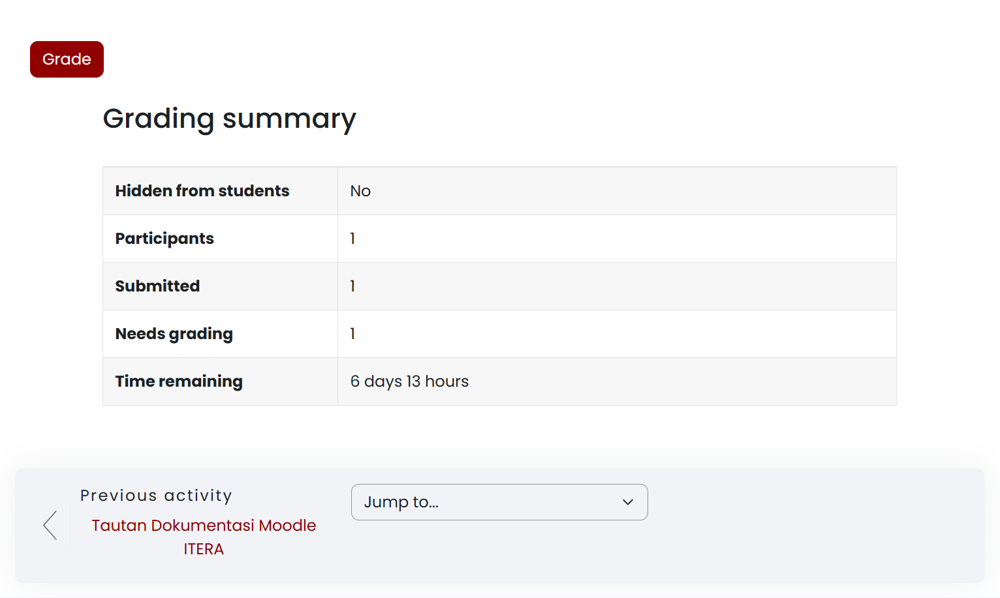
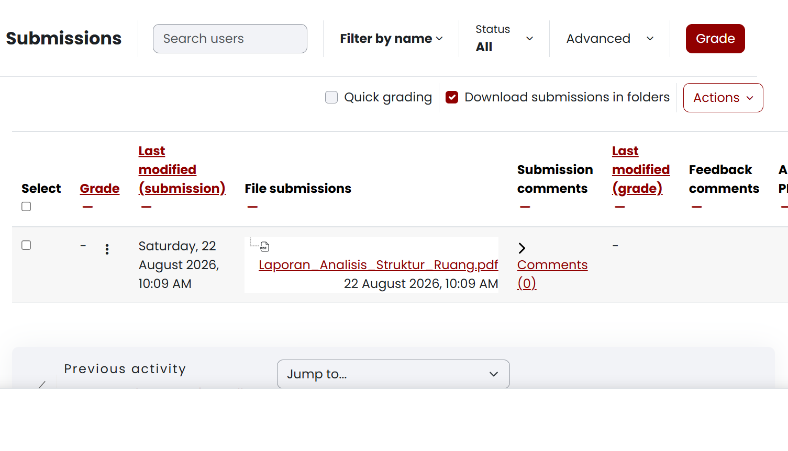
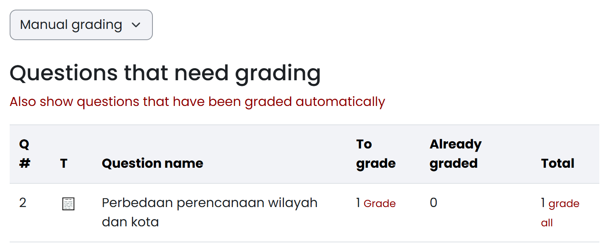
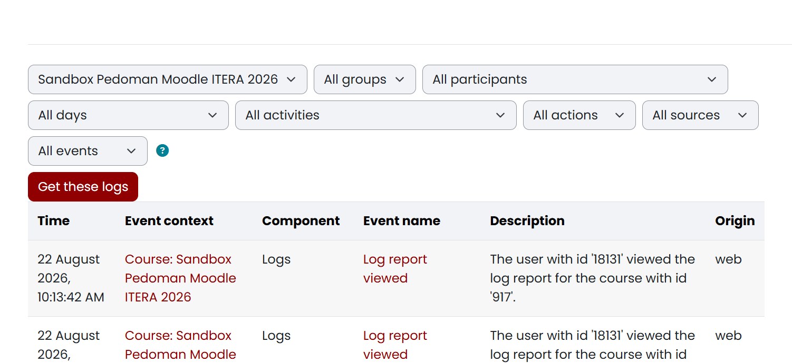

# Memantau Pengumpulan Tugas, Pengerjaan Kuis, dan Jejak Aktivitas Mahasiswa {#sec-dosen-pemantauan-laporan}

<!-- Sumber internal: Guide/spec.md D-09, D-10; Guide/KULIAH2.md §Asesmen, §Jejak Digital; Code/moodle_docs/Assignment.md; Assignment_settings.md; Activity_completion.md; Quiz_activity.md; Quiz_reports.md; Reports.md; temuan sandbox course 917: Grading summary (Participants, Submitted, Needs grading), tabel Submissions (action=grading), laporan Results -> Grades dan Manual grading pada Quiz, serta filter Reports -> Logs. -->

Setelah instrumen penugasan dan materi pembelajaran diterbitkan, dosen pengampu dan asisten pengajar perlu memantau progres penyerahan berkas tugas, memeriksa kepatuhan batas waktu (*Due date*), meninjau percobaan kuis, serta menelusuri keaktifan mahasiswa dalam mengakses bahan ajar.

Platform New E-Learning ITERA menyediakan ringkasan terpusat (*Grading summary*), tabel pemantauan pengumpulan (*Submissions table*), mekanisme perpanjangan batas waktu (*Grant extension*), laporan hasil kuis (*Results*), serta laporan jejak digital (*Reports & Logs*).

## Memeriksa status dan kelengkapan pengumpulan tugas {#sec-dosen-pantau-tugas}

<!-- Sumber internal: Code/moodle_docs/Assignment.md; Assignment_settings.md; temuan sandbox course 917: halaman mod/assign/view.php memuat kotak Grading summary dan tombol Grade / View all submissions. -->

Melalui halaman penugasan, Anda dapat memantau secara langsung jumlah mahasiswa yang sudah mengirimkan berkas (*Submitted*) dan berkas yang siap diperiksa (*Needs grading*). Modul penugasan (**Assignment**) harus sudah dibuat pada mata kuliah yang bersangkutan, dan Anda memerlukan peran **Dosen (Teacher)** atau **Asisten Pengajar (Non-editing teacher)** — keduanya dapat membuka ringkasan ini. Buka halaman utama mata kuliah, lalu ikuti langkah berikut:

1. Klik nama penugasan yang dituju, misalnya `Tugas 1: Analisis Struktur Ruang Kota`.
2. Perhatikan panel **Grading summary** yang merangkum kondisi kelas:
   - **Participants**: Jumlah total mahasiswa yang terdaftar di kelas atau kelompok yang dipilih.
   - **Submitted**: Jumlah mahasiswa yang telah berhasil mengunggah dan menyerahkan berkas tugas.
   - **Needs grading**: Jumlah berkas tugas yang telah diserahkan namun belum diberi nilai.
   - **Time remaining**: Sisa waktu pengerjaan tugas sebelum melewati batas tenggat (*Due date*).
3. Untuk memeriksa rincian berkas dan status per mahasiswa, pilih tombol **View all submissions** atau gulir ke bawah halaman.

Panel **Grading summary** menyajikan rekapitulasi data kepesertaan, jumlah penyerahan tugas, serta sisa waktu pengumpulan seperti terlihat pada @fig-dosen-summary-tugas-01.

{#fig-dosen-summary-tugas-01 fig-pos="H" width="85%"}

Jika angka **Participants** bernilai `0`, periksa penyaring kelompok (*Separate groups*) di bagian atas halaman dan pastikan Anda memilih kelas paralel yang sesuai, misalnya `Kelas RA` atau `All participants`. Jika kolom **Time remaining** menampilkan tulisan berwarna merah seperti `Assignment is overdue by ...`, batas waktu *Due date* sudah berakhir dan penyerahan tugas baru akan dicatat terlambat. Setelah ringkasan ini terbaca, lanjutkan ke tabel daftar pengumpulan untuk memeriksa berkas yang diserahkan dan meninjau keterlambatan.

## Memantau tabel pengumpulan dan penanda keterlambatan {#sec-dosen-tabel-submission}

<!-- Sumber internal: Code/moodle_docs/Assignment.md; temuan sandbox course 917: tabel gradingtable menampilkan kolom Status, Last modified, File submissions, Quick grading, dan Actions. -->

Tabel pengumpulan (*Submissions table*) menampilkan rincian berkas yang diunggah mahasiswa, waktu pengiriman terakhir, serta status keterlambatan jika tugas dikirim setelah batas *Due date*. Anda perlu berada pada halaman rincian pengumpulan tugas (`action=grading`); dosen maupun asisten pengajar sama-sama berwenang mengunduh dan memeriksa berkas pengumpulan di sini. Buka **Halaman Tugas → View all submissions**, lalu ikuti langkah berikut:

1. Gunakan penyaring di bagian atas tabel untuk menyaring tampilan:
   - **Filter by name**: Menyaring mahasiswa berdasarkan huruf awal nama depan atau nama belakang.
   - **Status**: Menyaring berdasarkan status penyerahan (*Submitted*, *Not submitted*, *Requires grading*, atau *Granted extension*).
2. Periksa kolom-kolom utama tabel:
   - **Status**: Menunjukkan status penyerahan, seperti `Submitted for grading` (hijau), `Draft` (kuning), atau `No submission`.
   - **Last modified (submission)**: Mencatat tanggal dan jam persis mahasiswa mengunggah atau memperbarui berkas.
   - **File submissions**: Memuat tautan nama berkas dokumen (misalnya `Laporan_Analisis_Struktur_Ruang.pdf`) yang dapat diklik untuk diunduh.
   - **Time remaining / Late**: Jika mahasiswa mengumpulkan setelah *Due date*, sistem secara otomatis memberi tanda teks merah `Submitted ... late`. Jika dikumpulkan lebih awal, sistem mencatat `Submitted ... early`.
3. Untuk mengunduh seluruh berkas mahasiswa sekaligus dalam satu berkas ZIP, pilih menu **Actions** di atas tabel, lalu pilih **Download all submissions**.

Tabel **Submissions** menyajikan daftar pengumpulan mahasiswa secara terstruktur lengkap dengan nama berkas, waktu pengiriman, dan status penyerahan seperti terlihat pada @fig-dosen-tabel-submission-01.

{#fig-dosen-tabel-submission-01 fig-pos="H" width="90%"}

Jika berkas mahasiswa berstatus `Draft (not submitted)`, mahasiswa baru mengunggah berkas ke draf penyimpanan tetapi belum menekan tombol konfirmasi **Submit assignment** — Anda dapat mengingatkan mahasiswa tersebut atau tetap menilai drafnya kalau batas waktu sudah habis. Jika tautan berkas di kolom **File submissions** tidak dapat diunduh, pastikan format berkas didukung dan koneksi jaringan stabil. Perlu diingat bahwa pengubahan pengaturan umum batas waktu tugas hanya dapat dilakukan peran **Teacher**, bukan **Non-editing teacher**. Kalau ada mahasiswa dengan kendala khusus yang sah, lanjutkan ke pemberian dispensasi perpanjangan waktu.

## Mengatur perpanjangan waktu pengumpulan (*Grant Extension*) {#sec-dosen-perpanjangan-waktu}

<!-- Sumber internal: Code/moodle_docs/Assignment_settings.md §Granting extensions; temuan menu titik tiga pada kolom Grade di tabel grading. -->

Fitur **Grant extension** memungkinkan Anda memberikan perpanjangan batas waktu pengumpulan khusus kepada perorangan mahasiswa — misalnya karena sakit atau penugasan institusi — tanpa mengubah jadwal *Due date* bagi mahasiswa lain di kelas. Perhatikan bahwa tenggat yang berbeda antar kelas paralel bukan diatur lewat Grant extension, melainkan lewat **Group overrides** pada Assignment (lihat @sec-dosen-group-overrides); Grant extension hanya untuk kasus perorangan. Mahasiswa yang bersangkutan harus sudah terdaftar pada mata kuliah dan penugasan tersebut, dan pemberian perpanjangan adalah kewenangan akademis dosen pengampu: Anda harus masuk dengan peran **Teacher**, karena **Non-editing teacher** tidak mempunyai izin ini. Buka **Halaman Tugas → View all submissions**, lalu ikuti langkah berikut:

1. Cari baris mahasiswa yang akan diberikan perpanjangan waktu.
2. Pada kolom **Edit** (ikon titik tiga **⋮** di samping kolom nilai), pilih opsi **Grant extension**.
3. Pada formulir perpanjangan yang muncul, centang kotak **Enable** pada bagian **Extension date**.
4. Tentukan tanggal dan jam batas akhir perpanjangan yang diizinkan.
5. Pilih **Save changes**.

Pada baris mahasiswa tersebut, kolom status akan menampilkan penanda `Extension granted until [Tanggal & Jam]`. Mahasiswa itu dapat mengunggah berkas hingga batas perpanjangan tercapai tanpa ditandai terlambat.

Jika menu **Grant extension** tidak muncul pada baris mahasiswa, pastikan akun Anda berperan **Teacher**, bukan **Non-editing teacher**. Jika opsi tanggal tidak dapat diubah, pastikan kotak centang **Enable** di samping tanggal perpanjangan sudah diaktifkan. Setelah dispensasi diberikan, lanjutkan dengan memantau percobaan kuis agar nilai esai dan status pengerjaan tidak tertinggal.

## Memantau percobaan dan hasil kuis {#sec-dosen-pantau-kuis}

<!-- Sumber internal: Guide/spec.md D-09; Code/moodle_docs/Quiz_reports.md; Quiz_activity.md; temuan sandbox course 917 (setelah percobaan uji pada cmid 6768): report.php?mode=overview menampilkan Attempts, filter Attempts from dan Attempts that are, kolom Status, Started, Completed, Duration, Grade, Q.x, penanda Requires grading, tautan Review attempt, serta tombol Delete selected attempts. -->

Berbeda dengan Assignment yang meninggalkan berkas, Quiz merekam jejak pengerjaan sebagai percobaan (*attempt*) yang tercatat otomatis. Melalui laporan hasil kuis, Anda dapat melihat berapa mahasiswa yang sudah mengerjakan, siapa yang belum mulai, berapa lama pengerjaannya, serta nilai setiap soal. Quiz harus sudah dibuat dan dijadwalkan lebih dahulu (@sec-dosen-quiz). Peran **Dosen (Teacher)** maupun **Asisten Pengajar (Non-editing teacher)** sama-sama dapat membuka laporan ini. Buka halaman kuis, lalu ikuti langkah berikut:

1. Pilih menu **Results**, lalu buka tab **Grades**.
2. Perhatikan ringkasan **Attempts: [jumlah]** di atas formulir penyaring. Angka ini menunjukkan jumlah percobaan yang tercatat, sedangkan keterangan dalam tanda kurung menunjukkan porsi percobaan dari kelompok yang sedang dipilih.
3. Atur formulir penyaring sesuai kebutuhan:
   - **Attempts from**: Pilih `enrolled users who have a quiz attempt` untuk melihat peserta yang sudah mengerjakan, atau `enrolled users who do not have a quiz attempt` untuk menemukan mahasiswa yang belum mencoba sama sekali.
   - **Attempts that are**: Saring berdasarkan status percobaan, yaitu `Not started`, `In progress`, `Overdue`, `Submitted`, `Finished`, atau `Never submitted`.
   - **Show at most one finished attempt per user**: Tampilkan hanya satu percobaan terbaik bila kuis mengizinkan percobaan berulang, sesuai **Grading method** kuis (misalnya `Highest grade`).
   - **Separate groups**: Pilih kelas paralel, misalnya `Kelas RA`, bila kuis dipakai bersama beberapa kelompok.
4. Pilih tombol **Show report** setelah mengubah penyaring.
5. Telusuri kolom-kolom tabel:
   - **First name / Last name**: Nama mahasiswa beserta tautan **Review attempt** untuk membuka jawaban dan riwayat pengerjaannya.
   - **Status**: `Finished` berarti percobaan sudah diserahkan, `In progress` masih dikerjakan, `Never submitted` ditinggalkan tanpa penyerahan, dan `Overdue` melewati batas waktu.
   - **Started** dan **Completed**: Waktu mulai dan waktu penyerahan percobaan.
   - **Duration**: Lama pengerjaan yang dihitung sistem.
   - **Grade**: Nilai akhir kuis; nilai per soal ditampilkan pada kolom **Q. 1**, **Q. 2**, dan seterusnya.
   - **Requires grading**: Penanda bahwa soal esai pada percobaan tersebut belum dinilai.

Laporan **Results → Grades** menampilkan status percobaan, waktu pengerjaan, nilai, serta penanda soal yang belum dinilai seperti terlihat pada @fig-dosen-pantau-kuis-01.

{#fig-dosen-pantau-kuis-01 fig-pos="H" width="90%"}

Untuk meninjau jawaban seorang mahasiswa, pilih tautan **Review attempt** pada barisnya. Halaman tersebut menampilkan jawaban tiap soal, umpan balik otomatis, serta kolom komentar dan penyesuaian nilai soal bila diperlukan. Untuk mengunduh rekap, gunakan **Download table data as** di atas tabel dan pilih format seperti CSV, Excel, atau PDF. Untuk menghapus percobaan uji, centang kotak pada baris yang dituju, pilih **Delete selected attempts**, lalu konfirmasi — tindakan ini menghapus jawaban mahasiswa secara permanen.

Jika tabel menampilkan **Nothing to display** padahal mahasiswa melaporkan sudah mengerjakan, periksa kembali kombinasi **Attempts from**, **Attempts that are**, dan **Separate groups**. Pada kuis yang mewajibkan **Safe Exam Browser** (@sec-dosen-seb), percobaan hanya tercatat bila mahasiswa benar-benar membuka kuis lewat SEB; percobaan yang gagal dibuka tidak akan muncul di laporan ini. Jika nilai akhir belum muncul sementara kolom soal berisi `Requires grading`, soal esai tersebut harus dinilai lebih dahulu.

## Menilai jawaban esai pada kuis (*Manual grading*) {#sec-dosen-nilai-esai-kuis}

<!-- Sumber internal: Code/moodle_docs/Quiz_reports.md §Manual grading report; temuan sandbox course 917: report.php?mode=grading menampilkan tabel Questions that need grading dengan kolom Q #, Question name, To grade, Already graded, Total, tautan Grade dan grade all, serta opsi Also show questions that have been graded automatically. -->

Soal pilihan ganda, benar/salah, dan jenis objektif lainnya dinilai otomatis begitu percobaan diserahkan. Soal esai (*Essay*) tidak demikian: jawabannya harus dibaca dan diberi nilai manual, sehingga percobaan yang memuat esai berstatus `Requires grading` pada laporan **Grades**. Anda perlu berada pada halaman kuis dengan peran **Teacher** atau **Non-editing teacher**; keduanya dapat memberi nilai, tetapi hanya **Teacher** yang dapat mengubah soal dan pengaturannya. Buka **Results → Manual grading**, lalu ikuti langkah berikut:

1. Periksa tabel **Questions that need grading**. Setiap baris mewakili satu soal esai dengan kolom **To grade** (jumlah jawaban yang belum dinilai), **Already graded** (sudah dinilai), dan **Total** (seluruh percobaan pada soal itu).
2. Pilih tautan **Grade** pada baris soal untuk mulai menilai, atau **grade all** untuk menelusuri seluruh jawaban pada soal tersebut satu per satu.
3. Pada halaman penilaian, baca jawaban mahasiswa, isi **Mark** dengan nilai yang sesuai, lalu tuliskan **Comment** sebagai umpan balik bila diperlukan.
4. Simpan penilaian, lalu lanjutkan ke jawaban berikutnya hingga tidak ada lagi yang berstatus belum dinilai.
5. Jika ingin meninjau soal yang sudah dinilai otomatis, centang **Also show questions that have been graded automatically**. Kolom **Already graded** akan bertambah dan nilai otomatis dapat ditimpa bila diperlukan.

Tabel **Questions that need grading** merangkum jumlah jawaban esai yang menunggu penilaian beserta tautan untuk mulai menilai seperti terlihat pada @fig-dosen-nilai-esai-kuis-01.

{#fig-dosen-nilai-esai-kuis-01 fig-pos="H" width="85%"}

Setelah seluruh jawaban esai dinilai, status pada laporan **Grades** berubah dari `Requires grading` menjadi nilai angka, dan nilai akhir kuis masuk ke buku nilai. Jika tabel **Manual grading** kosong, berarti belum ada percobaan yang masuk, tidak ada soal esai pada kuis tersebut, atau seluruh jawabannya sudah dinilai; periksa kembali jenis soal pada tab **Questions** (@sec-dosen-quiz). Jika nilai yang Anda masukkan tidak muncul pada laporan **Grades**, muat ulang halaman laporan dan pastikan penyaring **Attempts that are** tidak membatasi status percobaan. Setelah nilai kuis lengkap, lanjutkan dengan menelusuri laporan jejak digital untuk memantau kapan mahasiswa mengakses bahan ajar dan panduan.

## Melacak riwayat pembukaan panduan dan materi (*Reports & Logs*) {#sec-dosen-lacak-log}

<!-- Sumber internal: Guide/spec.md D-09 butir 2; Guide/KULIAH2.md §Jejak Digital; Code/moodle_docs/Reports.md; temuan sandbox course 917: menu Reports -> Logs (report/log/index.php) mencatat waktu, konteks event, komponen, nama event, dan deskripsi pembukaan modul. -->

Anda dapat memverifikasi apakah seorang mahasiswa benar-benar sudah membuka dan membaca panduan kuliah, materi ajar, atau petunjuk tugas melalui menu **Reports → Logs**. Setiap interaksi klik dan pembukaan dokumen dicatat sistem secara otomatis beserta cap waktu persisnya. Anda perlu berada pada ruang mata kuliah yang Anda kelola dengan peran **Dosen (Teacher)** atau **Asisten Pengajar (Non-editing teacher)**. Buka **More → Reports → Logs** dari bilah menu mata kuliah, lalu ikuti langkah berikut:

1. Atur parameter pencarian pada formulir penyaring:
   - **Course**: Pilih mata kuliah yang bersangkutan.
   - **Groups**: Saring berdasarkan kelompok kelas paralel, misalnya `Kelas RA` atau `All groups`.
   - **Participants**: Pilih **All participants** untuk melihat seluruh kelas, atau pilih nama mahasiswa tertentu untuk penelusuran individual.
   - **Days**: Pilih tanggal tertentu, misalnya tanggal pelaksanaan kuliah, atau pilih `All days`.
   - **Activities**: Pilih modul pembelajaran tertentu, misalnya `Assignment: Tugas 1` atau `Page: Silabus`.
   - **Actions**: Pilih jenis tindakan, misalnya `All actions` atau `View`.
2. Pilih tombol **Get these logs**.
3. Telusuri tabel riwayat log yang ditampilkan:
   - **Time**: Menunjukkan tanggal, jam, menit, dan detik persis saat aktivitas terjadi.
   - **Event context**: Menunjukkan lokasi modul atau *section* yang dibuka.
   - **Component**: Jenis komponen sistem, seperti `Assignment`, `Quiz`, `Page`, `URL`, atau `System`.
   - **Event name**: Nama kejadian teknis, seperti `Course module viewed` (materi dibuka), `The status of the submission has been viewed` (halaman tugas dilihat), `A submission has been submitted` (berkas tugas dikirim), `Quiz attempt started` (kuis mulai dikerjakan), `Quiz attempt submitted` (jawaban kuis diserahkan), atau `Quiz attempt reviewed` (hasil kuis dibuka).
   - **Description**: Deskripsi naratif rinci mengenai aktivitas yang dilakukan pengguna.

Halaman laporan menyajikan formulir penyaring beserta tabel rekaman jejak digital yang membuktikan kapan mahasiswa membuka materi atau mengirimkan tugas seperti terlihat pada @fig-dosen-laporan-logs-01.

{#fig-dosen-laporan-logs-01 fig-pos="H" width="90%"}

::: {.callout-note title="Catatan"}
#### Sifat Otentik dan Permanen Rekaman Log {.unnumbered .unlisted}

Rekaman log aktivitas bersifat hanya-baca dan tidak dapat dimanipulasi atau dihapus oleh dosen maupun mahasiswa. Karena itu log berfungsi sebagai bukti otentik akademik dalam penanganan sengketa pengumpulan tugas atau evaluasi keaktifan mahasiswa.
:::

Jika tabel log kosong setelah Anda menekan **Get these logs**, periksa kembali kombinasi penyaring tanggal dan aktivitas, dan pastikan rentang waktu yang dipilih mencakup saat perkuliahan berlangsung. Jika Anda perlu memantau aktivitas yang sedang berlangsung, pilih menu **Live logs** yang menampilkan rekaman kejadian satu jam terakhir. Jika yang Anda perlukan adalah rekapitulasi jumlah klik dan pembacaan materi secara agregat per dokumen, buka **Activity report** atau **Course participation**. Setelah berkas tugas terhimpun, percobaan kuis selesai, dan batas pengumpulan tercapai, Anda dapat melanjutkan ke tahap pemeriksaan dan penginputan nilai (*Grading*).
