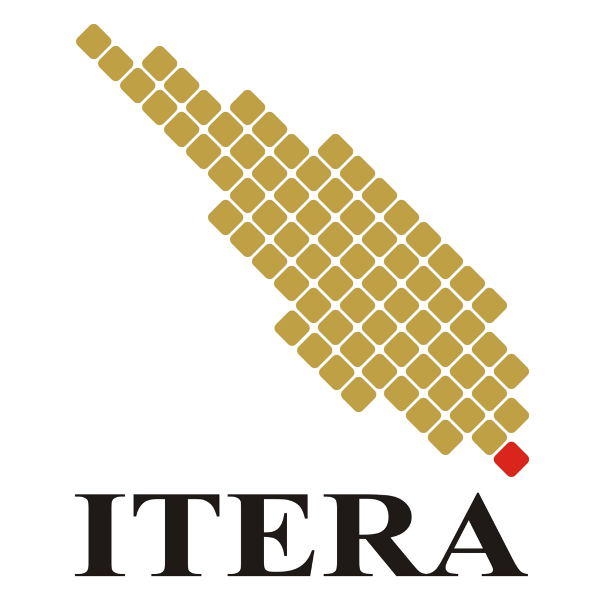

# Lembar Pengesahan {.unnumbered .unlisted}

```{=typst}
#let placeholder(value) = text(fill: rgb("#93000a"), weight: "bold")[#value]

// Seluruh isi lembar ini dibungkus blok konten `#[...]` supaya `set` di
// dalamnya tidak bocor ke bab-bab sesudahnya (yang harus tetap justified).
#[
#set text(size: 11pt)
#set par(justify: false)

#table(
  columns: (3.4cm, 7.4cm, 1fr),
  stroke: 0.75pt + black,
  align: (center + horizon, center + horizon, left + horizon),
  inset: 5pt,
  table.cell(rowspan: 4)[
    #image("assets/images/logo-itera.png", width: 2.2cm)
  ],
  table.cell(rowspan: 2)[
    *INSTITUT TEKNOLOGI SUMATERA*
  ],
  [Nomor : #placeholder("NOMOR DOKUMEN")],
  [Tanggal: #placeholder("TANGGAL PENERBITAN")],
  table.cell(rowspan: 2)[
    #text(weight: "bold")[PENGESAHAN PANDUAN PENGGUNAAN PLATFORM \ #emph[NEW E-LEARNING] ITERA]
  ],
  [Revisi : #placeholder("NOMOR REVISI")],
  [Halaman: #placeholder("NOMOR HALAMAN")],
)

#v(3.5cm)

#align(center)[
  #text(weight: "bold")[PANDUAN PENGGUNAAN PLATFORM #emph[NEW E-LEARNING] ITERA] \
  #text(weight: "bold")[DOSEN, ASISTEN, DAN MAHASISWA] \
  INSTITUT TEKNOLOGI SUMATERA
]

#v(2.5cm)

#table(
  columns: (2.8cm, 1fr, 3.2cm, 2.6cm, 2.4cm),
  stroke: 0.75pt + black,
  align: (left + horizon, center + horizon, center + horizon, center + horizon, center + horizon),
  inset: 6pt,
  table.cell(rowspan: 2, align: left + horizon)[*PROSES*],
  table.cell(colspan: 3)[*PENANGGUNG JAWAB*],
  table.cell(rowspan: 2)[*TANGGAL*],
  [*Nama*], [*Jabatan*], [*Tanda Tangan*],
  [Disusun oleh],
  [#placeholder("NAMA PENYUSUN")],
  [#placeholder("JABATAN PENYUSUN")],
  [],
  [#placeholder("TANGGAL PENYUSUNAN")],
  [Diperiksa oleh],
  [#placeholder("NAMA PEMERIKSA")],
  [#placeholder("JABATAN PEMERIKSA")],
  [],
  [#placeholder("TANGGAL PEMERIKSAAN")],
  [Pengesahan],
  [#placeholder("NAMA PEJABAT PENGESAH")],
  [#placeholder("JABATAN PEJABAT PENGESAH")],
  [],
  [#placeholder("TANGGAL PENGESAHAN")],
)
]
```


::: {.content-visible when-format="html"}

{.laman-logo}

::: {.laman-pembuka}
Pedoman ini menuntun dosen, asisten, dan mahasiswa menggunakan platform
*New E-Learning* ITERA (`kuliah2.itera.ac.id`). Setiap prosedur disusun dengan
prasyarat, jalur menu, langkah bernomor, hasil yang terlihat, dan tindakan
lanjutan ketika hasilnya berbeda.
:::

[Mulai membaca](prakata.qmd){.btn .btn-primary .laman-tombol}
[Unduh versi PDF](Panduan-Moodle-ITERA.pdf){.btn .btn-outline-secondary .laman-tombol}

## Penyusun {.unnumbered}

- Dr. Ir. Harry Yuliansyah, S.T., M.Eng
- Muhammad Abdul Mubdi Bindar, S.T., M.T.
- Misfallah Nurhayati, M.T.
- Dr. Husna Tiara Putri, S.T., M.T.
- Vivian Alvianti, S.P.W.K., M.P.W.K.

## Susunan Bagian {.unnumbered}

| Bagian | Untuk | Mulai dari |
| --- | --- | --- |
| I | Dosen | [Masuk dan orientasi](dosen/01-login-orientasi.qmd) |
| II | Asisten | [Kewenangan dan alur kerja](asisten/01-kewenangan-dan-alur-kerja.qmd) |
| III | Mahasiswa | [Masuk dan mengenali antarmuka](mahasiswa/login-dan-orientasi.qmd) |

Laman ini memuat versi HTML dari pedoman. Versi PDF pada tautan di atas adalah
terbitan resmi yang dipakai untuk pencetakan dan pengesahan.

:::