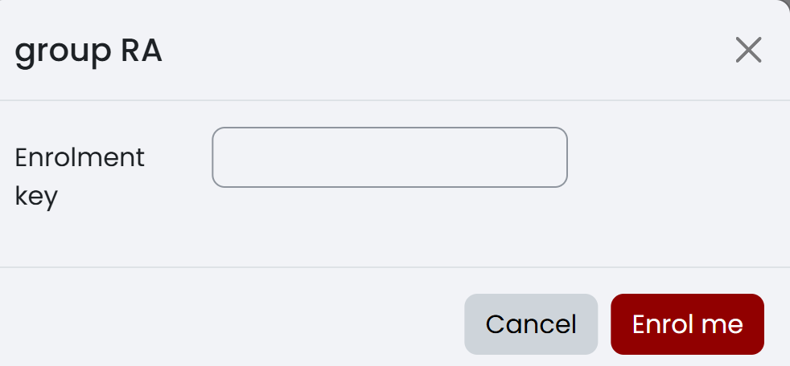
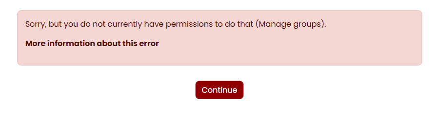

Pada mata kuliah yang menempatkan beberapa kelas paralel dalam satu ruang kursus, kelas seperti RA dan RB dibedakan melalui *group*. Karena itu, Anda perlu memeriksa dua hal setelah bergabung: nama mata kuliahnya benar dan kelas paralelnya juga benar.

<!-- Sumber internal: Guide/spec.md M-02 dan M-03; Guide/KULIAH2.md bagian Kepesertaan; Code/moodle_docs/Enrolment_methods.md; Code/moodle_docs/Self_enrolment.md; Code/moodle_docs/Groups.md; Code/moodle_docs/Groupings.md; temuan akun mahasiswa pada course 917: group enrolment key menghasilkan role Student dan group Kelas RA, Participants menampilkan role/group, group filter menampilkan RA/RB, dan capability Manage groups ditolak. -->

## Memahami kursus, peran, dan kelompok {#sec-mahasiswa-istilah}

| Istilah | Artinya bagi mahasiswa |
|---|---|
| Mata kuliah atau kursus | Ruang utama yang memuat bahan, kegiatan, tugas, ujian, dan nilai |
| **Mahasiswa (Student)** | Peran yang memungkinkan Anda mengikuti kegiatan yang dibuka dosen; peran ini tidak memberi kewenangan untuk mengubah struktur kursus |
| Kelas paralel | Pembagian peserta, seperti RA dan RB, yang dapat dikelola sebagai *group* di dalam satu ruang mata kuliah |
| Kelompok tugas | *Group* yang anggotanya bekerja bersama untuk kegiatan tertentu; kelompok ini dapat berbeda dari kelas paralel |
| *Grouping* | Kumpulan beberapa *group* yang dipakai dosen untuk mengarahkan kegiatan; mahasiswa tidak perlu mengelolanya |
| Tamu | Akses untuk melihat informasi yang diizinkan tanpa menjadi peserta penuh; akses ini tidak dapat dipakai untuk mengerjakan kegiatan |

Satu mahasiswa dapat menjadi anggota kelas paralel sekaligus kelompok tugas. Nama keduanya harus dibaca dengan teliti karena keduanya berada dalam ruang mata kuliah yang sama.

## Bergabung melalui pendaftaran mandiri {#sec-mahasiswa-daftar-mandiri}

Siapkan akun ITERA yang aktif, tautan mata kuliah resmi, serta kunci kelas yang diberikan dosen. Salin kunci langsung dari pengumuman dosen — jangan menebak, membagikan, atau memakai kunci dari kelas lain. Anda hanya dapat mendaftarkan diri ketika dosen membuka pendaftaran mandiri; dosen atau pengelola mata kuliah yang menentukan kunci, mengaktifkan metode pendaftaran, menempatkan peserta secara manual, dan menetapkan kelas paralel. Buka `https://kuliah2.itera.ac.id` dan masuk dengan akun ITERA Anda, lalu ikuti langkah berikut:

1. Buka tautan mata kuliah yang diberikan dosen. Jika Anda mencarinya melalui daftar mata kuliah, cocokkan kode, nama, semester, dan nama dosen sebelum melanjutkan.
2. Cari bagian pendaftaran mandiri yang ditentukan dosen, lalu pilih **Enrol me** untuk membuka formulir kunci.
3. Masukkan kunci kelas pada bidang **Enrolment key**. Kunci kelompok mendaftarkan Anda sebagai **Student** sekaligus menempatkan Anda ke kelas paralel yang sesuai.
4. Pilih **Enrol me** pada formulir. Pada tampilan tertentu, tombol akhir dapat berlabel **Save changes**.
5. Tunggu sampai halaman utama mata kuliah terbuka.
6. Cocokkan nama mata kuliah sekali lagi, lalu buka satu bagian pembelajaran yang memang ditujukan untuk seluruh peserta.

@fig-mahasiswa-enrol-01 memperlihatkan formulir pendaftaran mandiri dengan bidang **Enrolment key** yang harus diisi. Kalau pendaftaran berhasil, mata kuliah muncul pada daftar mata kuliah Anda dan halaman utamanya dapat dibuka; pada **Participants**, baris akun Anda menampilkan peran **Student** dan kelas paralel yang sesuai dengan kunci kelompok.

{#fig-mahasiswa-enrol-01 fig-pos="H" width="70%"}

Kalau yang Anda lihat berbeda, cocokkan dengan tabel berikut sebelum menghubungi dosen:

| Yang terlihat | Kemungkinan penyebab | Tindakan |
|---|---|---|
| Tombol pendaftaran tidak muncul, tetapi isi mata kuliah dapat dibuka | Anda mungkin sudah terdaftar | Periksa daftar mata kuliah dan identitas akun, lalu lanjutkan ke pemeriksaan peran |
| Halaman meminta kunci dan menolaknya | Kunci salah, sudah berubah, atau ditujukan untuk kelas lain | Ketik ulang dengan memperhatikan huruf besar, huruf kecil, dan spasi; jika tetap ditolak, minta dosen memastikan kunci untuk kelas Anda |
| Pesan menyatakan pendaftaran tidak tersedia | Pendaftaran mandiri belum dibuka, sudah ditutup, atau dibatasi | Jangan membuat akun baru; kirimkan nama, NIM, mata kuliah, dan kelas paralel kepada dosen |
| Mata kuliah tidak ditemukan | Tautan salah, mata kuliah masih disembunyikan, atau akun belum mendapat akses | Periksa kembali tautan resmi dan semester, lalu hubungi dosen |
| Halaman dapat dilihat sebagai tamu | Anda belum tentu menjadi peserta | Masuk dengan akun ITERA dan pastikan mata kuliah tercantum pada daftar mata kuliah sebelum mengerjakan kegiatan |

::: {.callout-note title="Catatan"}
#### Pendaftaran Tanpa Memasukkan Kunci Pendaftaran {.unnumbered .unlisted}

Sebagian dosen mendaftarkan mahasiswa secara manual, bukan lewat pendaftaran mandiri. Kalau mata kuliah sudah muncul di **My courses** padahal Anda belum pernah memasukkan kunci apa pun, itu berarti dosen sudah mendaftarkan Anda — jangan mencari tombol **Enrol me** dan jangan meminta kunci kepada teman. Yang tetap perlu Anda lakukan hanyalah memeriksa peran dan kelas paralel Anda pada langkah berikutnya, karena pendaftaran manual tidak selalu sekaligus menempatkan Anda ke sebuah kelompok.
:::

Setelah mata kuliah terbuka, periksa peran dan keanggotaan kelompok Anda. Jangan mengumpulkan tugas sebelum nama mata kuliah, peran, dan kelas paralel Anda sudah sesuai.

## Memastikan peran mahasiswa {#sec-mahasiswa-peran}

Anda perlu sudah dapat membuka halaman utama mata kuliah dengan akun sendiri. Perlu diingat bahwa mahasiswa tidak menetapkan atau mengganti perannya sendiri, dan perbedaan menu antara layar mahasiswa dan layar dosen adalah hal yang wajar karena setiap peran mempunyai kewenangan berbeda. Buka halaman mata kuliah, lalu ikuti langkah berikut:

1. Pilih **Participants** pada navigasi mata kuliah. Posisi menu dapat berbeda menurut ukuran layar.
2. Cari nama Anda sendiri pada daftar peserta.
3. Periksa peran yang ditampilkan pada akun Anda. Peran peserta biasa seharusnya tertulis **Mahasiswa (Student)**.
4. Kembali ke halaman utama tanpa mengubah data peserta atau pengaturan mata kuliah.

Kalau hasilnya benar, nama Anda tercatat sebagai peserta dengan peran **Mahasiswa (Student)**, dan Anda dapat membuka kegiatan yang ditujukan kepada mahasiswa tanpa melihat kendali untuk mengubah struktur mata kuliah.

Jika menu **Participants** tidak terlihat, buka menu navigasi yang terlipat terlebih dahulu; kalau kegiatan yang seharusnya terbuka tetap tidak dapat diakses, minta dosen memastikan peran Anda. Jika peran Anda tertulis tamu atau tidak tercantum sama sekali, jangan mulai mengerjakan tugas — hubungi dosen dan sertakan nama, NIM, serta nama mata kuliah. Jika Anda justru melihat kendali pengelolaan yang tidak semestinya, jangan menggunakannya: keluar dari mata kuliah dan laporkan kepada dosen atau pengelola Moodle ITERA. Setelah peran Anda benar, periksa kelas paralel atau kelompok yang diberikan kepada Anda.

## Memeriksa keanggotaan kelas paralel atau kelompok {#sec-mahasiswa-keanggotaan}

Siapkan nama kelas paralel atau kelompok yang diumumkan dosen, dan pastikan Anda sudah terdaftar pada mata kuliah dengan akun sendiri. Visibilitas anggota dan kegiatan kelompok ditentukan dosen — Anda tidak boleh memindahkan diri ke kelompok lain, memakai kunci milik kelas lain, atau menganggap akses ke baris peserta lain sebagai izin untuk ikut serta di kelompok mereka. Buka halaman mata kuliah lalu pilih **Participants**, dan ikuti langkah berikut:

1. Cari nama Anda pada daftar peserta.
2. Periksa kolom **Groups** pada baris Anda. Cocokkan nama yang tercantum dengan kelas paralel yang diberikan dosen.
3. Gunakan penyaring kelompok jika daftar peserta panjang. Penyaring dapat menampilkan kelas lain, seperti RA dan RB, serta baris peserta lain.
4. Kembali ke baris Anda sendiri dan catat nama kelompok persis seperti yang terlihat. Keberadaan kelas lain pada penyaring atau daftar peserta tidak mengubah keanggotaan Anda.
5. Jika dosen menunjuk forum, tugas, atau kegiatan khusus untuk kelas Anda, buka kegiatan tersebut dan baca nama kelompok yang tampil.

Kalau hasilnya benar, nama Anda terhubung dengan kelas paralel atau kelompok yang tepat dan kegiatan yang ditujukan kepada kelompok tersebut dapat dibuka. @fig-mahasiswa-grup-01 memperlihatkan kolom **Roles**, **Groups**, dan **Status** yang tampil pada **Participants**.

{#fig-mahasiswa-grup-01 fig-pos="H" width="100%"}

Kalau yang terlihat berbeda, cocokkan dengan tabel berikut:

| Yang terlihat | Artinya | Tindakan |
|---|---|---|
| Nama kelompok sesuai | Keanggotaan Anda sudah benar | Lanjutkan ke kegiatan mata kuliah |
| Nama kelompok berbeda | Anda mungkin memakai kunci kelas yang salah atau ditempatkan ke kelompok lain | Jangan mengerjakan kegiatan khusus kelompok; laporkan nama kelompok yang terlihat kepada dosen |
| Kolom **Groups** pada baris Anda kosong | Anda belum ditempatkan ke kelompok | Periksa pengumuman dosen, lalu minta konfirmasi dengan menyebutkan kelas paralel Anda |
| Hanya kelompok sendiri yang terlihat | Mata kuliah memakai kelompok terpisah | Gunakan kelompok tersebut; kelompok lain memang tidak ditampilkan |
| Kelas lain terlihat pada penyaring atau baris peserta | Daftar peserta menampilkan pilihan atau peserta dari kelompok lain | Jangan mengubah pilihan kelas berdasarkan daftar tersebut; ikuti kelompok pada baris Anda sendiri |

Simpan nama kelompok yang benar, dan gunakan nama itu ketika memilih forum, tugas, atau kegiatan yang menyediakan pilihan kelompok. Perlu diketahui bahwa dosen dapat menggabungkan beberapa kelompok menjadi satu *grouping* dan membuka sebuah kegiatan hanya bagi gabungan itu. Jadi kalau sebuah kegiatan terbuka bagi kelas RA dan RB tetapi tertutup bagi kelompok tugas Anda — atau sebaliknya — biasanya bukan kekeliruan, melainkan penargetan yang memang disengaja dosen.

## Membentuk kelompok tugas secara mandiri {#sec-mahasiswa-kelompok-tugas}

Membentuk kelompok secara mandiri berarti mahasiswa menyepakati anggota, tetapi pencatatan *group* di Moodle tetap mengikuti mekanisme yang disediakan dosen. Mahasiswa tidak dapat membuat atau mengelola *group* Moodle: kendali **Create group**, **Auto-create groups**, **Groupings**, dan **Enrol users** tidak tersedia bagi peran **Student**. Anda dapat memilih rekan apabila dosen mengizinkannya, tetapi kesepakatan informal tidak sama dengan keanggotaan resmi — dosen yang menentukan cara pencatatan, membuat atau mengesahkan *group*, dan mengatur kegiatan mana yang tersedia untuk setiap kelompok.

Baca petunjuk tugas sampai selesai dan pastikan jumlah anggota, batas waktu pembentukan, larangan lintas kelas, serta cara melaporkan kelompok sudah jelas. Setelah itu ikuti langkah berikut:

1. Bentuk kelompok sesuai jumlah dan batas kelas yang ditentukan dosen.
2. Sepakati satu nama kelompok dan satu koordinator. Gunakan format nama yang diminta dosen.
3. Periksa NIM dan nama setiap anggota. Pastikan seorang mahasiswa tidak tercatat pada dua kelompok untuk tugas yang sama.
4. Buka kegiatan yang disediakan dosen untuk pencatatan kelompok. Kegiatan tersebut dapat berupa pilihan, formulir, forum, atau mekanisme lain yang dijelaskan dalam mata kuliah.
5. Ikuti petunjuk pada kegiatan tersebut. Jika hanya koordinator yang diminta mengirim daftar, anggota lain tidak perlu mengirim ulang.
6. Setelah dosen menetapkan kelompok di Moodle, periksa kembali keanggotaan Anda mengikuti @sec-mahasiswa-keanggotaan.

Kalau prosesnya berjalan, daftar anggota sudah terkirim melalui mekanisme resmi dosen dan — setelah diproses — nama kelompok yang benar terlihat atau dikonfirmasi pada mata kuliah.

{#fig-mahasiswa-batas-grup-01 fig-pos="H" width="90%"}

Jika tidak ada kegiatan untuk mencatat kelompok, jangan mencari menu administrasi **Groups** — kirim daftar anggota melalui kanal yang ditentukan dosen, dan tanyakan kepada dosen kalau kanalnya belum disebutkan. Jika halaman pengelolaan kelompok menampilkan pesan bahwa Anda tidak mempunyai izin **Manage groups** seperti pada @fig-mahasiswa-batas-grup-01, kembali saja ke mata kuliah; pesan itu menegaskan bahwa pencatatan kelompok adalah kewenangan dosen. Jika anggota tidak dapat dipilih, pastikan semua anggota sudah terdaftar pada mata kuliah dan berada dalam kelas yang diizinkan. Jika nama kelompok belum muncul setelah daftar dikirim, tunggu pengumuman pemrosesan dari dosen dan jangan mendaftarkan ulang kelompok melalui beberapa kanal karena hal itu menghasilkan data ganda. Jika anggota atau kelas paralelnya salah, minta koordinator mengirim satu koreksi lengkap kepada dosen sebelum kelompok mulai mengumpulkan tugas.

Terakhir, pastikan setiap anggota dapat membuka kegiatan kelompok yang sama. Setelah itu gunakan satu kanal komunikasi kelompok dan ikuti ketentuan pengumpulan tugas yang ditampilkan pada kegiatan.
