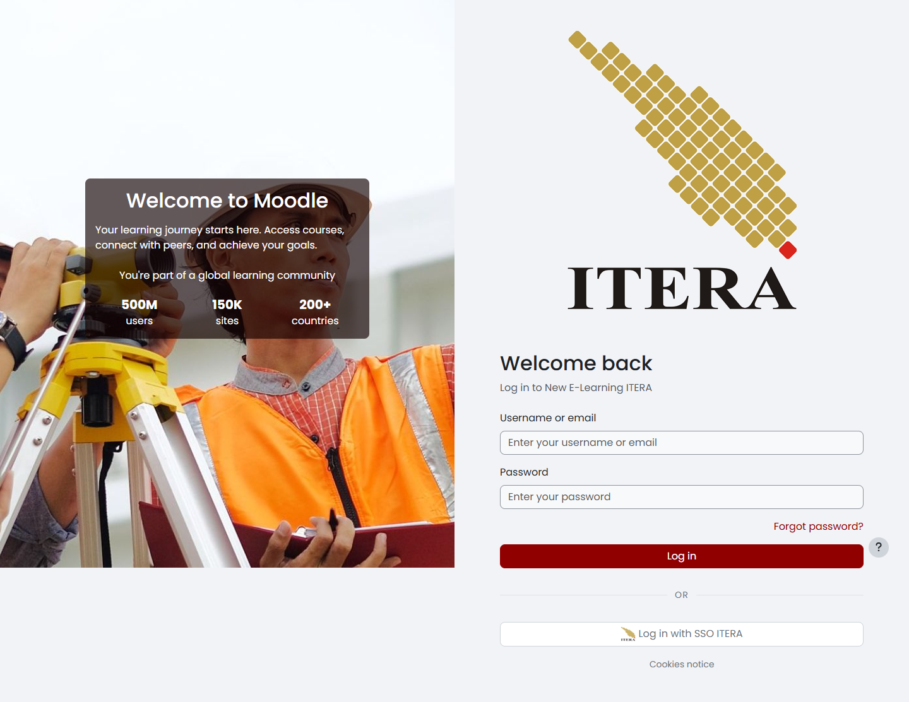
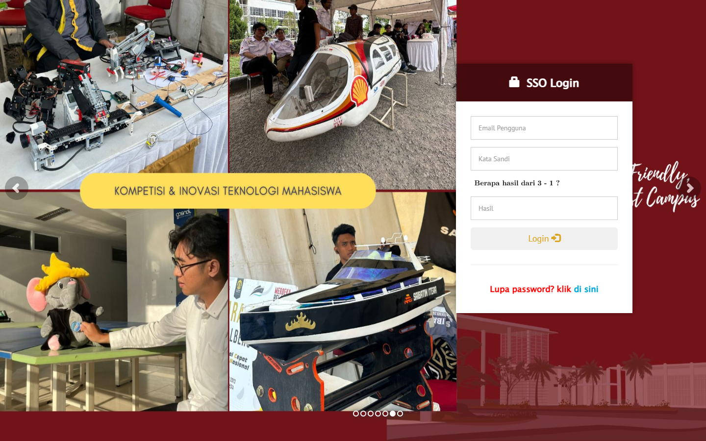
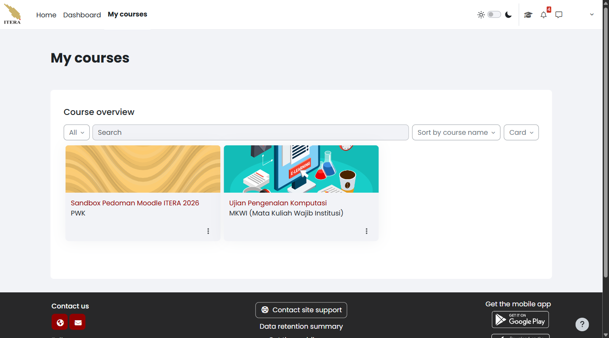
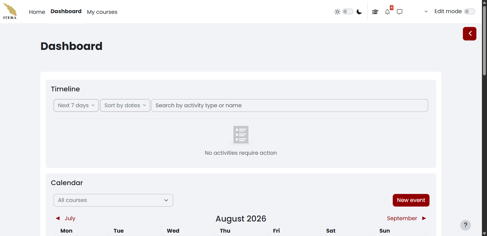
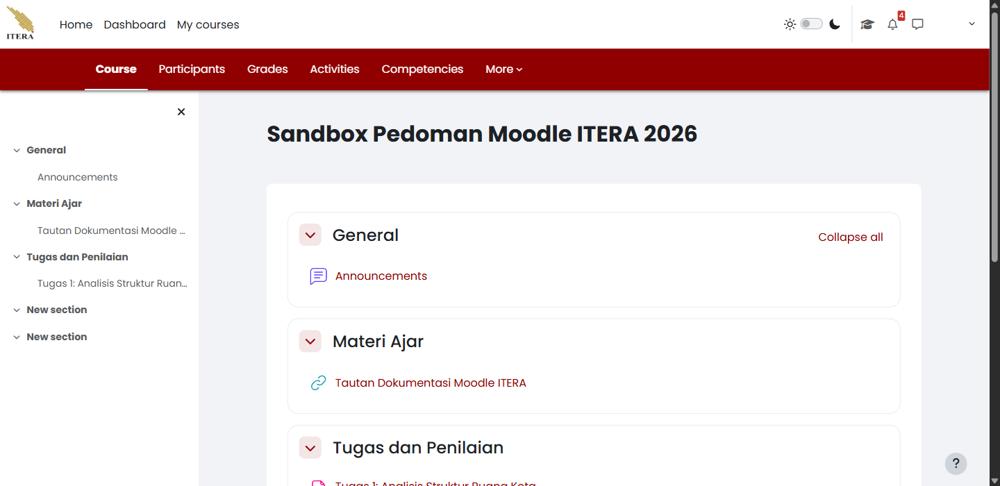
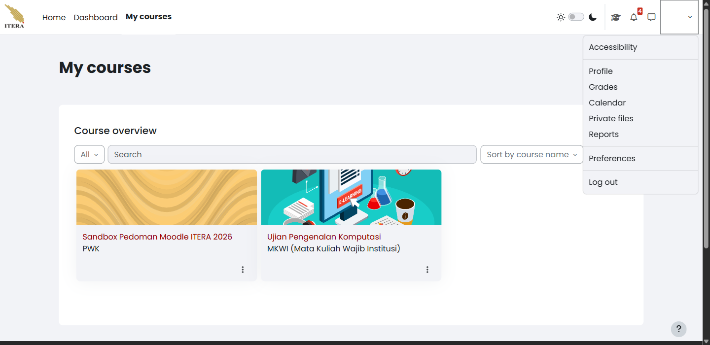

Masuk ke Moodle tidak hanya berarti halaman berhasil terbuka. Anda perlu memastikan bahwa Moodle mengenali akun ITERA yang benar dan menampilkan ruang belajar sesuai kepesertaan Anda. Jika langkah ini terlewat, Anda dapat mengira sebuah mata kuliah hilang, padahal akun yang aktif berbeda atau Anda memang belum terdaftar sebagai peserta.

## Sebelum mulai {#sec-mahasiswa-sebelum-mulai}

Siapkan hal berikut:

- akun ITERA yang masih aktif;
- peramban yang mutakhir;
- koneksi internet yang stabil; dan
- alamat resmi `https://kuliah2.itera.ac.id`.

Gunakan jendela peramban pribadi jika komputer dipakai bersama. Jangan pernah menuliskan kata sandi pada dokumen, pesan kepada dosen, atau formulir selain halaman autentikasi resmi ITERA.

## Masuk ke Moodle ITERA {#sec-mahasiswa-masuk}

1. Buka peramban, lalu ketik `https://kuliah2.itera.ac.id` pada bilah alamat.

   Pastikan nama domain berakhir dengan `itera.ac.id`. Kemiripan logo atau warna tidak cukup untuk membuktikan bahwa sebuah halaman adalah layanan resmi.

2. Pilih **Log in** di sudut kanan atas beranda seperti terlihat pada @fig-mahasiswa-login-beranda.

{#fig-mahasiswa-login-beranda fig-pos="H" width="100%"}

3. Pada halaman **Welcome back**, pilih **Log in with SSO ITERA** seperti terlihat pada @fig-mahasiswa-login-moodle. Jangan membuat akun lokal baru.

{#fig-mahasiswa-login-moodle fig-pos="H" width="100%"}

4. Pada halaman **SSO Login**, isi **Email Pengguna**, **Kata Sandi**, dan **Hasil** pemeriksaan aritmetika. Pilih **Login**. @fig-mahasiswa-login-sso memperlihatkan formulir sebelum data akun diisi.

{#fig-mahasiswa-login-sso fig-pos="H" width="100%"}

5. Tunggu sampai peramban kembali ke `kuliah2.itera.ac.id`. Moodle membuka halaman **My courses**, bukan **Dashboard**.

6. Periksa penanda akun pada bagian atas halaman. Pastikan nama atau identitas yang tampil adalah milik Anda.

### Membaca hasil login {#sec-mahasiswa-hasil-login}

| Yang terlihat | Artinya | Tindakan |
|---|---|---|
| Nama atau identitas Anda tampil pada Moodle | Login berhasil dan Moodle mengenali akun yang aktif | Lanjutkan ke orientasi antarmuka |
| Halaman autentikasi kembali muncul | Sesi belum terbentuk atau autentikasi gagal | Periksa kembali akun, jaringan, dan alamat situs; jangan mengulang kata sandi berkali-kali jika akun mungkin terkunci |
| Moodle terbuka, tetapi identitasnya milik orang lain | Peramban masih menyimpan sesi pengguna sebelumnya | Keluar dari Moodle, tutup jendela tersebut, lalu masuk melalui jendela pribadi |
| Daftar mata kuliah kosong | Login dapat saja berhasil, tetapi akun belum terdaftar pada kursus atau kursus belum terlihat | Jangan membuat akun baru; catat nama mata kuliah dan hubungi dosen pengampu |

::: {.callout-warning title="Peringatan"}
#### Keamanan Alamat Situs Resmi {.unnumbered .unlisted}

Jangan memasukkan kata sandi ketika bilah alamat tidak menunjukkan domain resmi ITERA atau peramban menampilkan peringatan sertifikat. Tutup halaman tersebut, lalu buka kembali `https://kuliah2.itera.ac.id` dengan mengetik alamatnya sendiri.
:::

## Mengenali tampilan antarmuka {#sec-mahasiswa-antarmuka}

<!-- Sumber internal: pengamatan sesi mahasiswa pada kuliah2.itera.ac.id — menubar Home/Dashboard/My courses tanpa Site administration, blok Course overview tanpa tombol Create course, menubar mata kuliah Course/Participants/Grades/Activities/Competencies/More tanpa Settings, dan menu akun delapan butir. -->

Menu navigasi teratas tetap sama di halaman mana pun Anda berada. Sisi kiri memuat tiga tautan laman — **Home**, **Dashboard**, dan **My courses** — sedangkan sisi kanan memuat togel tema terang/gelap, ikon notifikasi, ikon pesan, dan menu akun Anda. Kenali keempat wilayah berikut lebih dahulu, tanpa mengubah pengaturan apa pun.

### My courses {#sec-mahasiswa-laman-mycourses}

**My courses** adalah halaman pertama yang Anda lihat setelah masuk. Halaman ini memuat blok **Course overview** yang mendaftar seluruh mata kuliah tempat akun Anda terdaftar sebagai peserta (@fig-mahasiswa-mycourses-01).

{#fig-mahasiswa-mycourses-01 fig-pos="H" width="100%"}

Kendali yang tersedia di blok itu adalah penyaring keadaan mata kuliah (**All**, **In progress**, **Future**, **Past**, **Starred**, dan **Removed from view**), kotak **Search** untuk mencari menurut nama, pengurutan **Sort by course name**, dan pemilih bentuk tampilan **Card**. Setiap kartu menampilkan nama mata kuliah, kategorinya, serta menu titik tiga (**⋮**) untuk menandai mata kuliah sebagai favorit atau menyembunyikannya dari daftar.

::: {.callout-note title="Catatan"}
#### Daftar Mata Kuliah Dimuat Belakangan {.unnumbered .unlisted}

Blok **Course overview** mengambil isinya melalui permintaan terpisah setelah halaman tampil. Kalau daftarnya terlihat kosong sesaat setelah halaman terbuka, tunggu beberapa detik atau muat ulang halaman sebelum menyimpulkan bahwa Anda belum terdaftar di mata kuliah mana pun.
:::

Kalau sebuah mata kuliah tetap tidak muncul, periksa penyaring **All** dan pilihan **Removed from view** — kartu yang pernah Anda sembunyikan tidak ikut tampil pada penyaring lain. Kalau mata kuliahnya tetap tidak ada padahal Anda yakin sudah mendaftar, jangan membuat akun baru; catat nama mata kuliahnya dan hubungi dosen pengampu.

### Dashboard {#sec-mahasiswa-laman-dashboard}

**Dashboard** merangkum kegiatan lintas mata kuliah dalam satu layar (@fig-mahasiswa-dashboard-01). Halaman ini bersifat pribadi dan hanya berlaku untuk akun Anda.

{#fig-mahasiswa-dashboard-01 fig-pos="H" width="100%"}

Blok **Timeline** mendaftar tugas bertenggat yang memerlukan tindakan Anda, lengkap dengan penyaring rentang waktu dan kotak pencarian. Blok **Calendar** menandai tanggal batas pengumpulan pada kalender bulanan. Cara memakai kedua blok ini untuk memantau tenggat dibahas lebih lengkap pada @sec-mahasiswa-timeline.

Togel **Edit mode** yang muncul di halaman ini hanya mengatur susunan blok **Dashboard** Anda sendiri. Togel itu tidak memberi Anda kewenangan apa pun atas isi mata kuliah.

### Home {#sec-mahasiswa-laman-home}

**Home** membuka beranda situs New E-Learning ITERA, yaitu halaman yang juga terlihat oleh pengunjung yang belum masuk. Isinya ditetapkan pengelola layanan dan biasanya memuat pengumuman tingkat situs serta daftar kategori mata kuliah. Anda tidak mengelola apa pun dari sini — laman ini berguna ketika Anda perlu menelusuri kategori prodi atau memeriksa pengumuman resmi layanan, tetapi bukan tempat Anda membuka mata kuliah sehari-hari.

### Halaman mata kuliah {#sec-mahasiswa-laman-kursus}

Halaman mata kuliah terbagi menjadi panel indeks kursus di sisi kiri dan area utama di sisi kanan (@fig-mahasiswa-kursus-01). Panel indeks memuat seluruh *section* beserta bahan dan kegiatan di dalamnya, dapat dilipat, dan membawa Anda langsung ke bagian yang dipilih. Area utama memuat isi *section* yang sedang dibuka.

{#fig-mahasiswa-kursus-01 fig-pos="H" width="100%"}

Baris menu mata kuliah bagi mahasiswa memuat **Course**, **Participants**, **Grades**, **Activities**, **Competencies**, dan **More**. **Course** mengembalikan Anda ke halaman utama mata kuliah; **Participants** menampilkan daftar peserta beserta peran dan kelompoknya; **Grades** menampilkan nilai Anda sendiri di mata kuliah tersebut; **Activities** mendaftar seluruh kegiatan menurut jenisnya; **Competencies** menampilkan kerangka kompetensi kalau dosen memakainya; dan **More** memuat menu tambahan yang tersedia bagi peserta.

::: {.callout-note title="Catatan"}
#### Perbedaan Antarmuka Mahasiswa dan Dosen {.unnumbered .unlisted}

Layar dosen menampilkan **Settings** dan togel **Edit mode** yang tidak ada pada layar Anda. Perbedaan itu disengaja karena setiap peran mempunyai kewenangan berbeda, bukan tanda bahwa ada yang rusak. Jadi jangan membandingkan layar Anda dengan layar dosen secara harfiah — cocokkan tujuan tindakannya.
:::

### Menu akun dan preferensi {#sec-mahasiswa-laman-akun}

Menu akun dibuka lewat foto profil di ujung kanan menu navigasi (@fig-mahasiswa-akun-01). Isinya memuat **Accessibility**, **Profile**, **Grades**, **Calendar**, **Private files**, **Reports**, **Preferences**, dan **Log out**.

{#fig-mahasiswa-akun-01 fig-pos="H" width="100%"}

**Grades** pada menu ini menampilkan nilai Anda di seluruh mata kuliah sekaligus, berbeda dengan **Grades** di dalam mata kuliah yang hanya menampilkan nilai pada mata kuliah tersebut. **Preferences** memuat pengaturan bahasa, notifikasi, dan penyuntingan profil. **Private files** adalah ruang penyimpanan pribadi Anda yang tidak terikat pada satu mata kuliah — berkas di sana tidak terhitung sebagai pengumpulan tugas.

### Unsur yang perlu dikenali {#sec-mahasiswa-unsur}

Tabel berikut merangkum kegunaan dan batas setiap unsur di atas:

| Unsur | Kegunaan bagi mahasiswa | Batas yang perlu dipahami |
|---|---|---|
| **My courses** | Membuka mata kuliah yang dapat diakses akun Anda | Mata kuliah yang tidak muncul tidak otomatis berarti sudah dihapus |
| **Dashboard** | Merangkum kegiatan dan jadwal yang relevan dengan akun | Isinya menyesuaikan akun; blok **Timeline** atau **Calendar** dapat kosong kalau tidak ada tugas bertenggat |
| **Home** | Membuka beranda situs dan menelusuri kategori mata kuliah (lihat @sec-mahasiswa-laman-home) | Isinya ditetapkan pengelola layanan; Anda tidak mengelola apa pun dari sini |
| Menu mata kuliah | Berpindah antarwilayah dalam satu mata kuliah | Isi menu bergantung pada peran dan pengaturan mata kuliah |
| Indeks kursus | Melompat ke bagian, bahan, atau kegiatan tertentu | Panel dapat dilipat sehingga tampak seolah-olah hilang |
| Area utama mata kuliah | Membaca bahan dan membuka kegiatan pembelajaran | Susunannya dapat berbentuk topik, minggu, atau format lain |
| Menu akun | Memeriksa identitas akun dan keluar setelah selesai | Jangan meninggalkan sesi terbuka pada komputer bersama |

## Keluar dengan aman {#sec-mahasiswa-keluar}

1. Buka menu akun pada bagian atas halaman.

2. Pilih kendali untuk keluar.

3. Pastikan Moodle tidak lagi menampilkan identitas dan isi kursus Anda.

4. Tutup jendela pribadi jika Anda memakai komputer bersama.

::: {.callout-warning title="Peringatan"}
#### Sesi Berakhir Sendiri, Tetapi Jangan Mengandalkannya {.unnumbered .unlisted}

New E-Learning ITERA memutus sesi yang lama tidak dipakai dan menampilkan peringatan sebelum sesi berakhir. Batas waktunya ditetapkan pengelola layanan dan tidak dapat Anda ubah, jadi jangan memperkirakan sendiri berapa lama sesi Anda akan bertahan. Jangan meninggalkan komputer bersama dalam keadaan masuk dengan harapan sesi akan tertutup sendiri, dan simpan pekerjaan panjang — misalnya jawaban esai pada *Assignment* atau *Quiz* — secara berkala, karena formulir yang ditinggal terlalu lama dapat gagal tersimpan ketika sesi sudah berakhir.
:::

Jika halaman kursus masih dapat dibuka setelah Anda keluar, muat ulang halaman sekali. Jika identitas dan kursus tetap terlihat, tutup seluruh jendela peramban dan laporkan keadaan tersebut kepada pengelola layanan tanpa mengirimkan kata sandi.
