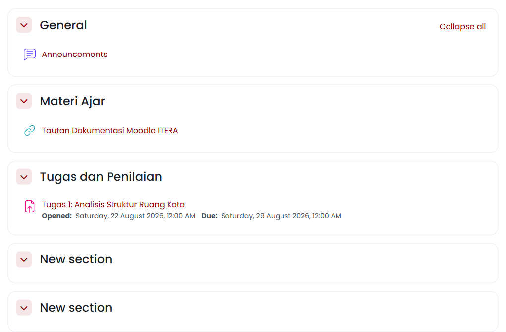
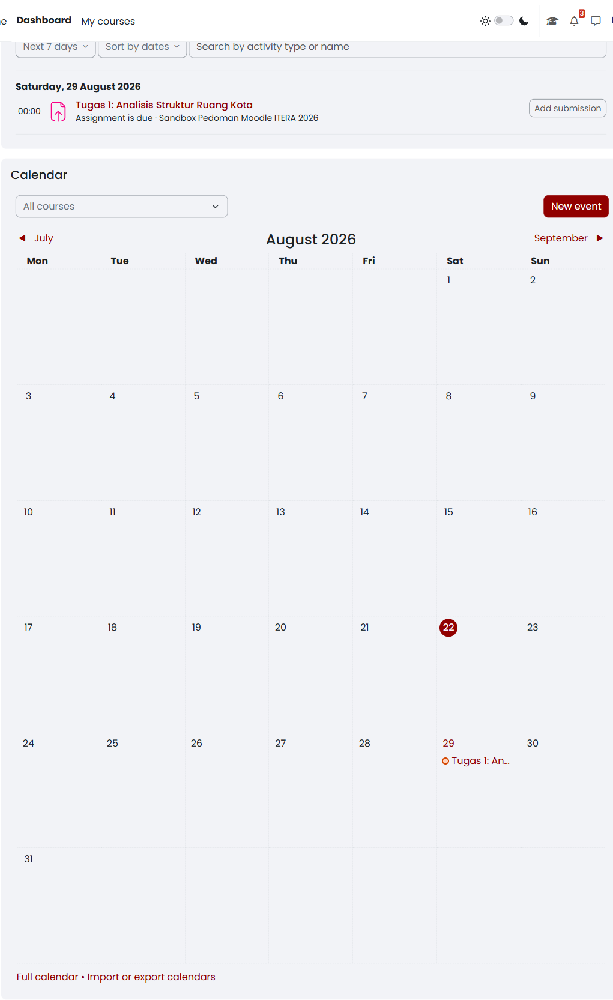

<!-- Sumber internal: Guide/spec.md M-04; Guide/KULIAH2.md §Knowledge & Community Management, §Asesmen; Code/moodle_docs/Activities.md; Resources.md; Calendar.md; temuan akun mahasiswa pada course 917: section General/Materi Ajar/Tugas dan Penilaian, icon URL/Assignment, status pembatasan grup, dan blok Timeline/Calendar pada Dashboard mahasiswa. -->

Setelah bergabung ke ruang mata kuliah, mahasiswa akan menemukan berbagai jenis materi perkuliahan, petunjuk praktikum, tautan rujukan, serta informasi asesmen tugas yang disusun oleh dosen pengampu.

Halaman mata kuliah dikelompokkan ke dalam bagian-bagian (*Section*) dan subbagian (*Subsection*). Setiap jenis materi dan kegiatan ditandai dengan ikon visual yang berbeda agar Anda dapat membedakan bahan bacaan mandiri dari penugasan yang wajib dikumpulkan.

## Memahami susunan materi dan jenis sumber belajar {#sec-mahasiswa-susunan-materi}

Platform New E-Learning ITERA membagi konten perkuliahan menjadi dua kategori utama: **Bahan Ajar (Resources)** yang dipelajari secara mandiri, dan **Aktivitas (Activities)** yang memerlukan partisipasi atau pengiriman tugas.

Tabel @tbl-mahasiswa-jenis-materi menjelaskan jenis bahan ajar yang sering disajikan dosen:

| Ikon & Jenis Bahan | Bentuk Materi | Tindakan Mahasiswa |
|---|---|---|
| **File** | Berkas dokumen tunggal (PDF, PPTX, DOCX) | Klik untuk membaca langsung atau mengunduh berkas ke perangkat |
| **Folder** | Direktori berisi kumpulan berkas | Buka folder untuk mengunduh satu per satu atau tombol *Download folder* |
| **Page** | Halaman web teks dan media di dalam Moodle | Klik untuk membaca materi atau instruksi langsung di peramban |
| **URL** | Tautan ke situs web atau repositori eksternal | Klik untuk membuka laman referensi luar pada tab baru |
| **Book** | Modul pembelajaran terstruktur dengan bab dan subbab | Gunakan panel navigasi bab di sisi kanan untuk berpindah halaman |
| **Text and media area** | Teks instruksi yang tampil langsung di halaman | Baca langsung tanpa perlu membuka tautan terpisah |

: Mengenal berbagai jenis bahan ajar (*Resources*) di Moodle ITERA {#tbl-mahasiswa-jenis-materi}

Akun Anda harus sudah terdaftar sebagai peserta mata kuliah dengan peran **Mahasiswa (Student)** dan halaman mata kuliahnya dapat dibuka. Anda hanya berwenang membaca, menyimak, dan mengunduh materi — mengubah nama materi, menambah bahan ajar, atau memindahkan susunan *section* adalah kewenangan dosen. Buka mata kuliah dari menu **My courses**, lalu ikuti langkah berikut:

1. Perhatikan pembagian *section*, seperti `General`, `Materi Ajar`, atau `Tugas dan Penilaian`.
2. Klik pada judul *section* atau ikon panah jika bagian tersebut dalam keadaan terlipat (*collapsed*).
3. Untuk membuka dokumen **File** atau **Page**, klik langsung pada nama materi yang diinginkan.
4. Jika materi berupa **Folder**, pilih tombol **Download folder** untuk mengunduh seluruh berkas sekaligus dalam bentuk arsip ZIP.
5. Jika materi berupa **URL**, tautan akan membuka alamat referensi tujuan.

Seluruh materi pembelajaran yang sudah dibuka dosen tampil terstruktur pada masing-masing *section* seperti terlihat pada @fig-mahasiswa-materi-01. Di bawah nama penugasan, sistem menampilkan informasi jadwal pembukaan (*Opened*) dan batas waktu pengumpulan (*Due date*).

{#fig-mahasiswa-materi-01 fig-pos="H" width="85%"}

Kalau yang terlihat berbeda, cocokkan dengan tabel berikut:

| Yang terlihat | Kemungkinan penyebab | Tindakan |
|---|---|---|
| Materi tidak dapat diklik atau berwarna abu-abu, dengan keterangan kecil seperti `Not available unless: You belong to Kelas RA` | Dosen membatasi materi itu untuk kelas paralel, tanggal, atau prasyarat tertentu | Baca keterangan syarat di bawah judul materi; kalau syaratnya kelas paralel, periksa kolom **Groups** pada **Participants** seperti pada @sec-mahasiswa-keanggotaan |
| Materi tidak muncul sama sekali di halaman | Dosen menyembunyikan materi atau belum membuka sesi perkuliahan | Tunggu jadwal perkuliahan atau konfirmasikan kepada dosen pengampu |
| Berkas tidak dapat diunduh | Masalah jaringan atau peramban memblokir unduhan otomatis | Muat ulang halaman (*refresh*) atau periksa pengaturan izin unduhan peramban |

::: {.callout-important title="Perhatian"}
#### Kepatuhan Terhadap Akses Materi Terkunci {.unnumbered .unlisted}

Kalau sebuah materi terkunci padahal Anda merasa berhak membukanya, periksa dahulu kolom **Groups** pada akun Anda; kolom yang kosong atau berisi kelas yang salah adalah penyebab paling sering, dan itu diperbaiki dosen. Jangan meminta tautan langsung atau salinan berkas kepada rekan dari kelas paralel lain — kalau materi itu memang diperuntukkan bagi kelas mereka, meneruskannya kepada Anda melanggar pengaturan yang dibuat dosen.
:::

Setelah Anda mengenali susunan materi dan jenis bahan ajarnya, perhatikan juga kolom sisi halaman mata kuliah. Dosen dapat memasang **blok (*blocks*)** di sisi kanan atau kiri halaman, misalnya **Calendar** yang menandai tenggat tugas, **Upcoming events** yang mendaftar kegiatan terdekat, **Recent activity** yang mencatat perubahan terbaru pada mata kuliah, dan **Timeline** yang menyajikan tugas bertenggat lintas mata kuliah. Blok dipasang dan diatur oleh dosen, bukan oleh mahasiswa — Anda tidak dapat menambah, menghapus, atau memindahkan blok di halaman mata kuliah. Kalau sebuah blok tidak muncul padahal rekan Anda melihatnya, pembatasan per kelompok (*group restriction*) mungkin sedang berlaku; periksa keanggotaan kelompok Anda lebih dahulu.

::: {.callout-tip title="Kiat Praktis"}
#### Pengaturan Mata Kuliah yang Menjadi Hak Dosen {.unnumbered .unlisted}

Jumlah pengumuman terbaru yang ditampilkan di bagian atas mata kuliah, bahasa antarmuka yang dipaksakan pada kursus tertentu, dan apakah laporan aktivitas Anda sendiri dapat Anda buka — semuanya diatur oleh dosen melalui pengaturan mata kuliah. Kalau Anda melihat pengumuman yang tiba-tiba bertambah atau berkurang, antarmuka berubah bahasa ketika membuka mata kuliah tertentu, atau menu laporan aktivitas tidak muncul, itu bukan kerusakan melainkan pengaturan yang dipilih dosen.
:::

Kenali juga bentuk kegiatan yang menuntut partisipasi Anda.

## Mengenal jenis kegiatan (*Activities*) {#sec-mahasiswa-jenis-activities}

Selain bahan ajar yang dibaca atau diunduh, dosen dapat membuka **kegiatan (*activities*)** yang menuntut partisipasi Anda. Bentuknya tidak selalu berupa unggahan tugas. Tabel @tbl-mahasiswa-jenis-activities merangkum kegiatan yang paling sering Anda temui beserta apa yang diharapkan dari Anda:

| Kegiatan | Yang diharapkan dari Anda | Yang perlu diperhatikan |
|---|---|---|
| **Assignment** | Mengunggah berkas atau menulis jawaban daring, lalu menekan **Submit** | Draf yang belum di-*submit* belum terhitung dikumpulkan (lihat @sec-mahasiswa-status-tugas) |
| **Quiz** | Mengerjakan soal dalam batas waktu tertentu | Sebagian kuis hanya boleh dikerjakan satu kali; baca ketentuan percobaan sebelum memulai |
| **Forum** | Menulis atau membalas diskusi | Kiriman forum sering ikut dinilai; periksa apakah forum tersebut bertenggat |
| **Choice** | Memilih satu opsi, misalnya jadwal presentasi atau topik | Pilihan bisa dibatasi kuota — semakin lambat memilih, semakin sedikit sisa opsinya |
| **Feedback** | Mengisi kuesioner atau survei | Sebagian survei bersifat anonim bagi dosen, tetapi tetap tercatat sudah Anda isi |
| **Workshop** | Mengumpulkan karya, lalu menilai karya rekan (*peer assessment*) | Ada dua tenggat terpisah: tenggat mengumpulkan dan tenggat menilai karya rekan |
| **H5P** / **Lesson** | Menjawab konten interaktif atau materi bercabang | Jawaban Anda menentukan halaman berikutnya dan dapat tercatat sebagai nilai |
| **Wiki**, **Glossary**, **Database** | Menyumbang tulisan atau entri bersama peserta lain | Setiap suntingan tercatat atas nama Anda |
| **BigBlueButton** | Menghadiri kelas daring langsung | Sesi dapat direkam; masuk dengan nama akun Anda sendiri |

: Jenis kegiatan (*activities*) yang dihadapi mahasiswa {#tbl-mahasiswa-jenis-activities}

Ikon di samping nama kegiatan membedakan jenisnya di halaman mata kuliah. Kalau Anda ragu sebuah butir termasuk bahan bacaan atau kegiatan bernilai, buka butir itu dan periksa apakah ada tenggat, tombol pengiriman, atau keterangan penilaian di dalamnya — kalau ada, perlakukan sebagai kegiatan yang dinilai.

::: {.callout-important title="Perhatian"}
#### Rekaman Aktivitas dan Cap Waktu Digital {.unnumbered .unlisted}

New E-Learning ITERA mencatat secara otomatis setiap kali Anda membuka materi, memulai kegiatan, dan mengirim tugas, lengkap dengan tanggal dan jam persisnya. Dosen dan asisten pengajar dapat membaca catatan itu melalui laporan mata kuliah, dan catatan tersebut tidak dapat diubah maupun dihapus — termasuk oleh dosen. Ini bukan pengawasan tersembunyi, melainkan mekanisme bukti: kalau terjadi selisih pendapat soal waktu pengumpulan atau keikutsertaan Anda, catatan inilah yang menjadi rujukan. Konsekuensi praktisnya, jangan meminjamkan akun Anda kepada siapa pun, karena seluruh jejaknya akan tercatat atas nama Anda.
:::

## Memantau tenggat tugas melalui Timeline dan Kalender {#sec-mahasiswa-timeline}

Platform New E-Learning ITERA secara otomatis menghimpun seluruh jadwal tugas yang mempunyai batas waktu (*Due date*) ke dalam bilah **Timeline** dan widget **Calendar** di **Dashboard** Anda. Agar tugas muncul di sana, dosen harus sudah menerbitkan tugas (*Assignment*) dengan mengaktifkan pengaturan tenggat waktu. Jadwal ini dibangkitkan otomatis dari pengaturan mata kuliah, sehingga Anda tidak dapat mengubah tanggal jatuh tempo pada kalender sistem. Pilih **Dashboard** pada bilah navigasi utama, lalu ikuti langkah berikut:

1. Pada blok **Timeline**, perhatikan daftar tugas mendatang yang diurutkan berdasarkan tanggal jatuh tempo (*Sort by dates*).
2. Gunakan penyaring rentang waktu, misalnya `Next 7 days` atau `Next 30 days`, untuk melihat agenda jangka pendek atau jangka menengah.
3. Untuk membuka lembar instruksi tugas secara langsung, klik judul tugas atau tombol **Add submission** pada baris tugas tersebut.
4. Pada widget **Calendar**, perhatikan tanggal yang mempunyai lingkaran penanda berwarna. Arahkan kursor ke tanggal tersebut untuk melihat nama tugas dan mata kuliah terkait.

Bilah **Timeline** menampilkan nama tugas, mata kuliah asal, serta tanggal dan jam jatuh tempo pengumpulan secara runtut seperti terlihat pada @fig-mahasiswa-timeline-01. Kalender bulanan menandai tanggal batas akhir pengumpulan secara otomatis.

{#fig-mahasiswa-timeline-01 fig-pos="H" width="85%"}

Kalau yang terlihat berbeda, cocokkan dengan tabel berikut:

| Yang terlihat | Kemungkinan penyebab | Tindakan |
|---|---|---|
| Tugas tidak muncul di Timeline | Dosen tidak menyetel *Due date* pada pengaturan tugas | Buka langsung halaman mata kuliah dan periksa petunjuk tugas di *section* terkait |
| Tanggal pada kalender berbeda dengan pengumuman lisan dosen | Jadwal di sistem belum disesuaikan dengan perubahan terkini | Tanyakan konfirmasi jadwal resmi kepada dosen pengampu |
| Jam pengumpulan tertera tengah malam (00:00) | Tenggat waktu jatuh tepat pada awal hari yang ditentukan | Perhatikan jam dengan teliti; 00:00 berarti tugas berakhir pada detik pertama tanggal tersebut |

Setelah jadwalnya jelas, pelajari instruksi tugas dengan saksama, siapkan berkas dokumen luaran sesuai format yang diminta, lalu kumpulkan berkas sebelum batas waktu *Due date* berakhir.
