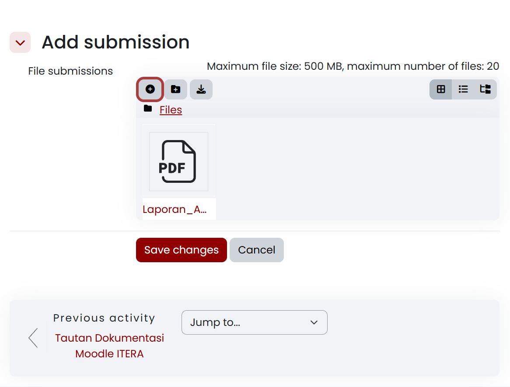
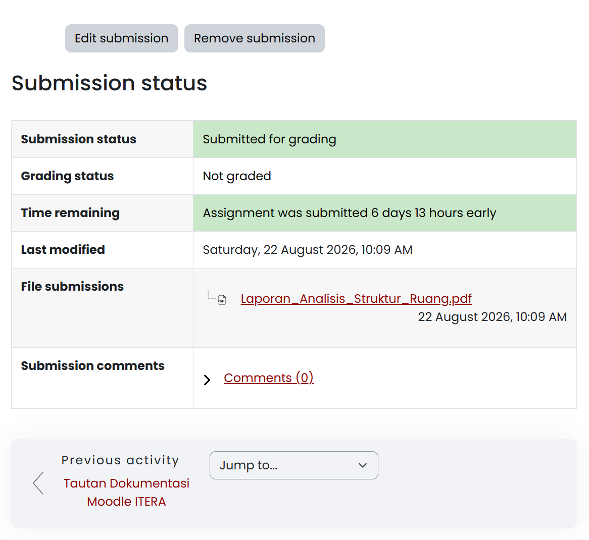
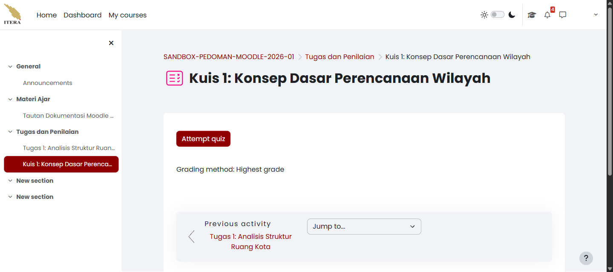
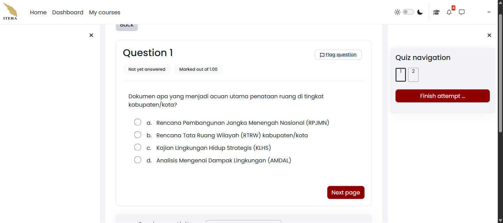
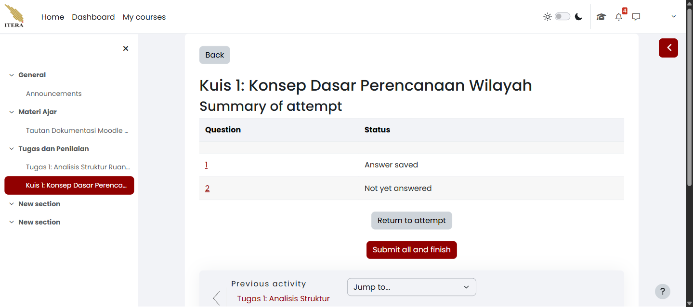
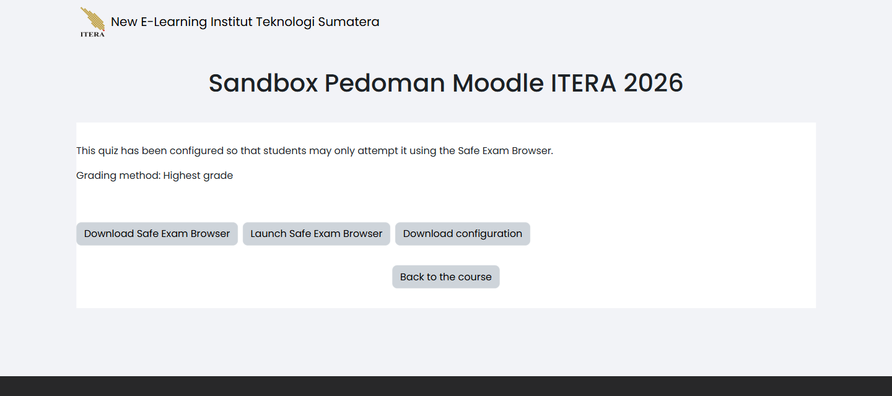
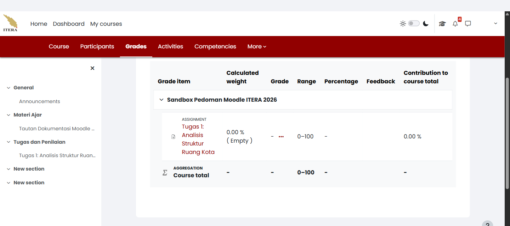

<!-- Sumber internal: Guide/spec.md M-05; Guide/KULIAH2.md §Asesmen; Code/moodle_docs/Assignment.md; Assignment_settings.md; temuan akun mahasiswa pada course 917: alur Add submission, filemanager modal, upload PDF Laporan_Analisis_Struktur_Ruang.pdf, tabel Submission status (Submitted for grading, Not graded, Time remaining, File submissions), tombol Edit submission dan Remove submission. -->

Pengumpulan tugas perkuliahan daring di platform New E-Learning ITERA dikelola melalui aktivitas **Assignment**. Mahasiswa dapat mengunggah dokumen laporan, artikel, atau hasil praktikum secara mandiri, memantau bukti penyerahan, serta melakukan pembaruan berkas sebelum batas waktu pengumpulan berakhir.

## Menyerahkan berkas tugas (*Add submission*) {#sec-mahasiswa-kirim-tugas}

Setiap penugasan mempunyai ketentuan format dokumen dan batas maksimum ukuran berkas yang ditetapkan dosen pengampu. Modul tugas harus sudah dibuka dan jadwalnya berada dalam masa pengumpulan (*Allow submissions from* sudah aktif), dan berkas dokumen tugas Anda — misalnya berformat PDF — sudah tersimpan di perangkat. Anda sendiri yang bertanggung jawab memastikan kebenaran berkas yang diunggah, karena waktu pengirimannya dicatat sistem secara otomatis. Buka halaman mata kuliah, lalu ikuti langkah berikut:

1. Pilih penugasan yang hendak dikumpulkan, misalnya `Tugas 1: Analisis Struktur Ruang Kota`.
2. Baca petunjuk pengerjaan dan ketentuan tugas dengan teliti.
3. Pilih tombol **Add submission** di bagian bawah instruksi tugas.
4. Pada kotak pengunggahan berkas (**File submissions**), tambahkan dokumen tugas Anda melalui salah satu cara berikut:
   - **Tarik dan lepas (*drag and drop*)**: Seret berkas dokumen langsung dari penjelajah berkas (*File Explorer*) ke dalam kotak bertanda panah ke bawah.
   - **Tombol tambah berkas**: Pilih ikon tambah berkas (**+** / *Add...*) di sudut kiri atas kotak, pilih **Upload a file → Choose File / Browse**, pilih berkas pada komputer Anda, lalu klik **Upload this file**.
5. Pastikan ikon dokumen beserta nama berkas — misalnya `Laporan_Analisis_Struktur_Ruang.pdf` — sudah muncul di dalam kotak berkas.
6. Pilih tombol **Save changes** untuk menyimpan pengunggahan.

Formulir penyerahan berkas menampilkan dokumen yang berhasil dimuat ke dalam kotak *filemanager* seperti terlihat pada @fig-mahasiswa-unggah-01.

{#fig-mahasiswa-unggah-01 fig-pos="H" width="85%"}

Kalau yang terlihat berbeda, cocokkan dengan tabel berikut:

| Yang terlihat | Kemungkinan penyebab | Tindakan |
|---|---|---|
| Tombol *Add submission* tidak muncul | Waktu pengumpulan belum dibuka atau batas akhir *Cut-off date* telah lewat | Periksa tanggal *Opened* dan *Due date* pada petunjuk tugas |
| Muncul pesan *File type not accepted* | Format ekstensi berkas tidak sesuai aturan dosen, misalnya dosen mewajibkan `.pdf` | Simpan ulang dokumen Anda ke format yang diizinkan sebelum mengunggah |
| Muncul pesan ukuran berkas melampaui batas | Ukuran dokumen melebihi batas maksimum unggahan | Kompres dokumen PDF Anda agar ukurannya lebih kecil |

Setelah berkas tersimpan, periksa tabel status pengumpulan untuk memastikan berkas sudah berstatus resmi terkirim (*Submitted for grading*).

## Memahami tabel status penyerahan tugas {#sec-mahasiswa-status-tugas}

Setelah Anda menekan tombol simpan, sistem menampilkan tabel **Submission status** sebagai bukti penyerahan tugas resmi. Tabel @tbl-mahasiswa-status-tugas merangkum arti setiap baris indikatornya:

| Baris Indikator | Makna & Status Normal | Keterangan Tambahan |
|---|---|---|
| **Submission status** | `Submitted for grading` (latar hijau) | Berkas berhasil terkirim dan siap dinilai dosen |
| **Grading status** | `Not graded` (atau `Graded`) | Menunjukkan apakah dosen sudah menginput nilai |
| **Time remaining** | `Assignment was submitted ... early` | Waktu tersisa atau penanda pengumpulan awal/terlambat |
| **Last modified** | Tanggal & jam persis berkas disimpan | Bukti sah pencatatan waktu (*timestamp*) sistem |
| **File submissions** | Tautan nama dokumen PDF yang diunggah | Klik untuk mengunduh dan memeriksa ulang isi berkas |
| **Submission comments** | Kolom catatan tambahan mahasiswa | Gunakan jika ingin menyampaikan catatan singkat ke dosen |

: Penjelasan indikator tabel status penyerahan tugas (*Submission status*) {#tbl-mahasiswa-status-tugas}

Anda perlu sudah mengunggah dan menyimpan berkas tugas pada langkah sebelumnya. Perhatikan bahwa cap waktu pada baris **Last modified** bersifat permanen dan menjadi rujukan waktu pengumpulan bagi dosen. Buka kembali halaman penugasan terkait, lalu ikuti langkah berikut:

1. Gulir ke bagian **Submission status**.
2. Periksa baris **Submission status** dan pastikan teksnya berwarna hijau bertuliskan `Submitted for grading`.
3. Periksa baris **File submissions**, lalu klik tautan nama berkas untuk memastikan dokumen yang terunggah bukan berkas kosong atau salah versi.

Tabel status menyajikan rincian lengkap penyerahan tugas, kepatuhan batas waktu, tautan berkas, serta tombol kendali perbaikan seperti terlihat pada @fig-mahasiswa-status-tugas-01.

{#fig-mahasiswa-status-tugas-01 fig-pos="H" width="85%"}

::: {.callout-note title="Catatan"}
#### Perbedaan Tenggat Waktu Pengumpulan Tugas {.unnumbered .unlisted}

Dosen dapat memberikan perpanjangan batas waktu kepada perorangan tanpa mengubah tenggat bagi seluruh kelas, dan juga dapat menetapkan tenggat yang berbeda untuk tiap kelas paralel. Karena itu, tenggat pada suatu tugas dapat berbeda-beda menurut kelompok — selalu ikuti tanggal dan jam yang tertera pada halaman tugas Anda sendiri. Kalau baris **Time remaining** menampilkan `Extension granted until ...`, berarti Anda menerima perpanjangan itu: berkas yang dikirim sampai tanggal tersebut tidak ditandai terlambat, meskipun *Due date* umum sudah lewat. Perpanjangan hanya dapat diberikan dosen — tidak ada tombol untuk memintanya sendiri di Moodle. Kalau Anda memerlukannya karena sakit atau penugasan institusi, hubungi dosen pengampu **sebelum** batas waktu berakhir, bukan sesudahnya.
:::

Jika status menampilkan teks kuning `Draft (not submitted)`, gulir ke bawah dan klik tombol **Submit assignment** untuk menyelesaikan pengiriman akhir — berkas yang berhenti di tahap draf belum terhitung dikumpulkan. Jika baris **Time remaining** menampilkan teks merah `Assignment was submitted ... late`, pengumpulan Anda tetap tersimpan tetapi tercatat melewati batas waktu resmi. Kalau Anda menyadari ada kesalahan isi dokumen sebelum batas waktu berakhir, berkas itu masih dapat diganti.

## Mengubah atau menghapus berkas pengumpulan (*Edit / Remove submission*) {#sec-mahasiswa-ubah-tugas}

Selama batas waktu pengumpulan (*Due date* / *Cut-off date*) belum ditutup dan dosen belum mengunci penugasan, Anda dapat memperbarui atau menghapus berkas tugas yang sudah dikirim. Berkas tugas harus sudah dikumpulkan sebelumnya dan status penugasan belum dikunci dosen. Hak mengubah dan menghapus ini berlaku hanya untuk akun Anda sendiri — Anda tidak dapat mengubah atau menghapus berkas milik rekan, kecuali pada penugasan bertipe kelompok (*group submission*). Buka halaman tugas yang bersangkutan, lalu ikuti langkah berikut:

1. Di atas atau di bawah tabel status pengumpulan, pilih salah satu aksi:
   - **Edit submission**: kalau Anda ingin mengganti berkas dengan versi perbaikan atau menambah dokumen luaran.
   - **Remove submission**: kalau Anda ingin membatalkan dan mengosongkan pengiriman tugas.
2. Pada halaman penyuntingan, lakukan yang Anda perlukan:
   - Untuk menghapus berkas lama, klik ikon dokumen di dalam kotak *filemanager*, lalu pilih tombol **Delete** pada dialog yang muncul.
   - Untuk mengunggah berkas baru, unggah berkas pengganti ke dalam kotak *dropzone*.
3. Pilih tombol **Save changes**.

Tabel status penyerahan diperbarui secara otomatis: baris **Last modified** menampilkan waktu saat revisi disimpan, dan tautan dokumen pada baris **File submissions** mencerminkan berkas terbaru.

Kalau yang terlihat berbeda, cocokkan dengan tabel berikut:

| Yang terlihat | Kemungkinan penyebab | Tindakan |
|---|---|---|
| Tombol *Edit submission* tidak dapat diklik | Batas toleransi (*Cut-off date*) sudah berakhir | Hubungi dosen pengampu kalau Anda memerlukan izin pengumpulan susulan |
| Muncul keterangan *Submissions are locked* | Dosen sudah mengunci pengumpulan untuk memulai proses penilaian | Nilai sedang diproses; pengubahan tidak lagi diizinkan |

## Mengerjakan kuis dan ujian daring (*Quiz*) {#sec-mahasiswa-kuis}

<!-- Sumber internal: Guide/spec.md M-06; Code/moodle_docs/Quiz.md; pengamatan sesi mahasiswa pada course 917 (Kuis 1: Konsep Dasar Perencanaan Wilayah): halaman kuis menampilkan tombol Attempt quiz dan keterangan Grading method; halaman pengerjaan menampilkan blok Quiz navigation, penanda Not yet answered, Marked out of 1.00, Flag question, tombol Next page dan Finish attempt; halaman ringkasan menampilkan tabel Question/Status dengan nilai Answer saved dan Not yet answered, serta tombol Return to attempt dan Submit all and finish. -->

Selain **Assignment** yang meminta Anda mengunggah berkas, dosen dapat memberikan penilaian berbentuk **Quiz** — soal yang dikerjakan langsung di dalam Moodle. Kuis muncul di halaman mata kuliah dengan ikon dan nama yang ditetapkan dosen, misalnya `Kuis 1: Konsep Dasar Perencanaan Wilayah`. Siapkan diri sebelum membukanya, karena pada sebagian kuis hitungan waktu mulai berjalan begitu Anda menekan tombol mulai. Buka **Halaman Mata Kuliah → nama kuis**, lalu ikuti langkah berikut:

1. Buka kuis dari halaman mata kuliah atau dari panel indeks kursus.
2. Baca keterangan pembuka: metode penilaian (**Grading method**), jumlah percobaan yang diizinkan, dan batas waktu pengerjaan kalau ada.
3. Pilih **Attempt quiz** untuk mulai mengerjakan.
4. Jawab soal pada halaman yang terbuka. Blok **Quiz navigation** di sisi kanan menampilkan nomor seluruh soal dan dapat dipakai untuk melompat antarsoal.
5. Pilih **Next page** untuk berpindah ke soal berikutnya. Jawaban pada halaman sebelumnya tersimpan otomatis saat Anda berpindah halaman.
6. Setelah soal terakhir, pilih **Finish attempt …** untuk membuka halaman ringkasan.
7. Periksa kolom **Status** pada tabel ringkasan, lalu pilih **Submit all and finish**.

Halaman kuis sebelum dikerjakan menampilkan tombol **Attempt quiz** beserta keterangan metode penilaian seperti pada @fig-mahasiswa-kuis-01.

{#fig-mahasiswa-kuis-01 fig-pos="H" width="100%"}

Selama mengerjakan, tiap soal menampilkan penanda keadaannya sendiri — **Not yet answered** atau **Answer saved** — beserta bobotnya (**Marked out of 1.00**) dan tautan **Flag question** untuk menandai soal yang ingin Anda tinjau ulang (@fig-mahasiswa-kuis-02). Tanda itu hanya pengingat pribadi dan tidak memengaruhi nilai.

{#fig-mahasiswa-kuis-02 fig-pos="H" width="100%"}

Halaman ringkasan mendaftar seluruh soal beserta keadaannya sebelum jawaban dikunci (@fig-mahasiswa-kuis-03). Soal yang masih bertuliskan **Not yet answered** berarti belum terjawab sama sekali — pilih **Return to attempt** untuk kembali mengisinya selagi waktu masih ada.

{#fig-mahasiswa-kuis-03 fig-pos="H" width="100%"}

::: {.callout-warning title="Peringatan"}
#### Konfirmasi Penyerahan Ujian Akhir {.unnumbered .unlisted}

Setelah **Submit all and finish** ditekan, percobaan Anda terkunci dan jawabannya tidak dapat diubah lagi. Kalau dosen hanya mengizinkan satu percobaan, tidak ada kesempatan kedua. Periksa tabel ringkasan lebih dahulu, dan tekan tombol itu hanya kalau Anda memang sudah selesai.
:::

Jika kuis Anda memakai **Safe Exam Browser** (SEB), halaman kuis tampak berbeda: tombol **Attempt quiz** tidak muncul dan digantikan keterangan bahwa kuis hanya dapat dikerjakan lewat Safe Exam Browser, beserta tombol **Download Safe Exam Browser**, **Launch Safe Exam Browser**, dan **Download configuration** (@fig-mahasiswa-seb-01). SEB adalah aplikasi peramban terkunci yang mencegah pembukaan aplikasi atau tab lain selama ujian berlangsung.

{#fig-mahasiswa-seb-01 fig-pos="H" width="100%"}

Urutan yang benar adalah memasang aplikasinya lebih dahulu lewat **Download Safe Exam Browser**, baru menekan **Launch Safe Exam Browser** untuk membuka ujian di dalam aplikasi tersebut. Kerjakan pemasangan itu jauh sebelum jadwal ujian, bukan pada menit-menit pertama ujian berlangsung, dan pastikan Anda memakai komputer — bukan telepon genggam — karena SEB tidak tersedia untuk semua perangkat.

::: {.callout-note title="Catatan"}
#### Kendala Peluncuran Safe Exam Browser {.unnumbered .unlisted}

Penyebab yang paling sering adalah aplikasi SEB belum terpasang di komputer Anda, sehingga tidak ada yang bisa diluncurkan. Pasang lebih dahulu lewat tombol **Download Safe Exam Browser** di halaman yang sama, lalu coba kembali. Jangan mencari cara lain untuk menembus penguncian ujian — seluruh percobaan Anda tercatat pada log mata kuliah dan dapat dibaca dosen.
:::

Jika kuis sama sekali tidak dapat dibuka padahal jadwalnya sudah tiba, periksa apakah keterangan pada halaman kuis menyebut tanggal pembukaan yang belum lewat, atau syarat yang belum Anda penuhi. Jika kuis tertutup di tengah pengerjaan karena batas waktu, jawaban yang sudah tersimpan tetap terhitung sesuai pengaturan dosen. Anda tidak dapat menambah percobaan, memperpanjang waktu, atau membuka kembali percobaan yang sudah terkunci — semuanya kewenangan dosen pengampu. Kalau Anda mengalami gangguan teknis nyata di tengah ujian, catat waktu kejadian dan bukti layarnya, lalu hubungi dosen pengampu secepatnya lewat kanal resmi kelas.

Setelah masa pengumpulan ditutup dan dosen selesai memeriksa berkas maupun kuis, Anda dapat memantau hasil evaluasinya melalui menu nilai mata kuliah.

## Melihat nilai dan umpan balik tugas {#sec-mahasiswa-lihat-nilai}

<!-- Sumber internal: pengamatan sesi mahasiswa pada course 917 — halaman User report memuat kolom Grade item, Calculated weight, Grade, Range, Percentage, Feedback, dan Contribution to course total, dengan baris Course total sebagai agregasi. -->

Setelah dosen selesai memeriksa berkas, nilai Anda muncul pada buku nilai mata kuliah. Anda hanya dapat melihat nilai Anda sendiri — nilai peserta lain tidak ditampilkan. Buka mata kuliah yang bersangkutan, lalu pilih **Grades** pada baris menu mata kuliah. Moodle menampilkan **User report** seperti pada @fig-mahasiswa-nilai-01.

{#fig-mahasiswa-nilai-01 fig-pos="H" width="100%"}

Kolom pada tabel itu dibaca sebagai berikut:

| Kolom | Artinya |
|---|---|
| **Grade item** | Nama tugas atau kegiatan yang dinilai, dengan jenisnya tertera di atas nama |
| **Calculated weight** | Bobot butir ini terhadap nilai akhir mata kuliah |
| **Grade** | Nilai yang Anda peroleh; tanda `-` berarti belum dinilai, bukan berarti nilainya nol |
| **Range** | Rentang nilai yang mungkin, misalnya `0–100` |
| **Percentage** | Nilai Anda dalam bentuk persentase terhadap rentang tersebut |
| **Feedback** | Komentar tertulis dari dosen, kalau ada — bagian ini sering terlewat, padahal di sinilah alasan nilai dijelaskan |
| **Contribution to course total** | Sumbangan butir ini terhadap baris **Course total** |

Baris **Course total** di bagian bawah adalah agregasi seluruh butir. Nilainya ikut berubah setiap kali dosen menilai satu tugas baru, jadi angka yang Anda lihat di tengah semester belum tentu mencerminkan nilai akhir.

::: {.callout-note title="Catatan"}
#### Ketersediaan Menu Nilai bagi Mahasiswa {.unnumbered .unlisted}

Sebagian dosen mematikan pilihan **Show gradebook to students** pada pengaturan mata kuliah, biasanya karena penilaian diumumkan lewat kanal lain. Kalau **Grades** tidak muncul di menu mata kuliah, itu pengaturan yang disengaja, bukan kerusakan — tanyakan kepada dosen di mana nilai akan diumumkan. Menu **Grades** pada menu akun Anda tetap dapat dibuka dan menampilkan ringkasan nilai lintas mata kuliah.
:::

Jika baris **Grade** masih menampilkan `-` padahal batas pengumpulan sudah lama berakhir, penilaian memang belum selesai — tunggu pengumuman dosen sebelum menanyakannya. Jika nilai yang tertera terasa tidak sesuai, baca kolom **Feedback** lebih dahulu, lalu sampaikan keberatan kepada dosen dengan menyebutkan nama tugas dan nilai yang tertera, bukan dengan mengirim ulang berkas.
