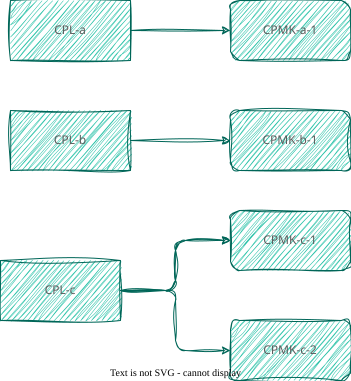

# CPL-CPMK

Terdapat 2 jenis capaian pembelajaran dalam setiap perkuliahan: (1) Capaian Pembelajaran Lulusan (CPL) dan (2) Capaian Pembelajaran Mata Kuliah (CPMK). CPL adalah butir-butir capaian yang ditetapkan oleh PS PWK ITERA dan menjadi indikator pemenuhan pembelajaran seorang lulusan PS PWK ITERA. CPMK adalah turunan dari butir-butir CPL yang berlaku untuk kelulusan mata kuliah tersebut.

Satu mata kuliah biasanya hanya memiliki beberapa CPL yang masing-masing butirnya memiliki turunan yang lebih kontekstual kepada CPMK.

 Hubungan CPL-CPMK

Dalam PS PWK ITERA terdapat kodifikasi yang mengindikasikan hubungan tersebut. Ini dijelaskan sebagai berikut:

- **`CPL-a`**: `a` adalah kode CPL berupa angka 2 digit ('1' → '01') yang menyatakan butir CPL
- **`CPMK-a-1`**: adalah kode CPMK yang sebelumnya diberi kode CPL dengan format 1 digit.

Dalam kasus khusus, yakni CPMK yang menginduk kepada 2 CPL, kodifikasinya menyesuaikan: `a` akan menjadi `ab` dengan masing-masingnya adalah kode angka dengan format 1 digit. Selanjutnya butir CPMK tersebut dibedakan dengan kode CPMK-nya. Dengan demikian, `CPMK-710-1` dan `CPMK-107-1` pada hakikatnya adalah CPMK yang sama, karena ia adalah satu CPMK yang menginduk pada `CPL-07` dan `CPL-10`.
